# JOREK 部分诊断工具简介

本教程演示如何运行 JOREK 的一些重要诊断工具。我们假定你已掌握运行 JOREK 的基础知识。关于如何分析 JOREK 仿真，教程 [首次运行 JOREK](running_jorek_for_the_first_time.md) 中已给出部分信息。这里提供更多细节，并介绍几个额外的诊断工具。

# 坐标系

解读任何仿真数据时（其实在搭建算例时便已如此），都应确保充分理解 JOREK 中所用的坐标系，以及它与实验装置所用坐标系之间的关系。JOREK 中的坐标系如下：

JOREK 的基本柱坐标系 $` (u1,u2,u3)=(R,Z,ϕ) `$ 由下式给出

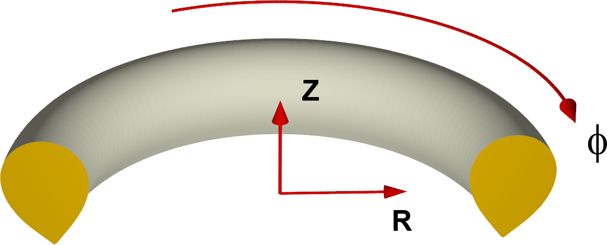

$$
\begin{aligned}
x&=R \cosϕ \\
y&=−R \sinϕ \\
z&=Z \\
\end{aligned}
$$

其中 $`(x,y,z)`$ 表示笛卡尔坐标。因此，从上往下看时 $`ϕ`$ 是顺时针方向！详见 [coordinates](..\physics\coordinates.md)。例如 ASDEX Upgrade 对 $`ϕ`$ 的定义方向正好相反！

# qprofile.dat

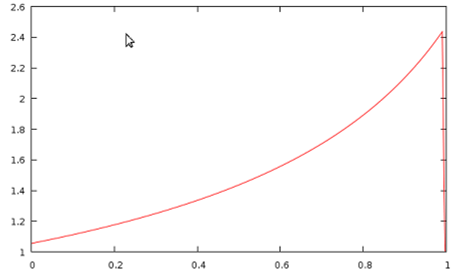

程序完成平衡计算后，会自动计算 q 剖面并写入 `qprofile.dat`。若需要在仿真过程中的其他时刻绘制 q 剖面，下文介绍的 `jorek2_postproc` 可以方便地实现。

# plot_grids.sh

脚本 `./util/plot_grids.sh` 可用于绘制仿真网格。例如通过选项 `-o xpoint` 可以只绘制 X 点网格。该脚本使用 JOREK 写入 `grid_*.dat` ASCII 文件的数据，并用 `gnuplot` 绘图。也可以直接输出为 `.ps` 或 `.png` 文件（用选项 `-h` 查看）。

# plot_live_data.sh

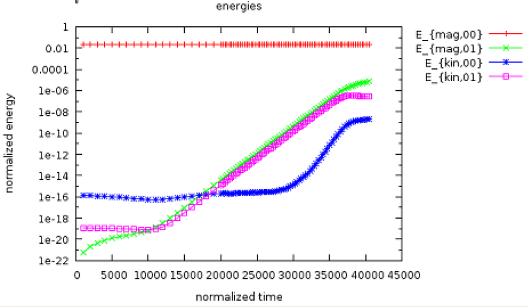

程序运行时会向 `macroscopic_vars.dat` 写入一些信息。脚本 `plot_live_data.sh` 可以方便地从该文件提取并绘制数据。不带选项调用该脚本时，会直接绘制磁能与动能随时间的演化（见示例）。绘图窗口打开后，

- 按<ins>右</ins>键可以放大
- 按 `U` 可恢复原来的显示范围
- 按 `L` 可在对数与非对数 y 轴之间切换
- 按 `E` 可更新图像，以纳入正在运行的仿真新写入的数据。

以选项 `-h` 调用脚本时，会打印用法信息。必要时可以直接绘制到 `.ps` 文件。若需要进一步调整图像，可把 `local_plot.gp` 复制为其他名称（例如 `my_plot.gp`），修改后运行 `gnuplot my_plot.gp`。

选项 `-l` 列出所有可绘制的物理量。目前包括：

```
* axis
* betas
* current
* diag_coil_curr
* energies
* growth_rates
* heatingpower
* input_profiles
* particlecontent
* particlesource
* thermalenergy
* times
```

可用选项 `-q` 选择要绘制的物理量。只需输入该物理量名称的开头部分即可。例如绘制增长率：

```
./util/plot_live_data.sh -q g
```

**注意：**

- 使用该诊断工具之前，可能需要先提供较新版本的 `gnuplot`。通常通过 `module load gnuplot` 即可。最好把这一行加入 `.bashrc` 登录脚本。
- `plot_live_data.sh` 脚本总是先把 `macroscopic_vars.dat` 中的数据提取到名为 `<quantity-name>.dat` 的文件中再绘图。因此你也可以方便地用任意工具自行绘制数据。这样比较两个算例就很简单：

```
  gnuplot
  > set log y
  > plot 'case1/energies.dat' using 1:3 with lines, ''case2/energies.dat'' using 1:3 with lines
```

# jorek2vtk {#jorek2vtk}
<!-- 原站引用的图/附件已缺失：上游仓库与旧 wiki 均无此文件，故移除引用 -->

你在教程 [首次运行 JOREK](running_jorek_for_the_first_time.md) 中已经接触过 `jorek2vtk`。这里补充一些信息。提醒一下，需要通过 `make -j 8 jorek2vtk` 编译该诊断工具。务必使用与主程序相同的硬编码参数。要把 `.h5` 重启文件真正转换为 `.vtk` 文件，只需运行

```
 ./util/convert2vtk.sh -j 8 jorek2vtk inputfile
```

**注意：**

- `convert2vtk.sh` 会自动把 `.vtk` 文件放入命名合理的子目录，例如 `vtk_no0_iplane1`。这些文件可以用 ParaView 或 VisIt 方便地绘制。
- `convert2vtk.sh` 会自动比较已有 `.vtk` 文件与相应 `.h5` 文件的时间戳：若 `.vtk` 文件更新，则无需转换；若 `.h5` 文件更新，则自动更新 `.vtk` 文件。

**可用选项：**

- 选项 `-si` 应对所有物理量做去归一化。
- 选项 `-no0` 从 VTK 文件中排除 $`n=0`$ 模，从而只能查看非轴对称分量。
- 选项 `-i_tor` 用于选择某个环向谐波。此处余弦与正弦分别计数。
- 选项 `-iplane` 用于把数据写到不同的环向平面。默认是平面 1（即 $`ϕ=0`$）。
- 选项 `-only XXXXX-XXXXX` 只转换部分重启文件。
- 选项 `-nsub X` 用于改变每个贝塞尔单元所用的子点数。默认值为 5。
- 选项 `-h` 说明脚本的用法。

**排查问题：** 若转换过程中出错，最好带调试选项重新编译 `jorek2vtk`，并先用“手动”方式尝试转换：

```
  cp jorekXXXXX.h5 jorek_restart.h5
  ./jorek2vtk < ./inputfile
```

常见问题包括：编译 `jorek2vtk` 时选错了模型或硬编码参数，或某个 `.h5` 重启文件已损坏，无法被 `jorek2vtk` 正确读入。

## 在 ParaView 图中显示仿真时间

要在 ParaView 图中显示仿真时间，使用 **Annotate Global Data** 过滤器。

`jorek2vtk` 写出的 legacy VTK 格式所提供的时间信息形式无法被 ParaView 直接使用。ParaView 5.5 及更新版本支持[基于 JSON 的文件序列元文件格式](https://gitlab.kitware.com/paraview/paraview/blob/v5.5.0/Documentation/release/ParaView-5.5.0.md#json-based-new-meta-file-format-for-series-added)，可作为一种变通方案。

在存放 VTK 文件的目录中，创建一个文件名以 `.vtk.series` 结尾的 JSON 文件。例如：

```json
{
  "file-series-version": "1.0",
  "files": [
    { "name": "jorek.32000.vtk", "time": 0.120529 },
    { "name": "jorek.45000.vtk", "time": 0.148458 }
  ]
}
```

# jorek2vtk_3d

<!-- 原站引用的图/附件已缺失：上游仓库与旧 wiki 均无此文件，故移除引用 -->

编译与用法同 jorek2vtk 几乎相同，但有几点区别：

- 输出的是 3D 数据。
- 这意味着文件会非常大。应使用 `-only` 选项只转换部分文件。
- 你可能需要编辑 `jorek2vtk_3d.f90` 文件，以调整输出的环向平面数。
- `.vtk` 文件会放在名为 `vtk3d_no0` 之类的子目录中。

$\rightarrow$ 可考虑改用 [ParaView 插件](running_jorek_for_the_first_time.md)

# jorek2_poincare {#jorek2_poincare}
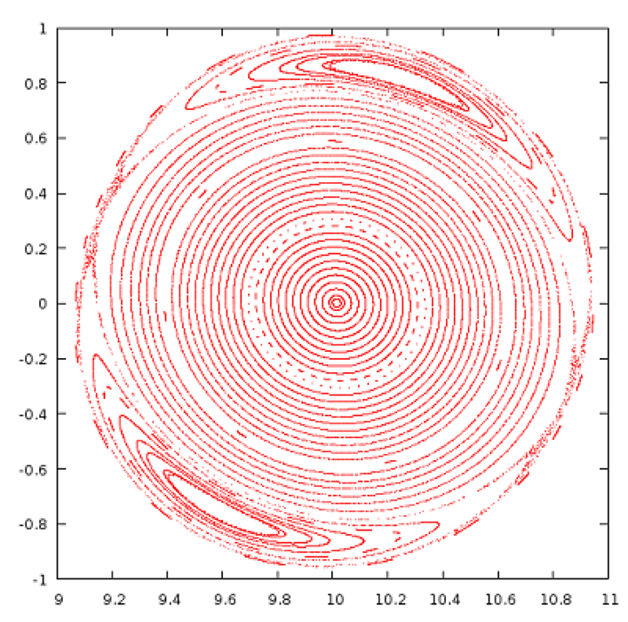

要可视化磁拓扑，Poincaré 图是非常有用的工具。`jorek2_poincare` 可以对给定的环向圈数追踪特定的磁力线。磁力线每次穿过 $`ϕ=0`$ 平面时标记一个点。需要额外创建一个小文件 `stpts` 来描述要追踪的磁力线。下例在 $`R=10`$、$`ϕ=0`$ 处，于 $`Z=0`$ 与 $`Z=1`$ 之间起始追踪 100 条磁力线。对未显式给出的磁力线，$`R,Z,ϕ`$ 与 `n_turns` 采用插值：

{: .warning }
译者注：原文此处称追踪 100 条磁力线，但示例 `stpts` 中 `n_lines` 为 40。

```
# n_lines
   40
# nr   R_start   Z_start    phi_start   n_turns
    1    10.000     0.00      0.000      1000
   40    10.000     1.00      0.000      2500
```

也可以逐条单独指定磁力线：

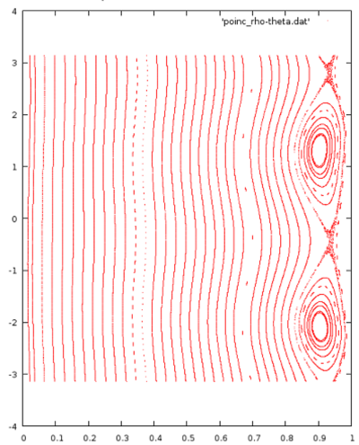

```
# n_lines
   3
# nr   R_start   Z_start    psi_start   n_turns
    1    10.000     0.00      0.000      1000
    2    10.000     0.50      0.000      1200
    3    10.000     1.00      0.000      3000
```

或者指定若干组磁力线：

```
# n_lines
   80
# nr   R_start   Z_start    phi_start   n_turns
    1    10.000     0.00      0.000      1000
   40    11.000     0.00      0.000      2500
   41    10.000     0.00      0.000      1000
   80    10.000     1.00      0.000      2500
```

现在只需这样运行该诊断工具：

```
cp jorekXXXXX.h5 jorek_restart.h5
./jorek2_poincare < ./inputfile
```

结果得到两个 [ASCII](## "American Standard Code for Information Interchange") 文件，其中以两种不同表示给出数据：

- `poinc_R-Z.dat` 包含 $`(R, Z)`$ 坐标下的点
- `poinc_rho-theta.dat` 包含 $`(ρ_\text{pol}, θ)`$ 坐标下的点，其中 $`θ`$ 是极向角，$`ρ_\text{pol}=\sqrt{Ψ_N}`$。

**警告：** `jorek2_poincare` 是一个有用但相当陈旧的诊断工具。为了得到干净的 Poincaré 图（尤其是模数较大时），可能需要修改源码手动增大 `n_phi` 值。原则上该程序将来应以更清晰的方式重新实现……

# jorek2_powers

该诊断工具只对 `model3XX` 和 X 点算例有意义。例如它计算流向偏滤器靶板的热流。注意目前需要在编译前于源码 `diagnostics/jorek2_powers.f90` 中手动设置三个参数：

```
R_in_out     # set to a value between the inner and outer target plate
Z_wall_in    # upper limit of inner divertor target
Z_wall_out   # lower limit of outer divertor target
```

若能自动识别这三个值，对你们中的某个人来说可能是个不错的练习，并不算太复杂……

该工具把计算出的物理量直接输出到屏幕：

```
 inner/outer wall/divertor parallel convection :  -0.11942676E-08 -0.34636717E-20  0.10706467E+00  0.48405278E+00 [MW]
 inner/outer wall/divertor parallel kinetic energy :  -0.38361754E-10  0.13592082E-46  0.53535814E-01  0.24202235E+00 [MW]
 inner/outer wall/divertor parallel conduction :   0.54521383E-06  0.11287870E-07 -0.57674292E-01 -0.80325170E-01 [MW]
 inner/outer wall/divertor perp. conduction    :   0.12950011E+01  0.40278144E+01 -0.13424678E+00 -0.26235797E+00 [MW]
 inner/outer wall/divertor energy diffusion    :   0.85255108E-02  0.76551935E-01  0.10318817E-02 -0.51809035E-03 [MW]
 inner/outer wall/divertor particle diffusion  :   0.23624058E+02  0.21243131E+03  0.25594812E+01  0.18333358E+00 [10^20 /s]
 inner/outer wall/divertor particle convection :  -0.20010146E-05 -0.58675714E-17  0.39754300E+02  0.13068614E+03 [10^20 /s]
 inner/outer wall/divertor total area          :   0.61033015E+02  0.87484798E+02  0.42806246E+01  0.67975876E+01 [m^2]
 inner/outer wall/divertor total length        :   0.38794511E+01  0.38347953E+01  0.26095161E+00  0.32175932E+00 [m]
 inner/outer wall/divertor total radius (avg)  :   0.25038867E+01  0.36308686E+01  0.26107620E+01  0.33623569E+01 [m]
 inner/outer wall/divertor Q                   :   0.16895744E-07  0.30984143E-19  0.39588715E-01  0.23191647E+00 [MW/m^2]
 inner/outer wall/divertor wetted area         :  -0.70684526E-01 -0.11178852E+00  0.27044239E+01  0.20871859E+01 [m^2]
 inner/outer wall/divertor wetted length         :  -0.44929316E-02 -0.49001212E-02  0.16486467E+00  0.98795565E-01 [m]
 ```

它还会把这些量导出到 `powers_time.out` 和 `powers_time_sum.out`。由于程序以追加方式写入，可以在 bash 中这样做，从所有重启文件收集数据：

```bash
for f in `ls jorek[0-9]*.h5`; do
  cp $f jorek_restart.h5
  ./jorek2_powers < ./inputfile
done
```
要详细理解这些诊断工具的输出，需要仔细查看源码本身，和／或直接询问。

# jorek2_target2vtk

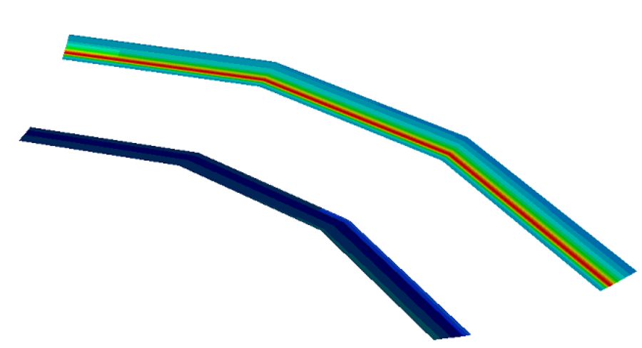

可将偏滤器靶板上的靶板热流写出为 VTK 文件以便绘图。编译：

```
make -j 8 jorek2_target2vtk
```

运行：

```
cp jorekXXXXX.h5 jorek_restart.h5
jorek2_target2vtk < inputfile
```

现在可以绘制 `jorek_tmp.vtk` 文件。

# jorek2_postproc {#jorek2_postproc}
该工具旨在用简单脚本以多种方式分析仿真，也可以交互使用。把自己的新诊断集成进来相对容易。

## 第一个交互示例

先从交互使用的例子开始。调用 `./jorek2_postproc`（不要把 namelist 输入文件用管道送入）后，会出现一个简单提示符，可在其中输入命令。基本用法也会一并打印：

```
 =========================================================================
 Help topic: getting_started
 -------------------------------------------------------------------------
 Welcome to the interactive postprocessing tool JOREK2_POSTPROC!
 
 An example to get you started:
 
   namelist input               # Read namelist input file
   jorek-units                  # Select JOREK units
   for step 100 to 200 do       # Do the following for severl time steps:
 
     expressions Psi_N T rho      # Select physical expressions
     mark_coords 1                # Mark first expression as coordinate
     set surfaces 200             # Number of flux surfaces
     average                      # Toroidal and poloidal average
 
     expressions R rho T Psi Er   # Select expressions
     mark_coords 1                # Mark first expression as coordinate
     set linepoints 200           # Number of points along a line
     midplane                     # Midplane profiles
   done
 
 All output is written into subfolder postproc/
 
 Type "help" for general usage information or, e.g., "help average" for
 command-specific help.
 
 Documentation: http://jorek.eu/wiki/doku.php?id=jorek2_postproc
 =========================================================================
```

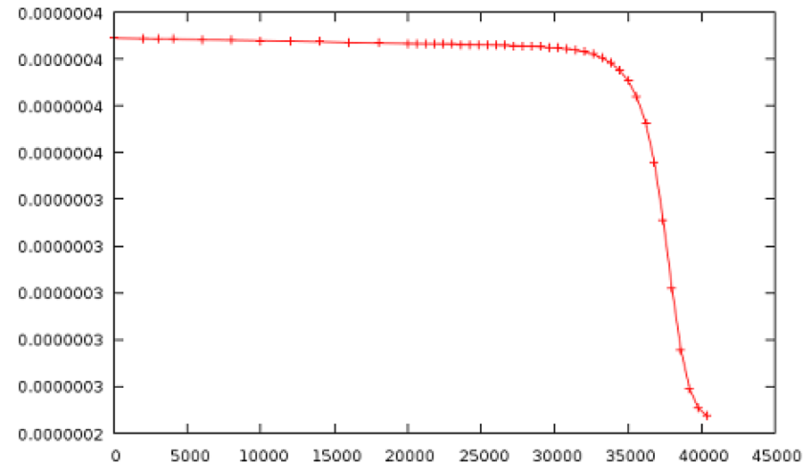

作为一个非常简单的例子，可以如下输入，写出中心点温度随时间的演化：

```
namelist intear
expressions t T
for step 0 to 999 do
  point 9.6 -0.7 0.
done
```

要查看有哪些“表达式”可用，直接输入 `expressions`。

`jorek2_postproc` 会读入指定范围内所有可用的重启文件，并对每个文件执行循环中的命令。当然，同一个循环里可以包含多种不同的计算。

结果写入 `postproc/exprs_at_R9.6000_Z-0.700_p0.000_s00000..00999.dat`，可以方便地用 gnuplot 或其他工具绘制。

## 用脚本运行

若把上面同样的命令写入文本文件（例如 `postproc_script`），就能在仿真继续推进后方便地重跑分析，或把同样的分析应用到另一个算例：

```
./jorek2_postproc < ./postproc_script
```

## 若干分析示例

#### 平均剖面

```
 =========================================================================
 Help topic: average
 -------------------------------------------------------------------------
 Usage:
   average
 
 Determine poloidally and toroidally averaged profiles.
 
 Examples:
   set surfaces 200
   expressions Psi_N rho T Er
   mark_coords 1
   for step 1 to 200 do
     average
   done
 =========================================================================
```

这只给出 $`Ψ_N=1`$ 以内的剖面。

#### 等离子体状态的基本性质

```
 =========================================================================
 Help topic: equil_params
 -------------------------------------------------------------------------
 Usage:
   equil_params
 
 Output equilibrim parameters (axis, X-point, limiter).
 
 Examples:
   for step 1 to 200 do
     equil_params
   done
 =========================================================================
```

#### 指定时间窗内的平均能谱

```
 =========================================================================
 Help topic: energy_spectrum
 -------------------------------------------------------------------------
 Usage:
   energy_spectrum tmin tmax
 
 Output the energy spectrum in the given time window.
 
 Examples:
   for step 200 do
     energy_spectrum 150. 3000.
   done
 =========================================================================
```

#### 磁面（Psi 等值线）

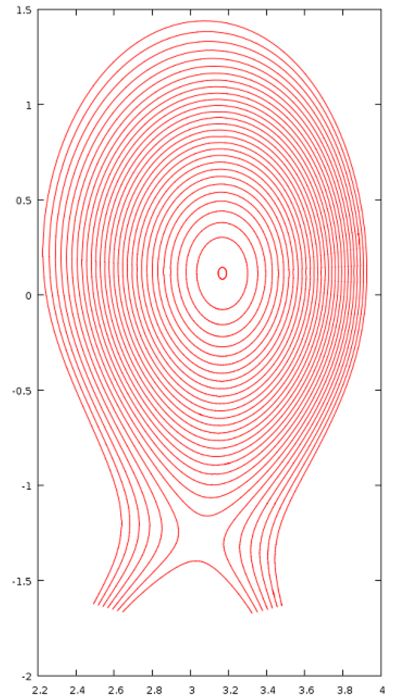

```
 ===========================================================
 Help topic: fluxsurfaces
 -----------------------------------------------------------
 Usage:
   fluxsurfaces
 
 Output flux surfaces of the axisymmetric part of the field.
 
 Examples:
   set surfaces 100
   for step 100 do
     fluxsurfaces
   done
 
 ===========================================================
```

#### 粒子数、电流等各种积分量

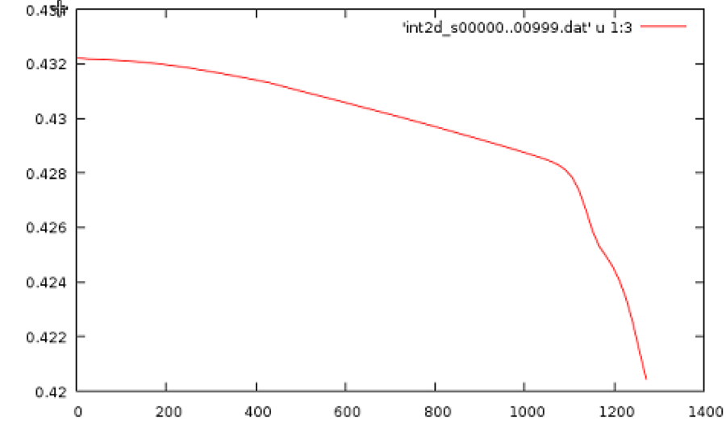

```
 =========================================================================
 Help topic: int2d
 -------------------------------------------------------------------------
 Usage:
   int2d
 
 "int2d" calculates various 2d integrals (calls integrals.f90) and outputs
 the results to file the file int2d_...
 
 Examples:
   int2d
 =========================================================================
```

#### 极向平面内沿一条线的积分（例如线积分密度）

```
 =========================================================================
 Help topic: int_along_pol_line
 -------------------------------------------------------------------------
 Usage:
   int_along_pol_line R0 Z0 R1 Z1 phi
 
 Integrate expressions along line from (R0,Z0,phi) to (R1,Z1,phi).
 
 Examples:
   set linepoints 500
   expressions R rho T E_r
   mark_coords 1
   for step 0 to 100 do
     int_along_pol_line 1.6 0.5 1.7 0.5 0.
   done
 =========================================================================
```

#### 中平面上的剖面

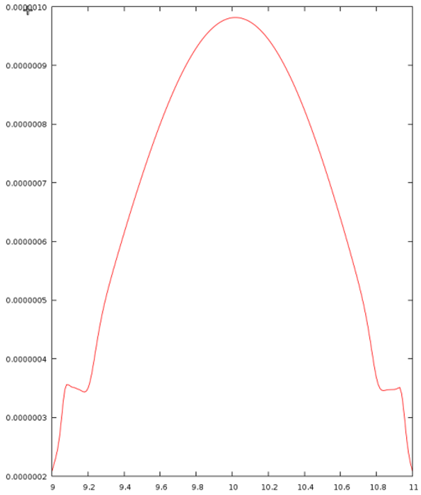


```
 =========================================================================
 Help topic: midplane
 -------------------------------------------------------------------------
 Usage:
   midplane
 
 Output toroidally averaged midplane profiles.
 
 Examples:
   set linepoints 200
   for step 1 to 100 do
     expressions R rho T Psi Er
     mark_coords 1                    # mark first expression as coordinate
     midplane
   done
 =========================================================================
```

#### 给定点处的值

```
 =========================================================================
 Help topic: point
 -------------------------------------------------------------------------
 Usage:
   point R Z phi
 
 Determine the value of a variable at position (R,Z,phi).
 
 Examples:
   for step 1 to 100 do
     expressions rho T Psi Er
     point 1.6 0.0 0.0
   done
 =========================================================================
```

#### 沿直线的剖面

```
 =========================================================================
 Help topic: pol_line
 -------------------------------------------------------------------------
 Usage:
   pol_line R0 Z0 R1 Z1 phi
 
 Expressions along line from (R0,Z0,phi) to (R1,Z1,phi).
 
 Examples:
   set linepoints 500
   expressions R rho T E_r
   mark_coords 1
   for step 0 to 100 do
     pol_line 1.6 0.5 1.7 0.5 0.
   done
 =========================================================================
```

#### HDF5 格式的矩形区域物理量（实验人员经常需要）

```
 =========================================================================
 Help topic: rectangle
 -------------------------------------------------------------------------
 Usage:
   rectangle Rmin Rmax nR Zmin Zmax nZ phi
 
 Expressions on a rectangular area in R,Z. Produced an HDF5 file.
 
 Examples:
   expressions phi rho T E_r
   for step 0 to 100 do
     rectangle 1.7 2.1 10 -0.3 0.3 10 0.
   done
 =========================================================================
```

#### 仿真过程中的 q 剖面

```
 =========================================================================
 Help topic: qprofile
 =========================================================================
```

#### 分界面位置

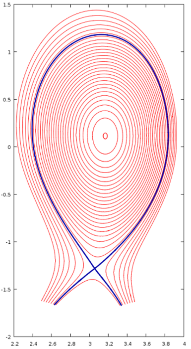

```
 =========================================================================
 Help topic: separatrix
 -------------------------------------------------------------------------
 Usage:
   separatrix
 
 Output the separatrix of the axisymmetric part of the field.
 
 Examples:
   for step 100 do
     separatrix
   done
 
 =========================================================================
```

(右图中，分界面与磁面同时绘出) 

#### 给定 R,Z 处剖面随 phi 的变化

```
 =========================================================================
 Help topic: tor_line
 -------------------------------------------------------------------------
 Usage:
   tor_line R Z phi0 phi1
 
 Expressions along line from (R,Z,phi0) to (R,Z,phi1).
 
 Examples:
   set linepoints 500
   expressions phi rho T E_r
   mark_coords 1
   for step 0 to 100 do
     tor_line 1.6 0.1 0. 3.141592
   done
 =========================================================================
```

## 可用的表达式 {#expressions-available}
这里的一个主要优势是：**大量不同的“表达式”**已经可以直接使用，而且不只是 JOREK 变量。目前可用于分析的表达式如下。在 `diagnostics/new_diag/mod_expression.f90` 中自行添加新表达式相当容易（另见下文）。**命令 `si-units` 可切换到去归一化单位。** 在 `jorek2_postproc` 交互模式下直接输入 `expressions` 即可列出可用表达式。

```
 List of Diagnostic Expressions:
 
 --------------------------------------------------------------------------------
 Number | Name         | Description
 --------------------------------------------------------------------------------
 000001 | R            | Cylindrical Coordinate R (== Major Radius)            
 000002 | Z            | Cylindrical Coordinate Z                              
 000003 | phi          | Cylindrical Coordinate phi                            
 000004 | theta        | Poloidal Angle With Respect to Magnetic Axis          
 000005 | theta_star   | Poloidal Straight Field Line Angle (for flux surfaces)
 000006 | length       | Length Along Poloidal Line (for poloidal lines)       
 000007 | r_minor      | Minor Radius From A = r_minor^2 pi (for flux surfaces)
 000008 | x            | Cartesian Coordinate x                                
 000009 | y            | Cartesian Coordinate y                                
 000010 | z            | Cartesian Coordinate z (== Cylindrical Z)             
 000011 | Psi_N        | Normalized Poloidal Magnetic Flux                     
 000012 | xjac         | 2D Jacobian in the Poloidal Plane                     
 000013 | t            | Simulation time                                       
 000014 | Psi          | Poloidal Magnetic Flux                                
 000015 | u            | Velocity Stream Function                              
 000016 | Phi          | Electric Potential Phi                                
 000017 | zj           | Toroidal Current Density Multiplied by 1/R            
 000018 | currdens     | Physical Toroidal Current Density (== zj/R)           
 000019 | omega        | Toroidal Vorticity Component                          
 000020 | rho          | Mass Density                                          
 000021 | ne           | Electron Density                                      
 000022 | T            | Temperature (Electrons plus Ions)                     
 000023 | Te           | Electron temperature (assuming Ti=Te)                 
 000024 | vpar         | Parallel Velocity (along magnetic field lines)        
 000025 | eta_T        | Temperature Dependent Resistivity                     
 000026 | visco_T      | Temperature Dependent Viscosity                       
 000027 | zkpar_T      | Temperature Dependent Parallel Heat Diffusivity       
 000028 | dprof        | Particle Diffusivity                                  
 000029 | zkprof       | Perpendicular Heat Diffusivity                        
 000030 | pres         | Total Pressure                                        
 000031 | B_abs        | Norm of the Magnetic Field Vector                     
 000032 | B_tor        | Toroidal Magnetic Field Component                     
 000033 | B_R          | Magnetic Field Component Along R                      
 000034 | B_Z          | Vertical Magnetic Field Component                     
 000035 | B_theta      | Poloidal Magnetic Field Component                     
 000036 | Er           | Radial Electric Field                                 
 000037 | Vtheta_i     | Ion Poloidal Velocity                                 
 000038 | Mach_par     | Parallel Mach Number                                  
 000039 | Mach_pol     | Poloidal Mach Number                                  
 000040 | V_sound      | Sound Speed                                           
 000041 | V_neo        | Neoclassical Velocity                                 
 000042 | Vperp_e      | Electron Perpendicular Velocity                       
 000043 | Vperp_i      | Ion Perpendicular Velocity                            
 000044 | V_ExB        | ExB Velocity                                          
 000045 | Vstar_e      | Electron Diamagnetic Velocity                         
 000046 | Vstar_i      | Ion Diamagnetic Velocity                              
 000047 | ki_neo       | Neoclassical Heat Diffusivity                         
 000048 | mu_neo       | Neoclassical Friction Coefficient                     
 --------------------------------------------------------------------------------
```

## new_diag {#new_diag}
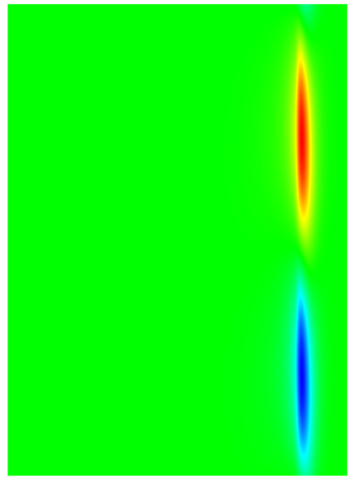

这是一个可用于自行构建不少诊断工具的框架。它在后台也支撑着 `jorek2_postproc` 的许多功能。实现位于 `diagnostics/new_diag/`，分为几个模块：

- `mod_new_diag`：要使用该框架功能必须包含的主模块。
- `mod_expressions`：提供大量表达式，可如上文所述在 `jorek2_postproc` 中方便地求值
- `mod_position`：用于选择求值表达式的极向／环向位置的数据结构。
- `mod_straight_field_line`：用于重建直磁力线坐标（见下文 `jorek2_four`）。
- `mod_four_filter`：可选择所求值表达式的特定 Fourier 模。
- `mod_diag_output`：以多种方式写出数据。

可以通过编辑 `diagnostics/new_diag_demo.f90` 并用 `make -j 8 new_diag_demo` 编译来试用这些功能。可写入的内容示例如下：

```
[...]
  ! --- Normal initialization
  allocate(node_list)
  allocate(element_list)
  allocate(bnd_elm_list)
  allocate(bnd_node_list)
  my_id = 0
  call initialise_parameters(my_id, "__NO_FILENAME__")
  call det_modes()
  call import_restart(node_list, element_list, 'jorek_restart',  rst_format, ierr)
  call initialise_basis()
  call boundary_from_grid(node_list, element_list, bnd_node_list, bnd_elm_list, .false.)
  
  ! --- Initialize the plasma equilibrium data structure
  call update_equil_state(node_list, element_list, bnd_elm_list, xpoint, xcase, equil_state)
  call print_equil_state(equil_state, .false.)
  
  ! --- Initialize the new_diag framework and print some information (.true.)
  call init_new_diag(.true.)
  
  expr_list = exprs((/'R    ', 'phi  ', 'pres ' /), 3, 2)
  call create_pol_pos(pol_pos_list, ierr, node_list, element_list, equil_state, &
    Rstart=3.17, Rend=3.92, n=150, Z=0.116)
  
  call create_tor_pos(tor_pos_list, ierr, nphi=150)
  
  call eval_expr(equil_state, JOREK_UNITS, expr_list, pol_pos_list, tor_pos_list, result, ierr)
  
  call reduce_result_to_2d(ierr, result, res2d, i2=1)
  call write_vtk_2d(ierr, expr_list, res2d, 'testA.vtk', (/1,2/))
  
  call apply_four_filter(result, simple_filter(n=6), 2, ierr)
  call reduce_result_to_2d(ierr, result, res2d, i2=1)
  call write_vtk_2d(ierr, expr_list, res2d, 'testB.vtk', (/1,2/))
[...]
```

# jorek2_four

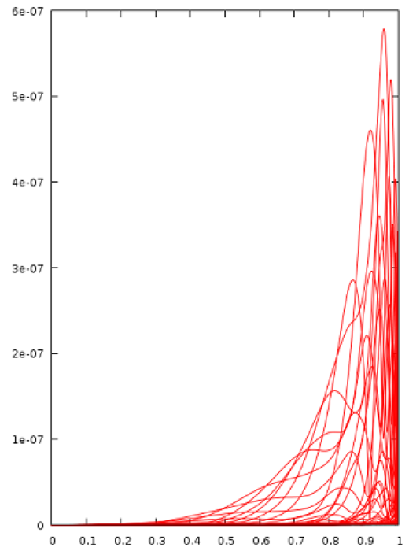

用 `make -j 8 jorek2_four` 编译。然后在算例目录中创建名为 `four_params.nml` 的文件：

```
&four_params
nstpts = 600 ! number of psi_N values
nmaxsteps = 2000
deltaphi = 0.2
nsmallsteps = 3
rad_range = 0.001, 0.999
nTht = 120
/
```

`jorek2_four` 在磁坐标（直磁力线坐标；Pest 坐标）下进行二维 Fourier 分析。

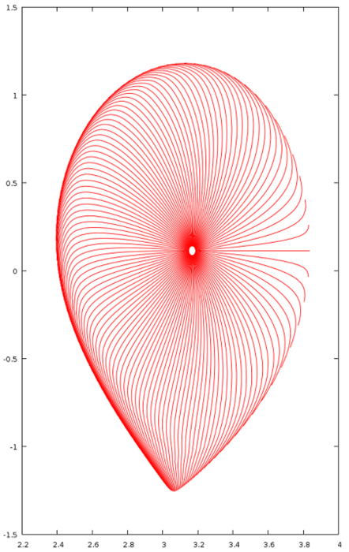

# 延伸 {#beyond}
还有更多诊断工具，例如：

```
jorek2_connection2
jorek2_diagno
jorek2_fieldlines_vtk
jorek2_import_perturbation
jorek2_povray
jorek2vtk_GaussVortTerms
jorek_diagnostics
jorek_to_helena
...
```

其中一些正在使用，另一些可能需要修复后才能重新派上用场。若你需要考察仿真的某个特定方面，最好先问一下是否已有现成方案。如果没有，很希望你能以实现得对整个社区都有用的方式加入自己的诊断工具。关于最佳做法（新程序、集成到 `jorek2_postproc` 等）可以随时咨询。
