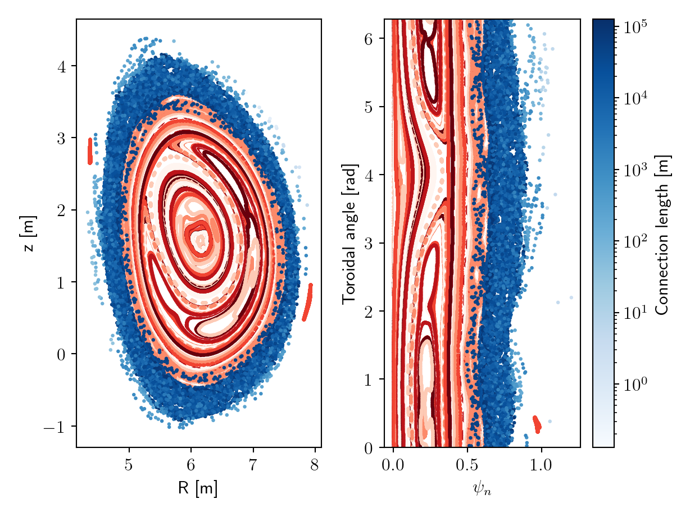

# 用粒子追踪器生成庞加莱图

## 与 jorek2_poincare 的区别

- 可选择用粒子而不仅是磁力线生成庞加莱图。
- 输出按每个标记粒子分开，并包含连接长度。
- 输出以 HDF5 格式存储。

## 1. 编译并运行代码

1. 建议为粒子追踪器使用 MUMPS（在 `Makefile.inc` 中设置 `USE_MUMPS=1`）。
2. （绘图需要 numpy、h5py 和 matplotlib）
3. 用以下命令编译庞加莱程序：`make poincare`
4. 把可执行文件放在与 JOREK 输入文件和重启文件相同的目录中。
5. 模拟选项在 `pncr` 文件中给出，该文件也应放在同一目录中，其内容如下：

    ```
    # n_tracers - number of field line/particle tracers 
    100
    # n_turns - how many times a marker must cross the outer mid-plane before terminating its simulation
    200
    # tstep in [s] for particles and [m] for field lines (1e-3 - 1e-2 is good for field lines, for particles it depends but 1e-8 - 1e-10 is ok for electrons)
    1.0e-10
    # mass [AMU] (if you use 0.0 here then field lines are traced)
    0.00055
    # charge [e]
    -1
    # pitch (vpar/vtot)
    0.99
    # energy [eV]
    1.0e3

    ```

6. 可以修改 `pncr` 文件中的数值，但不要改动其结构。
7. 庞加莱数据针对对应于 `jorek_restart.h5` 的单个时间片收集。
8. 运行代码使用 `mpirun -n 1 ./poincare < input_namelist`

### 进一步信息与可能的问题

- 若时间步过大可能出问题（例如磁力线发散，或在图中具有"宽度"，或模拟可能无法完成）。减小时间步意味着模拟耗时更长，但可通过减小 `n_tracers` 和 `n_turns` 来缓解。用默认设置运行应只需几分钟。
- 追踪粒子时默认包含电场，这会造成加速。要禁用电场，在 `particles/mod_fields.f90` 中子程序 `calc_EBNormBGradBCurlbDbdt` 的末尾添加 `E=0`。
- 追踪粒子时使用相对论导向中心推进器。当导向中心近似不成立时（例如在球形托卡马克中），这可能是个问题。
- 标记粒子在外中平面上沿径向以等间隔初始化，初始环向角从均匀分布中随机抽取。
- 磁力线沿 B 场矢量在一个方向上追踪。对于粒子，方向由平行速度比（pitch）决定。

## 2. 编译并运行代码

- 程序输出 `poincare.h5` 文件，其中包含以下字段

```
r       : R-coordinate
z       : z-coordinate
phi     : Toroidal angle [rad]
psi     : Normalized psi
iprt    : Marker ID this data point correspond to (1,...,Nmrk)
pncrid  : Poincare plane this data point correspond to (default is phi-tor plane = 1 and Rz-plane = 2 )
mil     : Distance the marker has travelled up to this point
mileage : The distance [m] that a marker travelled in total
```

- 数据存储在一维非结构化数组中，其中每个数据点对应一次极向或环向平面的穿越。这使得修改代码以便同时在多个（极向或环向）平面上收集数据变得容易。
- `iprt` 和 `pncrid` 可用于切分数据。例如，要获得标记粒子 i 在平面 j 上所有点的索引，使用：`idx = np.logical_and.reduce([iprt == i, iplane == j])`
- 目前数据在 phi = 0 对应的 Rz 平面以及外中平面处收集。
结果可用 `util/plot_poincare.py` 直接运行脚本进行可视化。以下是一个示例输出：

    

- 红色色调表示被约束的标记粒子（在模拟过程中未损失的）。每个标记粒子从六种颜色的池中分配一种（红色调）颜色，以便更容易区分相邻的线。
- 蓝色色调表示已损失标记粒子的连接长度。颜色显示该位置处的连接长度
