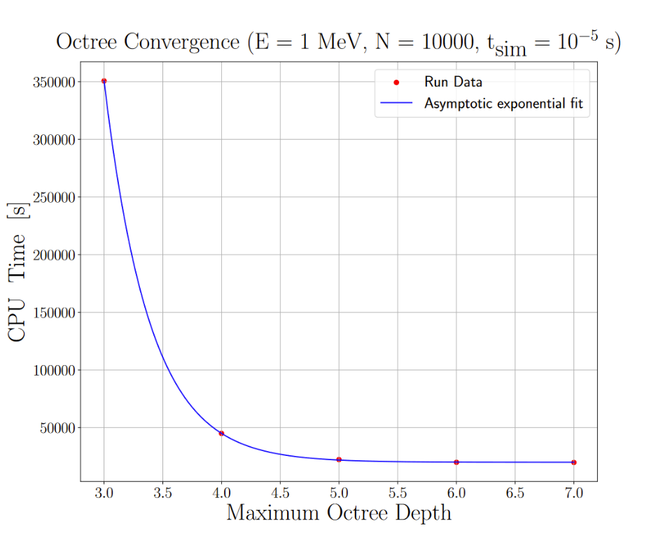
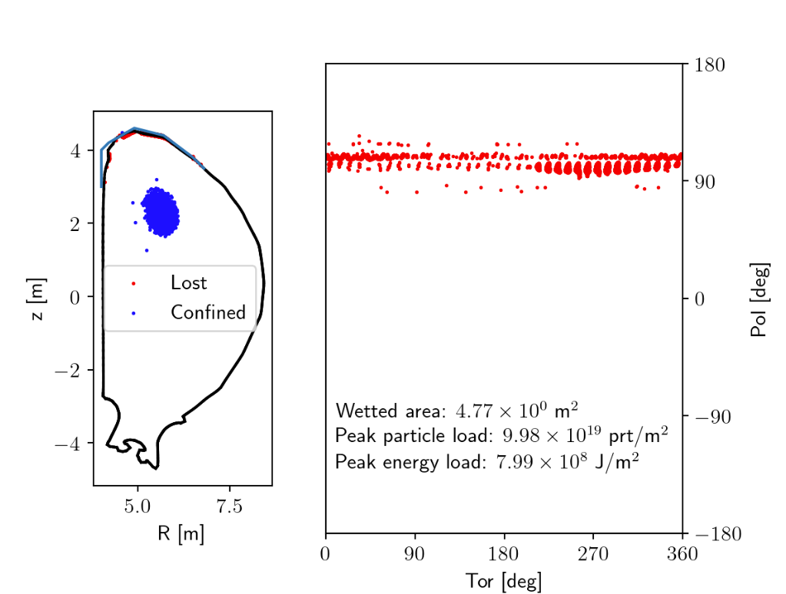
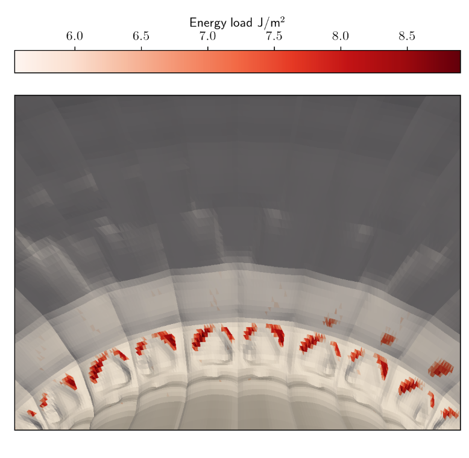
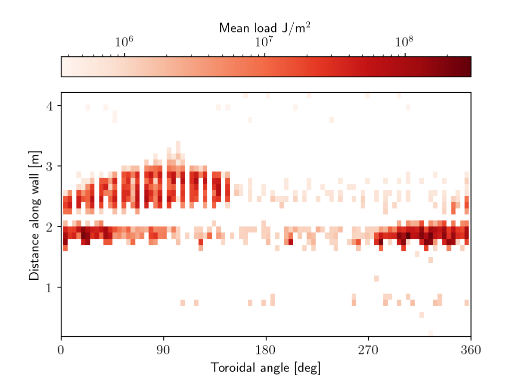
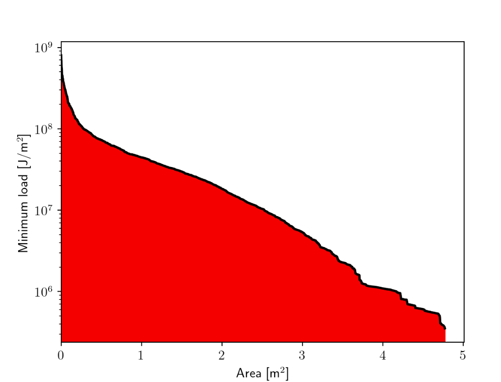
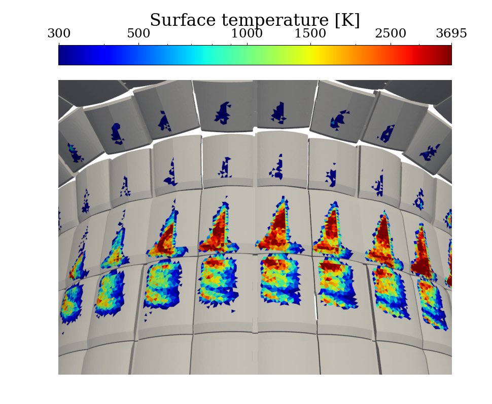
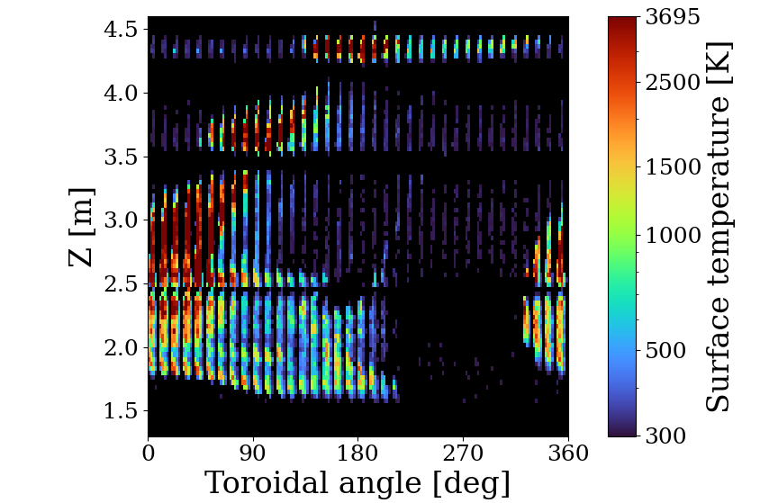

# 用粒子追踪器评估粒子壁负荷
**注意：**
  * 壁面碰撞检查仅对相对论粒子模式与相对论导向中心模式作了完整实现。对于其他模式，算法仍然存在，但如果不实现导出程序中粒子能量的计算方式，就无法获得完整输出（所以这是一件简单的事）。
  * 使用该模块需要一个代表面向等离子体部件（PFC）的三角形网格。若没有，可用脚本 `assets/particles_wall_load/create_basic_wall.py` 从 JOREK 计算网格的边缘生成一个简单的壁网格。
  * 更多细节见 Miko Skyllas 的 {{ ::internship_report_with_chapters.pdf |实习报告}}。


## 输入

输入是一个简单的 HDF5 文件，含两个数据集：**ntriangle** 表示壁单元（三角形）的数量，**nodes** 是三角形节点数组，格式为 [x1_1, y1_1, z1_1, x2_1, y2_1, z2_1,x3_1, y3_1, z3_1, x1_2, y1_2, z1_2, ...]，其中最后一个索引是三角形 ID。

构造壁输入的一种简便方式，例如用 pyvista 读取数据（通常为 stl 或 vtk 格式），再转换为所需格式。

目前已有若干托卡马克的壁模型采用 JOREK 所接受的格式：ITER、ASDEX Upgrade、EU-DEMO。这些模型可从 TOK 集群的 /shares/users/public/visv 获取。


壁网格必须包含在算例目录中。

## 运行带壁碰撞检查的模拟


该模块的实现见 particles/mod_wall_collision.f90。要在粒子模拟中使用该模块，先初始化壁数据。

``` fortran
type(octree_triangle) :: octree ! The struct containing the wall data.
call mod_wall_collision_init('wall.h5', octree, max_depth)
```

要在每个时间步检查壁碰撞，使用（在模拟循环内）
``` fortran
call mod_wall_collision_check(p, q, octree, wall_id, wall_pos)
```

其中 p 是时间步开始时标记粒子的位置（柱坐标），q 是时间步结束时的位置。该子程序返回被击中壁单元的 id（否则为零）以及撞击点 p + t * (q - p)，其中参数 t 由碰撞检查确定。壁单元 id 对应于该单元在输入文件中的位置。

用以下方式释放资源
``` fortran
call mod_wall_collision_free(octree)
```

随后可用以下方式导出数据
``` fortran
call mod_wall_collision_export(sim, file)
```

注意这假定（对于损失的标记粒子）你把数据存为 i_elm = (-1) * wall_id。负号只是为了标记该标记粒子已损失。

示例脚本见 particles/examples/example_wallload.f90

## 算法描述

算法相对简单。在每个时间步，以标记粒子新旧位置之间的线段，针对壁面三角形做射线追踪，采用 Möller-Trumbore 算法。为优化该过程，只对邻近的三角形做射线追踪。这通过把体积递归地划分为八个象限，并只对与标记粒子新位置或旧位置处于同一体积内的三角形做碰撞检查来实现。该八叉树在初始化时构建，其有效性可从下图看出（对于模拟，建议 max_depth=6）：




## 输出与后处理

该模块为输出创建一个 HDF5 文件，其中包含：
  * 被击中（润湿）单元的 ID（即原始输入数组中从 1 开始的索引）。
  * 每个被击中三角形上的粒子负荷（prt/m^2）。粒子负荷按 sum(weight) / 单元面积 计算，其中求和针对所有击中该单元的粒子。
  * 每个被击中三角形上的热负荷（J/m^2）。热负荷按 sum( 粒子权重 * 粒子能量) / 单元面积 计算。


后处理脚本为 util/plot_wallload.py，它将输出被击中的面积以及最大粒子负荷和热负荷。该脚本需要壁输入、壁负荷，可选地还需要粒子重启文件。该脚本还会可视化损失（注意默认设置是针对 ITER 的）：




**左**：标记粒子最终位置的散点图。**右** 3D 壁网格上的负荷。




**左** 壁面上的负荷分布。注意这些损失被投影到第一幅图中所示的蓝色曲线上，因此该图并不表示精确的损失或其分布，而只是总体的分布型貌。**右** 显示至少受到给定热负荷影响的面积的直方图。

可选地，也可以输出粒子重启文件，其中 i_elm 表示给定标记粒子的终态（>0 为被约束，=0 为已损失但未击中壁，< 0 为三角形 ID（乘以 -1 表示该标记粒子已损失），即该标记粒子损失的位置）。

另一种可能是输出与 FIREWALL 代码兼容格式的粒子输出文件。这是一个 HDF5 文件，其中含一个名为 "groups" 的组，其下有一个名为 "001" 的子组（粒子种类类型），后者又包含以下内容（仅列出 FIREWALL 所需的量）：
* i_elm：数组，含各标记粒子所击中三角形的壁 id。
* t_loss：数组，含标记粒子与壁撞击的时间。
* v：矩阵，含标记粒子撞击时刻的动量矢量。
* weight：数组，含每个标记粒子的物理粒子数。

FIREWALL 对 ITER 情形的输出将如下所示：




**左** 3D 壁模型上的表面温度。**右** 表面温度的环向投影。
