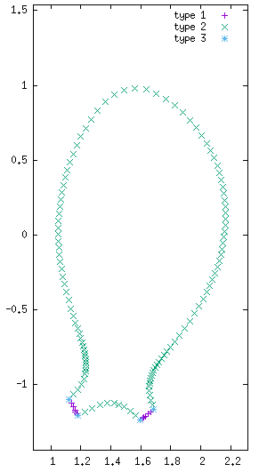

## 边界条件的类型

* **Dirichlet（狄利克雷）边界条件：** 变量的值随时间保持不变（例如 $\rho=cte$ 或 $\delta\rho = 0$）

* **Natural（自然）边界条件：** 通过边界积分项对变量的法向导数施加条件（例如 $\nabla T\cdot\mathbf{n} = c T$）。实现方式见 [JOREK 综述文章](https://doi.org/10.1088/1741-4326/abf99f)第 2.3.2 节。另见"[热流的鞘层边界条件](./sheath_heatflux_bc.md)"中的示例

* **特殊条件：** 某些变量可以施加特殊条件。例如，在偏滤器区域通常把平行速度设为声速（$v_\parallel=c_s$），即 Mach=1 条件。

* **不施加显式条件：** 可以选择不为该变量施加任何边界条件。对某些变量，这会导致代码崩溃，因为系统不封闭（例如 $\psi$）。但也存在这样一些变量：不显式施加条件反而隐含地确定了另一个条件。例如对 $\rho$ 和 $T$，不施加任何条件直接意味着（$\nabla T\cdot\mathbf{n} = 0$ 且 $\nabla \rho\cdot\mathbf{n} = 0$），因为这等价于实现一个取值为 0 的边界项。

## 边界的类型（边界类型索引）

JOREK 的边界可以划分为不同部分，例如偏滤器靶板（$\mathbf{B}\cdot\mathbf{n}$ 有限）以及与磁场对齐的边界（$\mathbf{B}\cdot\mathbf{n}=0$）。为在不同边界区域施加边界条件，这些区域用"边界类型"标注。该标注方式取决于所选网格，下面给出一些示例（并不完整）

* **极向网格**（grid_polar_bezier）：整个边界为 "2"
* **极向对齐网格**（grid_flux_surface）：整个边界为 "2"
* **X 点网格**（grid_xpoint）：偏滤器靶板为 "1"，磁面对齐边界为 "2"，网格角点为 "3"

更复杂的网格存在大于 3 的边界类型。可用 [jorek2_postproc](../../post_processing.md) 与命令 `grid_diagnostics` 检查所使用的边界类型。



该图由 gnuplot 通过以下命令生成：

```gnuplot
p 'postproc/nodes_by_boundary_type_00000001_s00000.dat' t 'type 1', 'postproc/nodes_by_boundary_type_00000002_s00000.dat' t 'type 2', 'postproc/nodes_by_boundary_type_00000003_s00000.dat' t 'type 3'
```
## 带 patch 的边界类型

!!! 回顾 !!! GUIDO 给出的定义
  * 1：TARGET（靶板），side 2
  * 2：TANGENT（相切），side 3
  * 3：CORNER（角点），介于类型 1 与类型 2 之间
  * 4：TARGET（靶板），side 2（与类型 1 相同）
  * 5：TARGET（靶板），side 3
  * 9：CORNER（角点），介于类型 4 与类型 5 之间

!!! 回顾 !!! STAN 为包含磁场方向而给出的定义，兼容旧网格
  *  1：TARGET（靶板），side 2                                   （内向磁场）
  * 11：TARGET（靶板），side 2                                   （外向磁场）
  *  5：TARGET（靶板），side 3                                   （内向磁场）
  * 15：TARGET（靶板），side 3                                   （外向磁场）
  *  9：CORNER（角点），自由                                      （内向磁场）
  * 19：CORNER（角点），自由                                      （外向磁场）
  *  2：TANGENT（相切），side 3                                   （切向磁场）
  * 12：TANGENT（相切），side 2                                   （切向磁场）
  * 20：CORNER（角点），固定                                     （切向磁场）
  * 21：CORNER（角点），反向（3 个单元）                          （特殊情况）

! 新网格中不使用
  *  3：类型 1 与类型 2 之间的角点                                     （仅用于旧网格）
  *  4：与类型 1 相同                                                （仅用于旧网格）

  !!! 映射 !!! 从 STAN 的定义转换为 GUIDO 的定义
  *  1 ->  1
  * 11 ->  1
  *  5 ->  5
  * 15 ->  5
  *  9 ->  9
  * 19 ->  9
  *  2 ->  2
  * 12 -> 未定义！
  * 20 ->  9（因为未定义！）
  * 21 -> 未定义！
  *  3 ->  3

## 在输入文件中指定边界条件
"bcs" 结构允许在输入文件中添加边界条件。例如，要为变量 "rho" 和边界类型 "j" 施加 Dirichlet 边界条件，请在输入文件中加入：

```fortran
bcs(j)%dirichlet%rho = .true.
```
> **重要**：试图用如下语句为所有边界类型指定边界条件是无效的：`bcs(:)%dirichlet%rho`。必须针对每个边界类型索引分别写出每一行：`bcs(1)%dirichlet%rho=.t.`、`bcs(2)%dirichlet%rho=.t.` 等。

> **重要**：若要施加任何形式的 Natural 边界条件，必须在输入文件中设置 `bc_natural_open=.t.`。

### 可用的边界条件

全部可用的边界条件见下表（以边界类型 "i" 为例）：

| 变量 | Dirichlet | Natural（bc_natural_open=.t.） | 特殊 | 不施加 |
|----------|-----------|-------------------------------|---------|--------------|
| $\psi$ | `bcs(i)%dirichlet%psi` | 无 | [自由边界](../../../physics/model_extensions/freebound.md) | ? |
| $u$ | `bcs(i)%dirichlet%u` | 无 | 无 | ? |
| $j$ | `bcs(i)%dirichlet%zj` | 无 | [自由边界](../../../physics/model_extensions/freebound.md) | 由感应方程决定 |
| $w$ | `bcs(i)%dirichlet%w` | 无 | 无 | ? |
| $\rho$ | `bcs(i)%dirichlet%rho` | `bcs(i)%natural%rho`<br><br>**条件**：$D\nabla\rho\cdot\mathbf{n} = -r_\rho\rho\mathbf{v}_\parallel \cdot\mathbf{n}$<br>其中 $r_\rho$ = density_reflection | 无 | $\nabla\rho\cdot\mathbf{n}=0$ |
| $T$ | `bcs(i)%dirichlet%T` | `bcs(i)%natural%T`<br><br>[见此处](./sheath_heatflux_bc.md) | 无 | $\nabla T \cdot\mathbf{n}=0$ |
| $T_i$ | `bcs(i)%dirichlet%Ti` | `bcs(i)%natural%Ti`<br><br>[见此处](./sheath_heatflux_bc.md) | 无 | $\nabla T_i\cdot\mathbf{n}=0$ |
| $T_e$ | `bcs(i)%dirichlet%Te` | `bcs(i)%natural%Te`<br><br>[见此处](./sheath_heatflux_bc.md) | 无 | $\nabla T_e\cdot\mathbf{n}=0$ |
| $v_\parallel$ | `bcs(i)%dirichlet%vpar` | `bcs(i)%natural%vpar`<br>`mach_one_bnd_integral=.t.`<br><br>**条件**：$v_\parallel = c_s$<br>通过惩罚法实现 | `bcs(i)%mach1`<br><br>**条件**：$v_\parallel = c_s$ | ? |
| $\rho_n$ | `bcs(i)%dirichlet%rhon` | `bcs(i)%natural%rhon`<br><br>**条件**：$D_n\nabla\rho_n\cdot\mathbf{n} = -r_{\rho_n}\rho\mathbf{v}_\parallel \cdot\mathbf{n}$<br>其中 $r_{\rho_n}$ = neutral_reflection | 无 | $\nabla\rho_n\cdot\mathbf{n}=0$ |
| $n_{RE}$ | `bcs(i)%dirichlet%nre` | 无 | 无 | ? |

### 默认值

* **$\psi, u, j, w, n_{RE}$**：对所有边界类型施加 Dirichlet 条件

* **$\rho, T, T_i, T_e, \rho_n$**：
  * 对边界类型 "1, 4, 5, 9, 11, 15, 19" 不施加条件
  * 对边界类型 "1, 4, 5, 9, 11, 15, 19" 施加 Natural 条件（若 `bc_natural_open=.t.`）
  * 对其他所有边界类型施加 Dirichlet 条件

* **$v_\parallel$**：
  * 对边界类型 "1, 3, 4, 5, 9, 11, 15, 19" 施加特殊的 Mach=1 条件
  * 对其他所有边界类型施加 Dirichlet 条件

## 边界条件之间的冲突

指定多个条件时可能发生冲突。例如，若同时指定 `bcs(i)%dirichlet%vpar=.t.` 与 `bcs(i)%mach1=.t.`，结果会怎样？此时按以下优先级顺序处理（1 = 最高优先级）：

1. 特殊条件（例如自由边界与 Mach=1）
2. Dirichlet 条件
3. Natural 条件
4. 不施加显式条件

### 示例 1：对 $v_\parallel$ 施加 Mach=1

```fortran
bcs(i)%mach1 = .t.
```

### 示例 2：对 $v_\parallel$ 施加 Dirichlet

```fortran
bcs(i)%mach1          = .f.
bcs(i)%dirichlet%vpar = .t.
```

### 示例 3：对 $T$ 施加 Natural 条件

```fortran
bc_natural_open    = .t.    ! Switches on boundary integral calls
bcs(i)%dirichlet%T = .f.
bcs(i)%natural%T   = .t.
```

### 示例 4：对 $\rho$ 不设置条件

```fortran
bc_natural_open      = .f.
bcs(i)%dirichlet%rho = .f.
bcs(i)%natural%rho   = .f.
```
