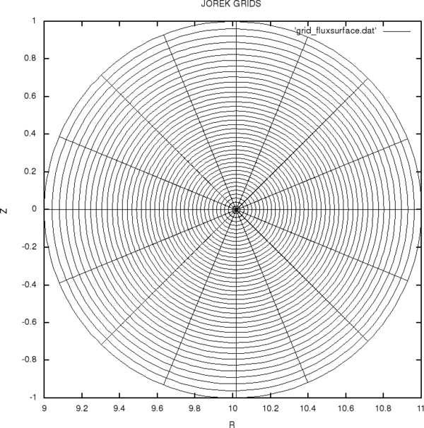
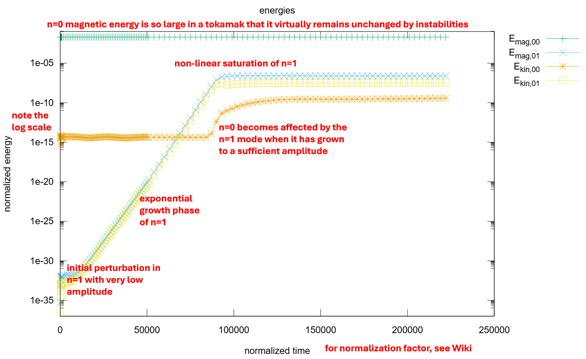
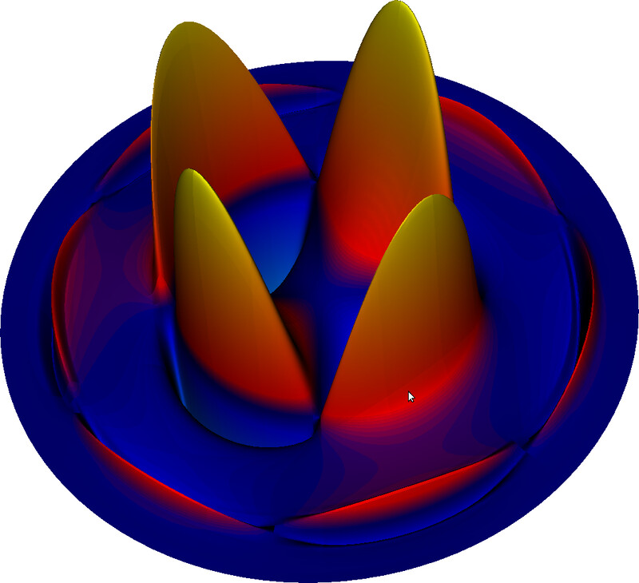
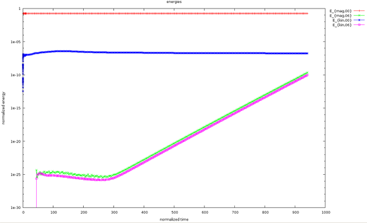
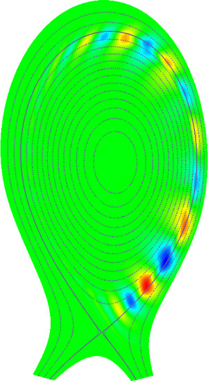

本教程将展示如何运行你的第一批小型 JOREK 仿真。它将帮助你配置并编译依赖库、主程序与诊断工具，并以交互方式或通过批处理系统运行。你还会学到如何使用几个简单的诊断工具。需要具备基本的 Linux 知识，并且你应当能够访问一个批处理 Linux 集群，以便亲自运行这些示例。

## 获取并保持全局认识

- **代码文档**在我们的 Wiki 系统中维护。请花些时间浏览[主页](/index.md)上链接的各个条目。文档既不完整也不完美，整个社区都必须持续地完善它。
- 重要信息通常通过我们的**邮件列表** [everyone@jorek.eu](mailto:everyone@jorek.eu) 发布。
- 我们的[公开网站](https://jorek.eu)托管在我们自己控制的虚拟服务器上。jorek.eu 上还有一个受限的 Wiki，用于组织会议等事务。

## 环境准备

下文假定你使用的是 `bash` shell。

在大多数机器上，都可以通过加载模块来获得额外的软件。我们建议直接在主目录的 `.bashrc` 文件中完成这件事。在其中写入类似下面的内容；模块名称在不同机器上可能不同。

```bash
module load intel ...
```

对于社区经常使用的机器，你可以在 [HPC 与 PC 配置](../compiling/compilation_and_libraries/hpc_pc_configurations.md)中找到模块名称（以及更多信息）。

如果你把它加入 `.bashrc` 文件，那么在你注销并重新登录、打开新终端，或手动执行 `source ~/.bashrc` 之后，它就会生效。

其他有用的命令：用 `module avail` 查看可用的模块，用 `module list` 查看你已经加载的模块，用 `module unload` 卸载模块，用 `module show` 查看详细信息。

## 配置与编译

如果你只想用代码开展物理研究而不做（相关的）改动，可以无需账号克隆源码仓库：

```bash
cd <where you want to check out the code>
git clone https://github.com/<REPOSITORY>
```

如果你希望自己在该代码上做开发，最好通过 ssh 克隆仓库。这需要你在 GitHub 上注册、生成 ssh 密钥对，并把你的公钥上传到 GitHub。完成之后，可以按如下方式克隆：
```bash
cd <where you want to check out the code>
git clone git@github.com:<REPOSITORY>
```

克隆仓库之后，你就拥有了 JOREK 源码的本地副本。接下来要编译这份源码，得到所需模型的可执行二进制文件，以及所需的诊断程序。这些二进制文件就是你稍后复制到算例目录中、用来运行和分析仿真的东西。为此，主要步骤是：
- 准备 `Makefile.inc` 文件，其中包含与机器相关的信息
- 设置硬编码参数，例如通过 `./util/config.sh` 选择物理模型
- 当你修改了配置或硬编码参数后，运行 `make clean`
- 编译代码，例如 `make -j 8`

下面将更详细地描述这些步骤。

首先，你需要准备 `Makefile.inc` 配置文件，其中包含使用哪个编译器、在何处找到依赖库等信息（如果是新的计算系统，你可能需要自己编译某些依赖库；这超出了本教程的范围）。该文件需要针对你使用的相应计算系统进行调整。对于社区频繁使用的计算系统，你可以在 [HPC 与 PC 配置](../compiling/compilation_and_libraries/hpc_pc_configurations.md)下找到这些文件。`Makefile.inc` 需要放在你克隆的仓库的主文件夹中，`jorek2_main.f90` 也在那里。

在编译代码之前，你需要设置一些**硬编码参数**。最重要的几个是：

| 名称 | 说明 | 合理取值 |
| --- | --- | --- |
| `model` | 物理模型（基本概览见[此处](/docs/physics/cat_physics.md)） | 600, ... |
| `n_tor` | 环向谐波数目（正弦与余弦分开计数） | 1, 3, 5, 7, 9, ... |
| `n_period` | 环向周期性 | 1, 2, 3, 4, ... |
| `n_plane` | 用于实空间表示的环向平面数目 | 至少 `2*(n_tor-1)` |

几个示例，展示在给定硬编码参数设置下仿真中包含的环向谐波：

| `n_tor` | `n_period` | 包含的环向模数 `n` |
| --- | --- | --- |
| 1 | 1 | 0 |
| 3 | 1 | 0, 1 |
| 5 | 1 | 0, 1, 2 |
| 17 | 1 | 0, 1, 2, 3, 4, 5, 6, 7, 8 |
| 3 | 6 | 0, 6 |
| 5 | 3 | 0, 3, 6 |

修改这些硬编码设置的最佳方式是通过 bash 脚本：

```bash
./util/config.sh
```
（模型直接在 `Makefile.inc` 中设置，其他硬编码参数位于 `models/mod_settings` 和 `models/modelXXX/model_settings`。）

该脚本还会列出上面未提及的几个额外硬编码参数：

```text
==============================
  model600
------------------------------
  n_tor            = 3
  n_coord_tor      = 1
  l_pol_domm       = 0
  n_period         = 6
  n_coord_period   = 1
  n_plane          = 4
  n_order          = 3
  n_nodes_max      = 60001
  n_elements_max   = 60001
  n_boundary_max   = 1001
  n_pieces_max     = 6001
------------------------------
  with_vpar        = .true.
  with_TiTe        = .false.
  with_neutrals    = .false.
  with_impurities  = .false.
==============================

('config.sh -h' for help)

```

当你把硬编码参数设成所需的值后，即可编译主程序：

```bash
make -j 8
```

这会使用优化设置，并在可能的情况下并行编译最多八个源文件（请按需选择数目）。编译通常需要几分钟，主要取决于文件系统。JOREK 还提供了一套预先准备好的诊断工具，可以这样编译：

```bash
make -j 8 <diagnostic-name>
```

本教程用到的诊断工具是：

| 名称 | 说明 |
| --- | --- |
| `jorek2vtk` | 把重启文件转换为 VTK 文件，以便用 Visit 或 Paraview 绘图 |
| `jorek2_postproc` | 带简单脚本语言的多用途诊断工具 |

## 调试选项

当你需要调试选项时，例如在代码开发过程中，可以用 `make clean; make -j 8 DEBUG=1` 进行编译。这会在运行时增加编译器检查，但会使代码变慢。在优化构建与调试构建之间切换，或修改硬编码参数时，务必在重新编译前执行一次 `make clean`。

## 练习

- **练习 1**：登录你可用的计算集群，克隆代码，按需加载模块，把正确的 `Makefile.inc` 放到位，用脚本以 `./util/config.sh model=600` 设置硬编码参数，并编译主程序以及 `jorek2vtk` 和 `jorek2_postproc` 诊断工具。如果这一步对你来说成功了，你就已经成功完成编译。很好！


## 运行一个简单的测试算例

在本教程中我们运行一个非常简单的测试算例：大长径比圆截面等离子体中的撕裂模。你需要自己为仿真组织目录结构。本教程假定如下目录结构，并且源码与 `Makefile.inc` 已准备就绪，例如放在你的 Marconi 主目录中：

```text
first-jorek-runs/
  jorek.git/                  # the source code
  intear_ntor3/               # run directory
```

首先，用适合该测试算例的设置编译代码：

```bash
cd jorek.git/
./util/config.sh model=600 with_vpar=.false. n_tor=3 n_period=1 n_plane=4     # run with toroidal mode numbers n=0,1
make clean
make cleanall
make -j 8
make -j 8 jorek2vtk jorek2_postproc
```

然后，把编译好的二进制文件和该测试算例的输入文件复制到算例目录。输入文件 `intear` 包含运行该测试算例所需的信息；关于 namelist 输入文件的更多信息在下面给出。

```bash
cp jorek_model600 jorek2vtk jorek2_postproc namelist/model199/intear ../intear_ntor3
cd ../intear_ntor3
ln -s ../jorek.git/util # create a soft link to the util folder with scripts for convenience
```

现在用你惯用的编辑器打开文件 `intear`。其中包含待仿真测试算例的描述。许多内容不会一眼就能自明。目前只需把时间步进设置改为：

```text
tstep = 3000.
nstep = 50
```

## 交互式运行

在一台能够以交互方式运行这种小算例的机器上（并非所有系统都可以），你可以直接执行类似下面的操作（细节取决于机器）：

```bash
export OMP_NUM_THREADS=4
nice mpirun -n 2 ./jorek_model199 < ./intear | tee logfile
```

{: .warning }
> **译者注：** 原文此处写 `jorek_model199`，与前文编译、复制的 `jorek_model600` 不一致，疑为笔误。

JOREK 采用 MPI + OpenMP 混合并行。使用的 CPU 核总数是 MPI 任务数与 OpenMP 线程数的乘积。第一行把 OpenMP 线程数设为四个。`mpirun -n 2` 表示我们运行两个 MPI 任务，每个环向谐波一个。因此，这个示例使用了八个 CPU 核。MPI 任务数通常应当是环向 `n` 谐波数目的整数倍：

```text
n_MPI = k * (n_tor+1)/2
```

`nice` 命令会略微降低运行的优先级，以免影响同一机器上的其他交互用户。可以用 `top` 命令查看一台交互式机器当前的使用率，值得一查。

我们把 namelist 输入文件 `intear` 通过管道送入代码，以便它读取算例设定。末尾的 `| tee logfile` 表示代码的所有输出都会打印到屏幕，同时写入名为 `logfile` 的文件，方便你事后检查细节。

## 在批处理队列中运行

生产中，仿真通常按如下方式准备。你编译代码、准备 JOREK 输入文件，并编写一个特定的**批处理作业文件**。在该文件中，你精确指定应当执行什么、在什么硬件上执行。你"提交"这个作业，作业调度器会在所需硬件可用时运行它。这是在大系统上运行仿真的常规方式。等待时间很大程度上取决于作业规模、你已使用的资源量、你在此系统上的项目规模以及其他参数。

示例作业脚本文件见 [HPC 与 PC 配置页面](../compiling/compilation_and_libraries/hpc_pc_configurations.md)。

准备好作业文件后，可以按如下方式提交（适用于使用 [SLURM 调度器](https://slurm.schedmd.com/documentation.html)的计算系统）：

```bash
sbatch jobscript
```

提交之后，可以用下面的命令查看作业状态：

```bash
squeue -u <your-username>
```

如果你需要"杀死"一个作业，可以这样做：
```bash
scancel <jobid>
```

另一种方式是，在算例文件夹中创建特殊文件 `STOP_NOW`，让 JOREK 在下一个时间步之后以干净的方式自行结束：
```bash
touch STOP_NOW
```

这在交互式和批处理系统中都有效，尤其在你并不写出每个重启文件时非常有用。代码的干净退出总会在最后一个时间步之后产生一个 `jorek_restart.h5`；而直接杀死运行（`Ctrl-C`、`kill -9 PID`，或在批处理系统中 `scancel`）会导致突然中断，你可能损失几个时间步。

## 重启仿真

重启 JOREK 仿真是容易的。如果仿真干净退出，你只需在 namelist 输入文件（本例中名为 `intear`）中设置 `restart=.true.`，然后重新提交作业脚本即可。例如，这允许用不同的时间步继续仿真，或仅仅是把它继续下去。仿真从 `jorek_restart.h5` 中保存的状态重新开始。

如果仿真没有干净结束，或者你想从并非最后一个的时间步重启，就需要把某个带编号的重启文件 `jorekXXXXXX.h5` 复制为 `jorek_restart.h5`。JOREK 每 `nout` 个时间步写一个带编号的重启文件（准确地说，只要 modulo(step,nout)==0 就写出一个重启文件），`nout` 可在 namelist 输入文件中指定。大多数诊断工具也从重启文件读取数据。

注意，JOREK 重启文件的编号实际上只是一个索引。与该索引对应的仿真时刻取决于你在仿真中选择的时间步进。你可以用下面的命令查看这种对应关系，得到以归一化单位表示的时间：

``
./util/plot_live_data.sh -q time
``

若要用 SI 单位表示时间，请改用下面的命令：
``
./util/plot_live_data.sh -q time -si
``

## Namelist 输入参数

示例输入文件 `intear` 只包含数量有限的输入参数，实际存在的要多得多。最好查看相应模型中定义的 namelist（`models/modelXXX/initialise_parameters.f90`），了解可以使用哪些输入参数。通常，在读取 namelist 输入文件之前，它们都会获得默认值，而实际使用的值会打印到日志文件中。

大多数输入变量在 `models/phys_module.f90` 中定义，并附有简短注释。起初，建议向更有经验的 JOREK 用户寻求帮助，弄清哪些输入参数与你的算例相关。至于它们的确切含义，往往最好直接查看使用它们的代码。本示例中几个重要的参数是：

| 参数 | 说明 |
| --- | --- |
| `restart` | 从头运行仿真，或重启仿真 |
| `tstep` | 每个时间步应有多大，以归一化单位表示 |
| `nstep` | 运行多少个时间步 |
| `tstep_n` | 与 `tstep` 相同，但允许依次使用若干个不同的值 |
| `nstep_n` | 与 `nstep` 相同，但允许依次使用若干个不同的值 |
| `nout` | 每 `nout` 个时间步写一个重启文件 |
| `F0` | 定义环向场强度：\\(B_\\phi = F_0 / R\\) |
| `n_radial, n_pol` | 初始网格的分辨率 |
| `n_flux, n_tht` | 磁面对齐网格的分辨率 |
| `eta` | 电阻率 |
| `visco` | 黏性 |
| `eta_num` | 用于数值稳定的超电阻率 |
| `visco_num` | 用于数值稳定的超黏性 |
| `D_perp` | 粒子扩散系数 |
| `ZK_par` | 平行热扩散系数 |
| `ZK_perp` | 垂直热扩散系数 |
| `FF_*` | FF' 剖面，作为 \\(\\Psi_N\\) 的函数，由解析表达式的系数给出 |
| `T_*` | 温度剖面，作为 \\(\\Psi_N\\) 的函数，由系数给出 |
| `rho_*` | 密度剖面，作为 \\(\\Psi_N\\) 的函数，由系数给出 |
| ... | ... |

JOREK 输入参数的完整列表请参阅 [namelist 输入完整清单](/docs/compiling/input.md)。对某些参数，也可以用数值剖面代替。这在本教程末尾描述。

输入参数也可以通过 `./util/setinput.sh` 操纵，这在脚本中特别有用。例如，把某个输入文件切换为重启模式：

```bash
./util/setinput.sh intear restart=.t.
```

## 分析仿真

我们有一份关于 [JOREK 诊断](/docs/howto/introduction_to_jorek_diagnostics.md)的独立教程，但这里给出一个粗略的概览，以便你检查仿真的若干方面。

### 日志文件

日志文件包含海量信息，对新用户来说可能不易阅读。值得注意的几点是：

- 在日志文件开头，你可以找到硬编码参数以及仿真使用的所有输入参数。所有输入参数都有默认值，可由 namelist 输入文件（本例中为 `intear`）修改。日志文件显示实际使用了哪些值。这对发现问题非常有帮助。
- 日志文件随后包含关于构造初始网格、以及通过求解 Grad-Shafranov 方程迭代计算平衡的信息。这一部分可能相对较长，取决于算例，并应以 `Fixed boundary equilibrium converged: after XXX iterations` 结尾。
- 通常随后会构造一个磁面对齐网格，并再次计算平衡以保证数值精度。
- 然后时间演化开始，每个时间步由类似下面的内容标记：

```text
**
*   time step :       1      1      1    3000.00000  *
**
```

- 行 `Number of iterations (info(2)): XXX` 很重要。如果在一个时间步内收敛所需的迭代次数变得太多，仿真可能变慢或停止收敛。此时，停止代码并以更小的时间步重启可能有用。
- 行 `min,max deltas` 也很重要。这些是上一时间步中有限元系数的最大变化量。如果这些值变得非常大，往往预示数值问题。
- 行 `Elapsed time ITERATION` 显示每个时间步花了多少秒。
- 你可以用下面的命令检查这些行：

```bash
egrep -i 'info\(2|time iterat|time step :|min,max deltas' logfile
```

### 网格

你可以可视化仿真的网格，包括初始网格和磁面对齐网格：

```bash
./util/plot_grids.sh
```

你也可以分别绘制网格、输出到 postscript 文件，等等：

```bash
./util/plot_grids.sh -h    # print usage information
./util/plot_grids.sh -o in # plot initial grid
./util/plot_grids.sh -o fl # plot flux surface aligned grid
./util/plot_grids.sh -o x  # plot an X-point 
```

`intear` 测试算例中 `./util/plot_grids.sh -o fl` 输出的示例：



### 能量

你可以通过输入下面的命令查看各个环向谐波中磁能与动能的时间演化：

```bash
./util/plot_live_data.sh
```

`intear` 测试算例中 `./util/plot_live_data.sh` 输出的示例：




在仿真运行时按下 `u` 应当会更新图像。你可以用鼠标右键放大，并用 `l` 在对数 y 轴与普通 y 轴之间切换。还有更多的量可供绘制：

```bash
./util/plot_live_data.sh -h          # print usage information
./util/plot_live_data.sh -l          # list all plottable quantities
./util/plot_live_data.sh -q gr       # plot growth rates instead of energies
```

该脚本从 `macroscopic_vars.dat` 中提取信息，例如写入 `energies.dat`，并用 gnuplot 绘制结果。

### VTK 文件

仿真每 `nout` 个时间步写出一个重启文件。工具 `jorek2vtk` 可以把重启文件转换为适合用 VisIt 或 Paraview 等工具绘图的 VTK 文件（通常先用 `module load visit` 或 `module load paraview`）。可以这样做：

```bash
./util/convert2vtk.sh -j 8 jorek2vtk intear
./util/convert2vtk.sh -no0 -j 8 jorek2vtk intear
./util/convert2vtk.sh -si -j 8 jorek2vtk intear
```
这会把全部或选定的重启文件转换为 VTK 文件，放在诸如 `vtk_iplane1/` 的子文件夹中。`-h` 选项打印用法信息。通过加上 `-no0`，可以把轴对称分量从 VTK 文件中排除。使用 `-si` 时，我们可以在非归一化单位下绘图。

若不使用 `convert2vtk.sh` 脚本（不推荐），你应当改为这样做：

```bash
cp jorekXXXXX.h5 jorek_restart.h5
./jorek2vtk < ./intear
```
然后绘制 `jorek_tmp.vtk`。

`intear` 测试算例的 VTK 图示例（用 `-no0` 选项生成的电流密度扰动）：



### jorek2_postproc {#jorek2_postproc}
工具 `jorek2_postproc` 可以对仿真的许多方面做快速分析。你可以通过调用下面的命令以交互方式运行它：

```bash
./jorek2_postproc
```

然后输入你想执行的命令。`help` 列出所有可用命令，`help <command>` 解释某个特定命令的详细用法，`expressions` 向你展示分析中可以使用的表达式，等等。另一种选择是，把你想要执行的命令写成一个小脚本，然后运行：

```bash
./jorek2_postproc < ./script
```

所有结果都写入 `postproc/` 子文件夹。

更详细的说明见 [JOREK 诊断教程](/docs/howto/introduction_to_jorek_diagnostics.md)。

### 其他可能有用的文件

- `jorek2.ps` 包含关于该仿真的有用信息。
- `qprofile.dat` 包含安全因子剖面，作为 \\(\\Psi_N\\) 的函数；不要被其中少数可能的假象所干扰。

## 练习

- **练习 2**：运行所述的算例，绘制网格、能量、增长率、输入剖面以及模结构（使用 `no0` 的 VTK 文件）。仿真过程中模结构如何演化？
- **练习 3**：用不同的电阻率或黏性设置运行同一算例，观察线性增长率如何变化。当你修改网格分辨率或超黏性、超电阻率（`visco_num` / `eta_num`）这类数值参数时，增长率是否受影响？你也可以改变 `F0` 来修改环向场强度并平移 q 剖面。请随意试验。原教程给出了 `model199`、`n_tor=2`、基线分辨率与 `F0` 下电阻率扫描的结果（模增长率）。
- **练习 4**：用环向模数 `n=0,1,2` 运行同一算例，并把结果与先前的 `n=0,1` 仿真比较，例如使用 VTK `no0` 和能量。注意你需要修改硬编码参数和作业脚本文件。
- **练习 5**：如果你要在 1、3 或 6 个计算节点上运行练习 4 的算例，批处理脚本需要如何调整？这样一个小算例在使用更多计算节点时运行得更快吗？你也可以在始终使用三个计算节点的前提下改变 OpenMP 线程数，看看效果。

## 走向更真实的模拟：X 点等离子体中的剥离—气球模

为了更真实的仿真，我们还在仿真中纳入平行速度（沿磁力线方向）。这就是切换到 `model600`。所以现在我们使用 `with_vpar=.true.` 的 `model600`。运行该模型通常需要先以轴对称设置（`n_tor=1`）启动，然后再以 `n_tor>1` 重启。这需要用不同的硬编码参数设置把代码编译两次。在许多情况下，建议以较小的时间步启动运行的轴对称部分并逐步增大，如下例所示。

### 准备与编译

```bash
cd jorek.git/
mkdir ../inxflow_nper6                                      # create run folder
cp namelist/model303/inxflow ../inxflow_nper6               # copy example input file to the run folder

# --- compile axisymmetric binary
./util/config.sh model=600 with_vpar=.true. n_tor=1 n_period=1 n_plane=1     # run with toroidal mode numbers n=0
make clean
make -j 8
cp jorek_model600 ../inxflow_nper6/jorek_model600_ntor1

# --- compile non-axisymmetric binary and diagnostics
./util/config.sh model=600 with_vpar=.true. n_tor=3 n_period=6 n_plane=4     # run with toroidal mode numbers n=0,6
make clean
make -j 8
make -j 8 jorek2vtk jorek2_postproc
cp jorek_model600 jorek2vtk jorek2_postproc ../inxflow_nper6

cd ../inxflow_nper6
ln -s ../jorek.git/util                                     # create link to util/
```

### 运行

下面的内容同样可以交互式运行以做测试，但最好通过批处理脚本完成：

```bash
# --- First axisymmetric for a few successively increasing time steps:
./util/setinput.sh inxflow tstep_n=1.d-3,1.d-2,1.d-1,1.d0,3.d0 nstep_n=10,10,10,10,10 restart=.f. nout=5
export OMP_NUM_THREADS=8
nice mpirun -n 1 ./jorek_model600_ntor1 < ./inxflow | tee logfile

# --- Then run non-axisymmetrically to study the instability:
./util/setinput.sh inxflow tstep_n=3.d0 nstep_n=500 restart=.t.
export OMP_NUM_THREADS=8
nice mpirun -n 2 ./jorek_model600 < ./inxflow | tee -a logfile
```

通过 `setinput.sh` 设置变量时不允许出现空格。显然，你也可以手工修改输入文件（此处名为 `inxflow`）。

`inxflow` 测试算例的能量图与模结构示例：





### 模型扩展

`model600` 有多种扩展可用，几个例子是：

- 双流体；需要补充链接
- 抗磁漂移效应与新经典流；需要补充链接
- 自由边界与电阻壁；需要补充链接
- ...

## 练习

- **练习 6**：自己运行该算例，绘制初始网格与磁面对齐网格、能量、增长率、VTK 等。该不稳定性的极向模数大约是多少？模所在位置的电阻率以 \\(\\Omega m\\) 为单位是多少（见[归一化](/docs/physics/normalization.md)）？
- **练习 7**：尝试用更小的时间步重启，把仿真进一步推进到非线性阶段。如果你在线性阶段用不同的时间步重启，增长率会变化吗？
- **练习 8**：尝试在 namelist 输入文件中加入 `tauIC`，以包含抗磁漂移效应运行同一算例，看看增长率与模结构如何变化。

## 数值输入剖面

通常，当你想运行与实验相关的算例时，仅通过解析函数的系数来给出温度等输入剖面是不够的。为此，可以为许多用途提供 ASCII 文件来替代。在这样的文件中，第一列必须是作为径向坐标的归一化极向磁通 \\(\\Psi_N\\)，第二列必须包含相应的量。允许以 `#` 开头的注释。例如：

```text
# Psi_N  D_perp
0.  1.1e-7
0.1 1.003e-7
...
```

要使用这一功能，请为下列 namelist 输入参数正确设置文件名：

| 参数 | 说明 | 通过系数给出的替代方式 |
| --- | --- | --- |
| `D_perp_file` | 粒子扩散系数 | `D_perp` |
| `ZK_perp_file` | 垂直热扩散系数 | `ZK_perp` |
| `rho_file` | 密度剖面 | `rho_0`, `rho_1`, `rho_coeff` |
| `T_file` | 温度剖面 | `T_0`, `T_1`, `T_coeff` |
| `FFprime_file` | 用于 Grad-Shafranov 方程的 FF' 剖面 | `FF_0`, `FF_1`, `FF_coeff` |

某些代码扩展还提供了另外几个参数。

**注：**
- 对于 JOREK X 点仿真，你需要提供直至 \\(\\Psi_N > 1\\) 的剖面。
- FF'、密度与温度剖面需要光滑。确保一阶数值导数也光滑、没有跳变。
- 使用足够的分辨率，使导数能以合理的方式数值计算。
- 通常一个好做法是用 `./util/plot_live_data.sh -q inp` 检查实际使用的输入参数是否与你想用的一致，无论你是通过系数还是通过输入文件指定的。

## 后续步骤

- 关于如何入门，更多信息见[此处](/docs/howto/first_steps.md)。
- 如果你发现文档缺少重要内容，或遇到错误，请帮助改进它。文档是仓库的一部分，位于 `docs/` 文件夹。
- JOREK 是一个庞大而强大的代码。运行真实问题远比运行本教程中的测试算例复杂。你需要经验才能真正做得出成果，而从长远看，你至少需要对诊断工具或方程做一些修改。
- 而且你绝对应当与更有经验的用户建立联系。敢于提问！我们的社区非常乐于帮助。
