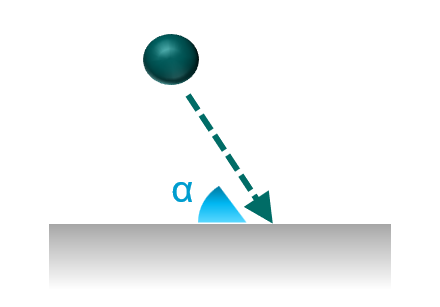
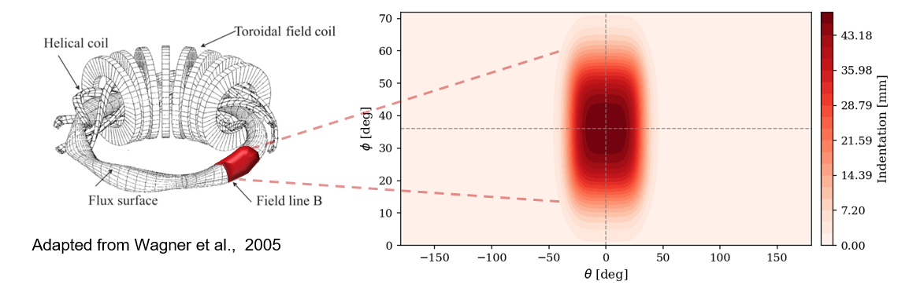
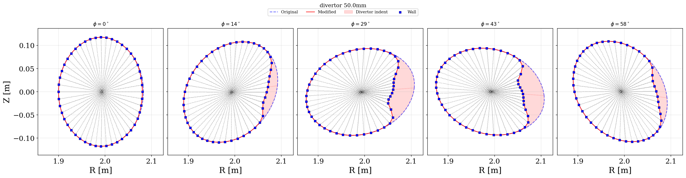
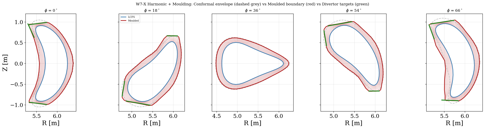

# 运行含偏滤器区域的仿星器模型

与托卡马克模型不同，JOREK 没有内置的仿星器平衡求解器，而是使用 GVEC 的理想 MHD 平衡求解器，并假定磁面嵌套。历史上，这意味着模拟区域被限制在最后闭合磁面（LCFS）以内。要越过 LCFS，通常需要以下两者之一：

1. Dommaschk 势 
2. 由线圈产生的真空场 $\nabla \chi$

更多概念性细节参见 [仿星器](stellarator.md) 页面。本页给出使用含偏滤器的仿星器网格创建并运行模拟所需的最小构成要素。

关于基础的仿星器导入流程（GVEC 到 JOREK 重启文件），请先参见 [运行仿星器模拟](stellarator_setup.md)。

本页所需的最小上下文：
1. 从 `gvec2jorek.dat`（或其修改版本）出发。
2. 运行 model 180 以建立一致的重启状态（`jorek000000.h5`、`jorek000001.h5`）。
3. 将 `jorek000001.h5` 作为 model 183 的 `jorek_restart.h5` 使用。

`USE_EXT_FIELD` 控制仿星器边界诊断／边界条件所用的真空场来源：
1. `USE_EXT_FIELD=0`：使用基于 chi 的路径（`gvec2jorek.dat` 中不需要显式的 `B_vac_*` 数组）。
2. `USE_EXT_FIELD=1`：使用 `gvec2jorek.dat` 中显式的真空场数组（`B_vac_R`、`B_vac_Z`、`B_vac_phi` 及其导数）。

对于需要边界处线圈场拓扑的 W7-X 偏滤器工作流，本页假定 `USE_EXT_FIELD=1`，且 `gvec2jorek.dat` 已包含 `B_vac_*` 数据块。

要在物理上真实地刻画偏滤器物理，当开放磁力线与边界相交时，必须采用**鞘层边界条件**（SBC）来捕捉第一壁附近的动力学。已有成熟且已写入 JOREK 托卡马克模型及其他偏滤器物理代码的主要物理公式指出：对于以角度 $\alpha$ 与边界相交的磁面，有（其中 $\alpha_0$ 可设为例如 5 deg）：

1. **Bohm 判据**：

$$

v_{\parallel} \geq \pm c_s f(\alpha), \quad \alpha = \arcsin\left(\frac{\lvert\hat{n} \cdot \mathbf{B}\rvert}{\Vert\mathbf{B}\Vert}\right), \quad f(\alpha)=\tanh\left(\frac{\alpha}{\alpha_0}\right)

$$

2. 鞘层入口处的**粒子通量**：$\Gamma_n = n \cdot v_{\parallel}$

3. **热流**（单 $T$ 的最简情形）：$q = \gamma \cdot k T_e \Gamma_n$

关于 SBC 及其实现的更多物理细节见 P.C Stangeby (2000), CRC Press 以及 M. Hoelzl et al., Nucl. Fusion 61, 065001 (2021)。仿星器 model 183 现已包含可用的仿星器 SBC 路径，但与托卡马克不同，必须处理强三维、随环向变化的入射角 $\alpha(\theta,\phi)$，并在环向 Fourier 基下一致地表示边界条件目标。




## 简化算例：带人工偏滤器的 W7-A

第一个最小可行的仿星器偏滤器网格示例，在仿星器 Wendelstein 7-A 中引入了一个人工偏滤器凹槽（示意图仅作说明之用）：



所用的凹槽是对边界壳层的平滑径向内移，深度参数为 $d$（此处 $d=50$ mm，属较极端的测试情形）。对这一人工 W7-A 测试偏滤器，凹槽区块可解析地描述为：

$$
\Delta r(\theta,\phi) = d\,\frac{f_\theta(\theta)\,f_\phi(\phi)}{\sqrt{\cos^2\theta + \left(\sin\theta/\kappa\right)^2}}
$$

其中 $f_\theta$ 与 $f_\phi$ 是基于平滑函数的 tanh 窗包络：

```python
def tanh_smooth(x, center, width, smooth_width):
    """Smooth envelope: 1 inside [center-width, center+width], 0 outside."""
    left = 0.5 * (1 + np.tanh((x - (center - width)) / smooth_width))
    right = 0.5 * (1 - np.tanh((x - (center + width)) / smooth_width))
    return left * right
```

而 $\kappa$ 为椭圆度因子（本例中 $\kappa=1.5$）。实际处理时，边界节点向内移动 $\Delta r$，内部壳层按从轴（0）到边界（1）的比例缩放。绘制该人工凹槽的示例用法见 [W7-A 凹槽示例图](assets/stellarator_with_divertor/plot_w7a_example_indentation_map.py)。

该 W7-A 步骤中对 Bezier-Hermite 的处理有意保持简单：几何在实空间中修改，一阶／混合导数（`_s`、`_t`、`_st`）则用 `scipy.interpolate.PchipInterpolator` 在径向与极向重新计算（包括极向角上的周期闭合）。这样可避免边界位移后句柄失效。

*待办：待 stellarator_setup.md 完成后，链接到该脚本。*

主要构成见 [modify_w7a_gvec2jorek_to_divertor 脚本](assets/stellarator_with_divertor/modify_w7a_gvec2jorek_to_divertor.py)。输入为原始的 `gvec2jorek.dat` 几何／Fourier 场以及凹槽的几何参数方案，输出为修改后的 `gvec2jorek_divertor_<depth>mm.dat`，随后 model180／model183 按 [仿星器设置](stellarator_setup.md) 的标准流程执行。

该步骤是 W7-A 的首个直接几何凹槽工作流，用于在尚不需要任何膨胀或调和映射之前演示网格修改原理。



## W7-X 偏滤器网格

### 网格构建

#### 在 gvec2jorek.dat 文件中引入真空场 

*该步骤需要 a) 一份可用的 gvec2jorek.dat 平衡文件，以及 b) 来自 W7-X 的 mgrid 文件（包含真空场）。若没有这些文件，请联系 W7-X 团队。*

*待办：若／当以下文件公开可用时，添加链接 1) mgrid_w7x.nc（high_res）、2) gvec2jorek.dat 文件、3) Kisslinger 格式的 W7-X 偏滤器文件。*

真空场的添加方式是：在 JOREK 通量网格上采样 W7-X mgrid 线圈场，变换为环向 Fourier 模，并把 `B_vac_*` 数据块追加到 `gvec2jorek.dat`。参考脚本为 [w7x_mgrid2bvac](assets/stellarator_with_divertor/w7x_mgrid2bvac.py)。该脚本大致执行以下步骤：

1. 将现有 `gvec2jorek.dat` 读入网格几何 `R(s,theta,phi), Z(s,theta,phi)`
2. 在柱坐标网格上按线圈组将 `mgrid_w7x.nc` 读入 `B_vac(R,Z,phi)`，并按 `EXTCUR` 权重叠加各线圈贡献
3. 对 mgrid 的 `B(R,Z,phi)` 插值
4. 在 phi 方向作 Fourier 变换
5. 将 `B_vac_R/Z/phi`（含 `_s`、`_t`、`_st`）写入 gvec2jorek.dat

请注意：mgrid 文件与 `EXTCUR` 取值必须与生成目标平衡所用的磁位形一致（否则导入的真空场拓扑将不一致）。此外，在 jorek model 180／183 的编译中必须设 `USE_EXT_FIELD=1` 才能包含真空场。

#### 调和映射

调和映射——由两个调和坐标函数定义，通过求解两个带 Dirichlet 边界条件的 Laplace 方程构造——为强非轴对称几何构造光滑的嵌套延伸壳层：在每个环向平面上求解映射问题，然后重建环向一致的 Fourier 表示。该方法可减少几何畸变，并有助于在延伸过程中保持雅可比为正，细节见 Robert Babin et al., Plasma Phys. Control. Fusion 67 (2025) 035005。

在 [`w7x_extend_grid_harmonic.py`](assets/stellarator_with_divertor/w7x_extend_grid_harmonic.py) 中，步骤 1 为调和映射阶段：对每个环向平面，将 LCFS 映射到一个附加的共形包络，然后在所有平面上变换回 Fourier 模。

#### 偏滤器成形

在同一脚本中，步骤 2 为偏滤器成形：由射线与偏滤器靶板段的交点构造位移／缩放场，然后用平滑的角度渐变（`DIVERTOR_SMOOTH_DEG`、`PHI_TAPER_DEG`）与安全边界（`SCALE_MIN`、`SCALE_MAX`）将延伸壳层朝这些靶板重新缩放，以保持网格规则。

下图给出所构造网格一路延伸至偏滤器表面的输出示例图（同时标出了原始 LCFS，其内部网格基本未改动）：


