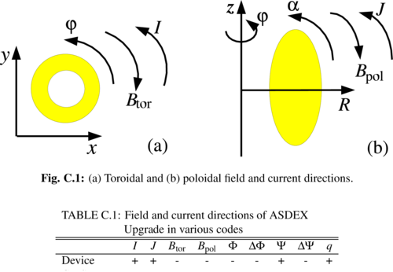
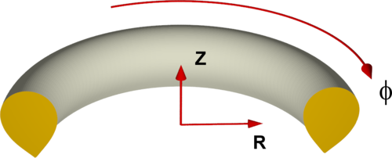
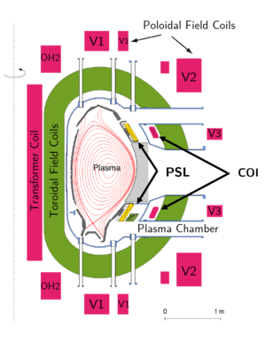

# 模拟 ASDEX Upgrade 的相关信息
<!-- 部分特定测试算例另见 [ASDEX Upgrade JOREK Wiki](asdex_upgrade_wiki)（**旧版**） -->

ASDEX Upgrade 中的标准符号在 JOREK 中对应如下：

```
F0       > 0
Psi_axis < Psi_xpoint
```

## Erika Strumberger 的概述

<!-- {: width="500"} -->


## JOREK 坐标系

<!-- {: width="500"} -->


## 平衡

<!-- ### cliste2jorek 脚本 -->

<!-- - [cliste2jorek 脚本](cliste2jorek_script) 从 ASDEX Upgrade 的 shotfile 中提取平衡信息供 JOREK 使用。 -->

### NEMEC 平衡的转换

- 取 Cotrans mode0 的 $J_{pol}$（`xm_jpol_spol`）$\rightarrow$ 由它按下方公式计算 $FF'$，并做拟合使之平滑
- $\Delta\Psi_\text{NEMEC}$ 在 NEMEC 坐标下即 $\Psi_{bnd} - \Psi_{axis}$
- 符号可能需要修正（见上）

$$
\begin{align}
F &= \frac{\mu_0}{2\pi}\; J_{pol} \\
\Psi_\text{JOREK} &= \frac{1}{2\pi}\;\Psi_\text{NEMEC} \\
F' &= \frac{\partial F}{\partial\Psi_\text{JOREK}} = \frac{\partial F}{\partial\Psi_N}\underbrace{\frac{\partial\Psi_N}{\partial\Psi_\text{JOREK}}}_{=1/(\Delta\Psi_\text{JOREK})} = \frac{2\pi}{\Delta\Psi_\text{NEMEC}}\;\frac{\partial F}{\partial\Psi_N} \\
FF' &= \frac{2\pi}{\Delta\Psi_\text{NEMEC}}\;\frac{\mu_0^2}{4\pi^2}J_{pol}\frac{\partial J_{pol}}{\partial\Psi_N} = \frac{\mu_0^2}{2\pi\Delta\Psi_\text{NEMEC}}\;J_{pol}\frac{\partial J_{pol}}{\partial\Psi_N}
\end{align}
$$

### 测试用简化平衡

- [测试用简化平衡](asdex_upgrade_simplified-equilibria-for-tests)
- [大长径比撕裂模基准算例](asdex_upgrade_large-aspect-ratio-tearing-mode-benchmark)
- [简化 X 点撕裂模测试算例](asdex_upgrade_simplified-x-point-tearing-mode-test-case)

## 线圈几何

### PF 线圈
STARWALL 所用的线圈几何取自 Mike Dunne 提供的装置描述文件，其中包含全部 PF 线圈。

该 tar 文件包含原始装置描述文件、AUG 导电结构的几何、真空室几何、供 STARWALL 使用的 PF 线圈（以细丝表示）、PSL 的厚带模型（曾与 CASTOR3D 做过基准比对），以及一个 STARWALL 示例输入文件：
[aug_freeb_input.tar](assets/asdex_upgrade/aug_freeb_input.tar)
<!-- [aug_freeb_input.tar](https://www.jorek.eu/wiki/lib/exe/fetch.php?media=aug_freeb_input.tar) -->

PF 线圈的几何（下图中以品红色标出）以及装置描述文件的说明另见 [pf coils](asdex_upgrade_pf-coils-cliste)。

<!-- {: width="300"} -->


特定 shot 的线圈电流可由 cliste 直接从 shotfile 中提取。自由边界平衡过程中使用 V2 线圈做反馈。
在模拟中使用[控制器](active_controller_model_for_vertical_stabilization)进行主动稳定时，CoI 线圈像实验中一样用于快速反馈。

<!-- [以 ascii 与 sw 输入形式给出的线圈供电](https://www.jorek.eu/wiki/lib/exe/fetch.php?media=aug_feeding.tar.gz) -->
线圈供电由 I. Zammuto 提供，并转换为 STARWALL 数据。
OH2o 与 OH2u 线圈接在 OH 供电上，同时另有独立输入。

```
1. +OH1
2. -OH1 > +OH2o
3. -OH2o > +OH2u
4. -OH2u > +OH3u
5. -OH3u > +OH3o
6. -OH3o
The OH2 coils get additional currents (in fact they have additional feeders, the reserve in the mesh file):
1. the OH2o has the current IOH+dIOH2s and
2. the OH2u has the current IOH+dIOH2s+dIOH2u 
All these feedings are included in the OH file.
The V1+V2 coils consist of two different circuits each, so there is also a line connecting the two circuits.
```

<!-- # RMP 线圈

- [R. Nazikian 的幻灯片 16-07-2015](assets/asdex_upgrade/nazikian_ipp_07152015.pdf) -->

## 文献
- [ELM 物理文献](asdex_upgrade_literature_on_elm_physics)
- [破裂物理文献](asdex_upgrade_literature_on_disruption_physics)
