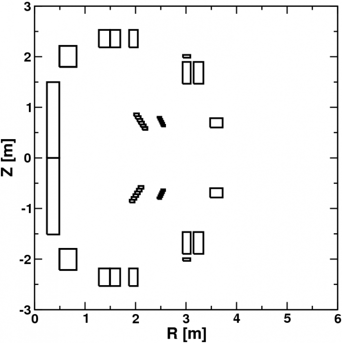

# PF 线圈

**E-Mail 2.3.2016：**

*下面是我从 AUG 的 MachineDescription 文件中抄出的行——它并不好读，但我也想不出更好的呈现方式。第一块只是线圈名称，第二块是随后两段描述中"有效"段的数目。第三块是每个"段"的匝数——这些划分在我看来相当随意，不过是为了让每段既不太大、也不呈非矩形。它是一个 18x6 的数组，对应 18 个线圈、每个线圈最多 6 段——很多线圈的段数更少。最后一块则更复杂：18 行 x 6 段 x 每段 4 个数据点，给出各段的 R、z、dr、dz，匝数取自第三块数据。*

*若不清楚请告诉我——这些内容确实不容易看明白。如果是从 shotfile 中读取线圈数据，则电流只是在所有匝之间平均分配。*

*Mike*

**线圈顺序：**

```
'V1o', 'V1u', 'V2o', 'V2u', 'V3o', 'V3u', 'PSLu', 'PSLo', 'Coio', 'Coiu', 'OHo', 'OHu', 'PSLQuhi', 'PSLQulo', 'PSLQolo', 'PSLQohi', 'OH2o', 'OH2u'
```

**下方给出非零取值的段数：**

```
3, 3, 2, 2, 1, 1, 6, 6, 5, 5, 3, 3, 3, 3, 3, 3, 1, 1
```

**每段匝数，每行一个导体：**

```
35.0000, 31.0000, 27.0000, 0.0000, 0.0000, 0.0000,
35.0000, 31.0000, 27.0000, 0.0000, 0.0000, 0.0000,
39.0000, 47.0000, 0.0000, 0.0000, 0.0000, 0.0000,
39.0000, 47.0000, 0.0000, 0.0000, 0.0000, 0.0000,
28.0000, 0.0000, 0.0000, 0.0000, 0.0000, 0.0000,
28.0000, 0.0000, 0.0000, 0.0000, 0.0000, 0.0000,
0.16667, 0.16667, 0.16667, 0.16667, 0.16667, 0.16667,
0.16667, 0.16667, 0.16667, 0.16667, 0.16667, 0.16667,
1.0000, 1.0000, 1.0000, 1.0000, 1.0000, 0.0000,
1.0000, 1.0000, 1.0000, 1.0000, 1.0000, 0.0000,
255.0000, 81.000, 5.0000, 0.0000, 0.0000, 0.0000,
255.0000, 81.000, 5.0000, 0.0000, 0.0000, 0.0000,
0.50000, 0.3660, 0.1340, 0.0000, 0.0000, 0.0000,
0.1340, 0.3660, 0.5000, 0.0000, 0.0000, 0.0000,
0.50000, 0.3660, 0.1340, 0.0000, 0.0000, 0.0000,
0.1340, 0.3660, 0.5000, 0.0000, 0.0000, 0.0000,
81.0000, 0.0000, 0.0000, 0.0000, 0.0000, 0.0000,
81.0000, 0.0000, 0.0000, 0.0000, 0.0000, 0.0000
```

**段信息（R、z、dr、dz，每行一个导体）：**

```
1.3836,2.3582,0.2182,0.3463, 1.5979,2.3582,0.1985,0.3463, 1.9572,2.3582,0.1724,0.3463,0.00,0.00,0.00,0.00,0.00,0.00,0.00,0.00, 0.00,0.00,0.00,0.00,
1.3816,-2.3583,0.2178,0.3466, 1.5956,-2.3583,0.1981,0.3466, 1.9562,-2.3583,0.1720,0.3466,0.00,0.00,0.00,0.00,0.00,0.00,0.00,0.00, 0.00,0.00,0.00,0.00,
3.0110,1.6815,0.1590,0.4310, 3.2462,1.6815,0.1945,0.4310, 0.00, 0.00, 0.00, 0.00, 0.00, 0.00, 0.00, 0.00, 0.00, 0.00, 0.00, 0.00, 0.00,0.00,0.00,0.00,
3.0120,-1.6815,0.1590,0.4310, 3.2458,-1.6815,0.1945,0.4310,0.00, 0.00, 0.00, 0.00, 0.00, 0.00, 0.00, 0.00, 0.00, 0.00, 0.00, 0.00, 0.00,0.00,0.00,0.00,
3.5995,0.6937,0.2479,0.1836, 0.00, 0.00, 0.00, 0.00, 0.00, 0.00, 0.00, 0.00, 0.00, 0.00, 0.00, 0.00, 0.00, 0.00, 0.00, 0.00, 0.00,0.00,0.00,0.00,
3.6001,-0.6914,0.2480,0.1836, 0.00, 0.00, 0.00, 0.00, 0.00, 0.00, 0.00, 0.00, 0.00, 0.00, 0.00, 0.00, 0.00, 0.00, 0.00, 0.00, 0.00,0.00,0.00,0.00,
2.109, -0.583, 0.096, 0.054, 2.074, -0.637, 0.096, 0.054, 2.038, -0.691,  0.096, 0.054, 2.003, -0.745, 0.096, 0.054, 1.967, -0.799, 0.096, 0.054,  1.932, -0.853, 0.096, 0.054,
2.1845, 0.583, 0.095, 0.054, 2.1515, 0.637,  0.095, 0.054, 2.1185, 0.691, 0.095, 0.054, 2.0855, 0.745, 0.095, 0.054,  2.0525, 0.799, 0.095, 0.054, 2.0195, 0.853, 0.095, 0.054,
2.5480,0.6380,0.0750,0.0320, 2.5293,0.6775,0.0750,0.0320, 2.5105,0.7170,0.0750,0.0320, 2.4918,0.7565,0.0750,0.0320, 2.4730,0.7960,0.0750,0.0320, 0.00,0.00,0.00,0.00,
2.5463,-0.6380,0.0750,0.0320, 2.5276,-0.6775,0.0750,0.0320, 2.5088,-0.7170,0.0750,0.0320, 2.4901,-0.7565,0.0750,0.0320, 2.4713,-0.7960,0.0750,0.0320,0.00,0.00,0.00,0.00,
0.3685, 0.7490,0.2450,1.4980, 0.6610, 2.0073, 0.3380, 0.4145, 3.0119, 2.0081, 0.1458, 0.0528, 0.00, 0.00, 0.00, 0.00, 0.00, 0.00, 0.00, 0.00, 0.00,0.00,0.00,0.00,
0.3685,-0.7570,0.2450,1.5140, 0.6610,-2.0073, 0.3380, 0.4145, 3.0112,-2.0086, 0.1458, 0.0528, 0.00, 0.00, 0.00, 0.00, 0.00, 0.00, 0.00, 0.00, 0.00,0.00,0.00,0.00,
2.109, -0.583, 0.096, 0.054, 2.074, -0.637, 0.096, 0.054, 2.038, -0.691,  0.096, 0.054, 0.00, 0.00, 0.00, 0.00, 0.00, 0.00, 0.00, 0.00, 0.00,0.00,0.00,0.00,
2.003, -0.745, 0.096, 0.054, 1.967, -0.799, 0.096, 0.054,  1.932, -0.853, 0.096, 0.054, 0.00, 0.00, 0.00, 0.00, 0.00, 0.00, 0.00, 0.00, 0.00,0.00,0.00,0.00,
2.1845, 0.583, 0.095, 0.054, 2.1515, 0.637,  0.095, 0.054, 2.1185, 0.691, 0.095, 0.054, 0.00, 0.00, 0.00, 0.00, 0.00, 0.00, 0.00, 0.00, 0.00,0.00,0.00,0.00,
2.0855, 0.745, 0.095, 0.054,  2.0525, 0.799, 0.095, 0.054, 2.0195, 0.853, 0.095, 0.054, 0.00, 0.00, 0.00, 0.00, 0.00, 0.00, 0.00, 0.00, 0.00,0.00,0.00,0.00,
0.6610,2.0072,0.3380,0.4145, 0.00, 0.00, 0.00, 0.00, 0.00, 0.00, 0.00, 0.00, 0.00, 0.00, 0.00, 0.00, 0.00, 0.00, 0.00, 0.00, 0.00,0.00,0.00,0.00,
0.6610,-2.0072,0.3380,0.4145, 0.00, 0.00, 0.00, 0.00, 0.00, 0.00, 0.00, 0.00, 0.00, 0.00, 0.00, 0.00, 0.00, 0.00, 0.00, 0.00, 0.00,0.00,0.00,0.00
```

<!-- - [aug-pf-coils.tar.gz](assets/asdex_upgrade/aug-pf-coils.tar.gz) -->


