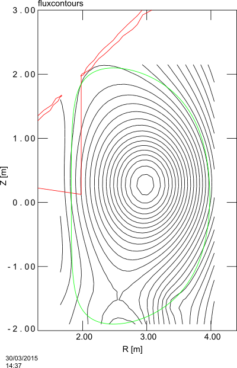
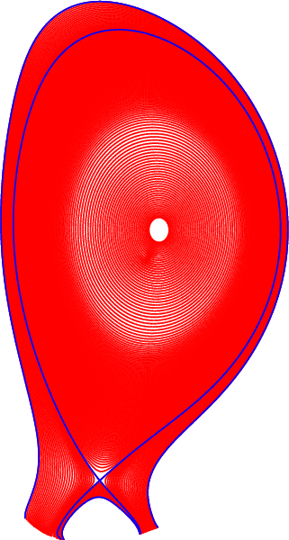
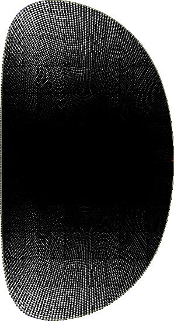
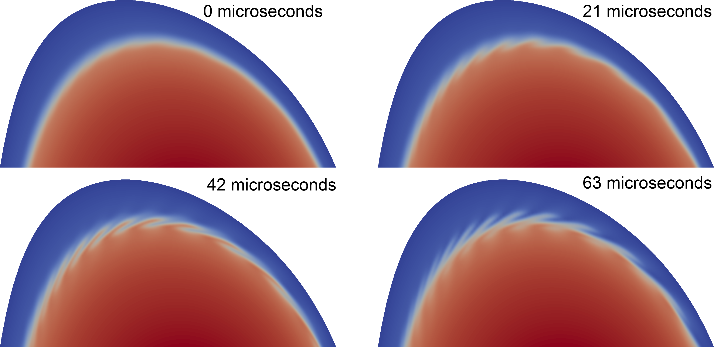

# JET ELM 教程
最常见的算例之一是 JET ELM。
本页说明在集群上成功运行该算例所需的步骤。

## 准备工作
首先须按[编译](../compiling/compilation_and_libraries/compiling.md)中的说明编译出可用的 JOREK 版本。本教程其余部分使用 model 303。
运行该模拟需要编译两个不同的可执行文件。
第一个用于计算平衡，采用环向对称。
第二个具有该测试算例所需的 Fourier 模数。
这些是[硬编码参数](../compiling/compilation_and_libraries/hard-coded_parameters.md)，必须在编译时设定。

若模拟耗时过长，请检查 `Makefile.inc`，去掉调试标志和额外检查。
### 平衡计算用可执行文件
首先把硬编码参数设为计算平衡所需的值。

```bash
./util/config.sh model=303 n_tor=1 n_period=1 n_plane=1
make clean
make -j4
mv jorek_model303 jorek_model303_equil
```
这会生成名为 `jorek_model303` 的可执行文件，并将其重命名为 `jorek_model303_equil`。

### 模拟用可执行文件
正式计算要使用更多谐波。

```bash
./util/config.sh model=303 n_tor=3 n_period=10 n_plane=8
make clean
make -j4
```
该可执行文件可以保留原名。

## 运行模拟
该模拟由三步组成。第一步计算平衡（求解 Grad-Shafranov 方程），第二步计算含流动的平衡，最后一步以指定数目的谐波计算解。

所需输入文件可从 [jet_tutorial.zip](assets/jet/jet_tutorial.zip) 获取。
其中含 3 个输入文件，分别对应模拟的不同阶段。
这些文件由程序 `eqdsk2jorek.f90` 从 `eqdsk` 文件生成，两者都包含在压缩包内。下图给出平衡磁通等值线（线性插值）的绘图。



这些文件之间的重要差异在下面标出，其余内容大多相同。
参数清单及其含义见[运行 JOREK](../compiling/running.md)。
### 平衡
计算平衡的做法是在输入文件 `in_jet_equil` 中设置以下参数

```text
restart = .f.
nstep   = 0
```
这告诉 JOREK 针对该输入文件中的其他参数计算一个新的平衡。
随后即可用 `jorek_model303_equil` 计算平衡并保存到 `jorek_restart.h5`

### 含流动的平衡
要加入流动，只需在文件 `in_jet_n0` 中设定非零的时间步数与时间步长。
为保证数值稳定性，须从小时间步开始并逐步增大。

```text
restart = .t.
tstep_n = 0.01, 0.1, 1., 2.,  5.
nstep_n =   25,  25, 50, 50, 450,
```
这里同样用 `jorek_model303_equil` 计算该平衡。
本教程把这一部分称作 $n=0$ 模的 `n0` 阶段。

### 完整模拟
该模拟只需在文件 `in_jet` 中设定单一时间步长，并模拟 2000 步。

```text
restart = .t.
tstep   = 5.
nstep   = 2000
```
用 `jorek_model303` 完成。

### 提交到批处理节点
zip 文件中含两个便捷脚本。第一个用于在 n=0 模下计算平衡（先不含流动，再含流动）。
先在该文件中改好你的邮箱地址，再把队列、节点数与进程数调整为适合你的计算系统的取值，然后运行

```bash
./launch_jet_equil.sh
```

`launch_jet_equil.sh` 的第一行是 `#!/bin/sh`。可能需要改成 `#!/bin/bash`。`launch_jet_run.sh` 同理。

这些作业完成后，可用以下命令启动 ELM 计算

```bash
./launch_jet_run.sh
```


若运行 `./launch_jet_equil.sh` 时系统回复 `Permission denied`，请运行 `chmod u+x launch_jet_equil.sh`。
`./launch_jet_run.sh` 同理。

### 重启模拟

把模拟延长到更长的模拟时间，最简单的做法是把最后一个重启（`.h5`）文件复制为 `jorek_restart.h5`，然后重新运行 JOREK。

```bash
cp jorekXXXXX.h5 jorek_restart.h5
./launch_jet_run.sh
```

### 查看输出
可用以下命令查看输出

```bash
tail --retry -n 20 -f jet_{equil,n0,run}.{err,out}
```
该命令会持续等待这些文件出现，并打印其中的新增内容。

## 输出
平衡计算会生成文件 `jorek2.ps`，其中含网格与磁面的绘图。
如下所示。




输出文件可用 jorek2vtk(.sh) 转换，再用 paraview 处理成动画（例如 [jorek_jet.mp4](assets/jet/jorek_jet.mp4)）。下图给出某个极向截面上的密度。


