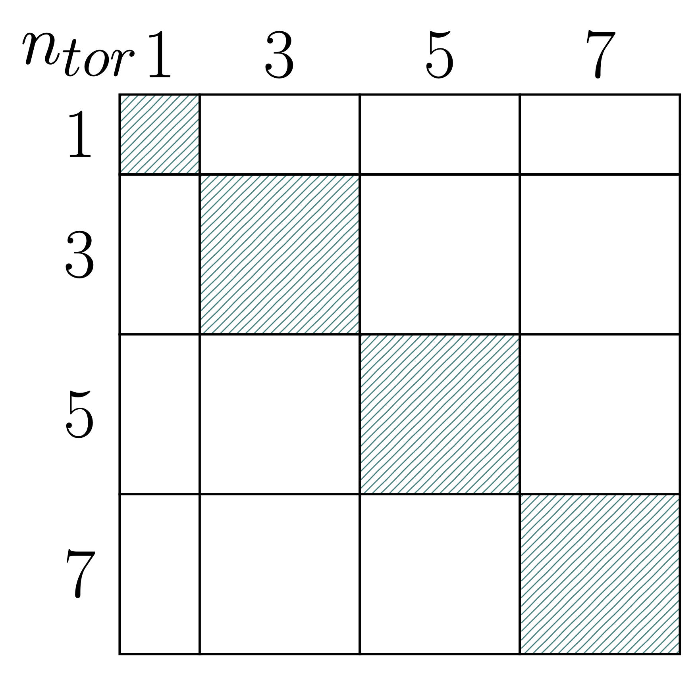
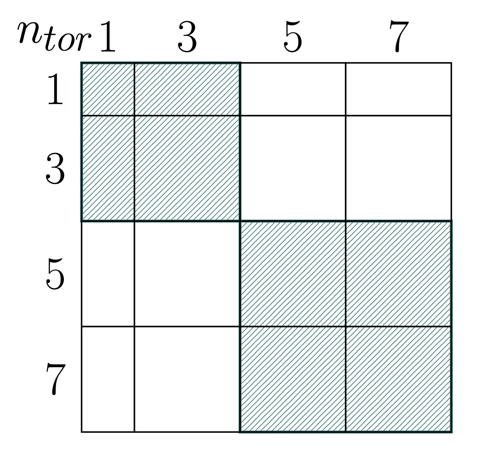

# JOREK 求解器
JOREK 实现的隐式时间积分格式会导出一个**大型**且**稀疏**的线性系统，其一般形式为

$$A\,x = b.$$

矩阵 $A$ 以分布式块 COO 格式组装（可按需转换为分布式块 CSR 格式），并按**环向傅里叶谐波**与**有限元节点**分块。求解器基础设施在分解层面与预条件层面都利用了这种块结构。

支持两种高层求解策略：

| | **直接求解** | **迭代求解** |
|---|---|---|
| 输入开关 | `gmres = .false.` | `gmres = .true.` |
| 方法 | $A$ 的稀疏 LU 分解 | GMRES（或 BiCGSTAB）加块预条件器 |
| 优势 | 稳健；对条件数不敏感 | 内存占用更低；可扩展到大规模问题 |
| 劣势 | 内存与填充元增长迅速 | 收敛性依赖预条件器 |
| 典型用途 | 中小规模问题 | 大规模／生产算例 |

两种策略都支持多种第三方库作为后端，并可选择将矩阵—向量乘积卸载到 GPU 硬件上执行。

主入口为
`solvers/mod_sparse.f90` 中的 `solve_sparse_system()`。

---

## 直接求解器

当输入文件中 `gmres = .false.` 时，系统被直接交给所支持的某个稀疏直接法依赖库。该库在编译期通过编译标志（`USE_MUMPS`、`USE_PASTIX`、`USE_STRUMPACK`）选择，在运行期通过相应的 `use_*` 输入开关选择。


> <b><font color="red">提示</font></b>：
> 大型稀疏矩阵的分解是开销很大的操作，会产生大量填充元，从而提高内存需求。因此，多数情况下建议使用**迭代求解器**！

---

## 迭代求解器

当 `gmres = .true.` 时，使用 Krylov 迭代方法，并由下一节介绍的**块谐波预条件器**做预条件。

### GMRES

左预条件重启 GMRES 实现在 `solvers/mod_gmres.f90` 中。（部分分支中提供了更现代的实现在 `solvers/mod_gmres2.f90` 中）。

该算法把预条件器 $M^{-1}$ 同时施加到初始残差和每个新的 Krylov 向量上。正交化由 Gram–Schmidt 变体完成（经典或修正版本，是否重正交在编译期控制）。Givens 旋转就地将上 Hessenberg 矩阵保持为三角形式。每次重启之后，解按 $x \leftarrow x + V y$ 更新，其中 $y$ 在当前 Krylov 子空间上极小化预条件后的残差。

当

$$\frac{\|r_k\|}{\|r_0\|} < \texttt{gmres_tol}$$

成立，或绝对残差降到次级阈值以下时，判定为收敛。

关键输入参数：

| 参数 | 默认值 | 说明 |
|---|---|---|
| `gmres_m` | 40 | 重启维数 |
| `gmres_max_iter` | 400 | 外部（重启）迭代的最大次数 |
| `gmres_tol` | — | 相对残差容差 |

### BiCGSTAB

BiCGSTAB（位于 `solvers/mod_bicgstab.f90`）是一种替代方案，它无需重启，内存占用为 $O(n)$ 且与迭代次数无关。它**每次迭代施加两次**预条件器（一次用于搜索方向，一次用于稳定化因子），因此单步开销高于 GMRES，但避免了重启开销。在编译期用 `USE_BICGSTAB` 预处理宏启用。

> <b><font color="red">提示：</font></b> 通常不建议使用 BiSCSTAB。

---

## 预条件器

**预条件**在用迭代方法求解线性系统时是必不可少的。JOREK 中 MHD 格式所产生的矩阵条件数极高，若没有合适的预条件器，迭代方法不会收敛。
选择预条件器 $M$，使求解的是修正后的左预条件系统

$$M^{-1}A x = M^{-1}b,$$

其中 $M$ 求逆"便宜"，而 $M^{-1}A$ 是单位阵的相当好的近似。
存在许多"标准"技术，可以在不考虑原始问题的情况下应用于一般系统。这些技术当然具有"即插即用"的优点，并在很广的问题范围内表现尚可。但在处理条件数极高的问题时，会发现其中大多数方法效果甚微乃至无效。这类情形需要更深入的研究，构造量身定制的预条件器才能获得良好的收敛。

JOREK 中的_块谐波_预条件器利用 MHD 系统的**环向傅里叶结构**，构造出一个预条件器 $M$，其作用只需在更小的子系统上做彼此独立的稀疏直接求解，每个**模群**一个子系统。

预条件器由 `solvers/mod_preconditioner.f90` 建立并施加。

### 概念

对于纯轴对称几何，环向谐波完全解耦：系统矩阵中模数为 $n$ 的行与模数 $m \ne n$ 的列之间没有耦合。
JOREK 的矩阵确实包含谐波间耦合项（源自系统中的谐波间耦合项），但在许多情况下，占主导的、与物理相关的耦合是谐波内耦合。因此，预条件器 $M$ 的构造方式是**把环向模数分组为模群**，并为每个模群组装一个块对角预条件矩阵，该矩阵保留全部群内耦合、丢弃群间耦合项。随后每个模群由所选直接求解库独立分解。

### 模群分配 {#mode-family-distribution}
环向模数 $0, 1, 2, 3, \ldots$ 被划分为若干模群。有两种策略可用：

- **自动**（`autodistribute_modes = .true.`）：模数 0（轴对称）自成一个模群；其余模数两两配对为 $(n_1, n_2), (n_3, n_4), \ldots$
- **手动**：用户显式指定 `n_mode_families`、`modes_per_family(:)` 和 `mode_families_modes(:,:)`。

#### 重叠模群

手动划分的模群不必构成互不相交的分划：同一个环向模数可以出现在多个模群中。属于某一模群的所有模数之间的耦合都保留在该模群的预条件块中，当重要的谐波间耦合本来会被丢弃时，这可改善 GMRES 的收敛性。

当模群重叠时，它们的解都会对全局解向量的同一批行产生贡献。JOREK 用 `weights_per_family` 中为每个模群指定的因子把这些贡献组合起来。权重应与重叠方式保持一致；在下面的例子中，每个模数属于两个模群，因此每个模群的权重都是 $0.5$：

```fortran
autodistribute_modes = .false.
n_mode_families = 5

modes_per_family = 1, 3, 4, 4, 2
mode_families_modes(1,:) = 1
mode_families_modes(2,:) = 1, 2, 3
mode_families_modes(3,:) = 2, 3, 4, 5
mode_families_modes(4,:) = 4, 5, 6, 7
mode_families_modes(5,:) = 6, 7

weights_per_family = 0.5, 0.5, 0.5, 0.5, 0.5
```

`mode_families_modes` 中的数值是 JOREK 内部使用的、以 1 为基的 `i_tor` 模数索引。增加每个模群中的模数会保留更多原始矩阵耦合，但也会产生更大、分解开销更高的块。

MPI 进程也以同样的方式在各模群之间分配：

- **自动**（`autodistribute_ranks = .true.`）：进程尽可能均匀地分配到各模群。
- **手动**：通过 `ranks_per_family(:)` 指定。

由于各模群的块大小可能差别很大，均分进程可能造成负载不均衡。一个有用的起步经验法则是，按各模群中模数数目的平方大致成比例地分配进程。对于上面五个重叠模群，一种可行的设置为：

```fortran
autodistribute_ranks = .false.
ranks_per_family = 2, 8, 16, 16, 4
```

算例使用的 MPI 进程总数必须等于 `ranks_per_family` 之和。最优分配取决于矩阵结构、直接求解器和机器，因此这一初始分配可能需要调整。

更多细节见 [Holod et al., *Enhanced preconditioner for JOREK MHD
solver*, Plasma Physics and Controlled Fusion **63**, 114002
(2021)](https://iopscience.iop.org/article/10.1088/1361-6587/ac206b)。

<div style="display: flex; justify-content: space-evenly; align-items: flex-start; text-align: center;">
  
  <figure style="width: 30%; margin: 0;">
    
    <figcaption><i>每个块包含单个谐波对</i></figcaption>
  </figure>

  <figure style="width: 31.5%; margin: 0;">
    
    <figcaption><i>分组后的谐波模群</i></figcaption>
  </figure>

</div>

### 预条件器求解流程

每次 GMRES／BiCGSTAB 施加预条件器都执行以下步骤：

1. **散射右端项**——从全局残差向量中取出属于本模群的行（通过预先计算好的 `row_index` 映射）。
2. **求解**——该模群的直接求解器（MUMPS／PaStiX／STRUMPACK）分解新的矩阵或复用已有分解，并针对本地右端项求解预条件矩阵。
3. **收集解**——所有模群的贡献通过 `MPI_AllReduce`（求和）归约进全局解向量；每个模群的行按 `row_factor` 加权（通常为 1；对手动定义的模群则由 `weights_per_family` 设定）。

### 分解复用

在每个时间步都重新分解预条件器开销很大。因此，可以在多个时间步上复用已分解的预条件矩阵，此时它们仍能给出线性系统的良好近似。JOREK 在下列条件下复用已有分解（`solve_only` 路径）：

$$\texttt{iter_gmres} + \texttt{iter_prev} \le 2 \times \texttt{iter_precon}
\quad \text{and} \quad
\texttt{n_since_update} < \texttt{max_steps_noUpdate}$$

其中 `iter_precon` 与 `max_steps_noUpdate` 是输入参数。当两个条件都不满足时，预条件矩阵会被重新组装并重新分解。

### 预条件矩阵组装

有两种组装策略可用（由编译期标志 `DIRECT_CONSTRUCTION` 选择）：

- **直接构造**：每个 MPI 进程直接在有限元层面组装其所属的那部分预条件矩阵，不经过分发步骤。
- **分布式构造**：完整系统矩阵通过 `MPI_ALLTOALLV` 传送到拥有各模群的进程组，这些进程组再在本地提取各自的行。

---

## PETSc 集成

> **说明：** 基于 PETSc 的求解路径正在积极开发中。
> 待实现稳定后，本节将予以扩充。

使用 `USE_PETSC` 编译时，可使用一条替代求解路径，它借助 PETSc 的 KSP 框架进行直接求解与迭代求解。PETSc 集成层位于 `solvers/mod_petsc.f90`，对外提供：

- 跨越时间步持续复用的一个持久 `KSP` 上下文。
- 可由 JOREK 原生 BCSR 数据填充的 MPIBAIJ 系统矩阵。
- 以 PETSc `PCSHELL` 或 `PCFIELDSPLIT` 对象实现的插件式预条件器。

基于 PETSc 的预条件器及其配置的细节将另行说明。

---

## 延伸阅读

#### JOREK 求解器与数值方法
- Y. Saad, *Iterative Methods for Sparse Linear Systems*, 2nd ed., SIAM (2003). [可向作者免费获取。](https://www-users.cse.umn.edu/~saad/IterMethBook_2ndEd.pdf)
- T. A. Davis, *Direct Methods for Sparse Linear Systems*, SIAM (2006).
- I. Holod *et al.*, "Enhanced preconditioner for JOREK MHD solver," arXiv:2101.08646 (2021).
- A. Quinlan, V. Dwarka, I. Holod, M. Hoelzl, "Towards Robust Solvers for Nuclear Fusion Simulations Using JOREK: A Numerical Analysis Perspective," arXiv:2308.16124 (2023).

#### 直接求解器后端
- **MUMPS** — [mumps-solver.org](https://mumps-solver.org/)
- **PaStiX** — [solverstack.gitlabpages.inria.fr/pastix](https://solverstack.gitlabpages.inria.fr/pastix/)
- **STRUMPACK** — [portal.nersc.gov/project/sparse/strumpack](https://portal.nersc.gov/project/sparse/strumpack/)
- **PETSc** — [petsc.org](https://petsc.org/)
