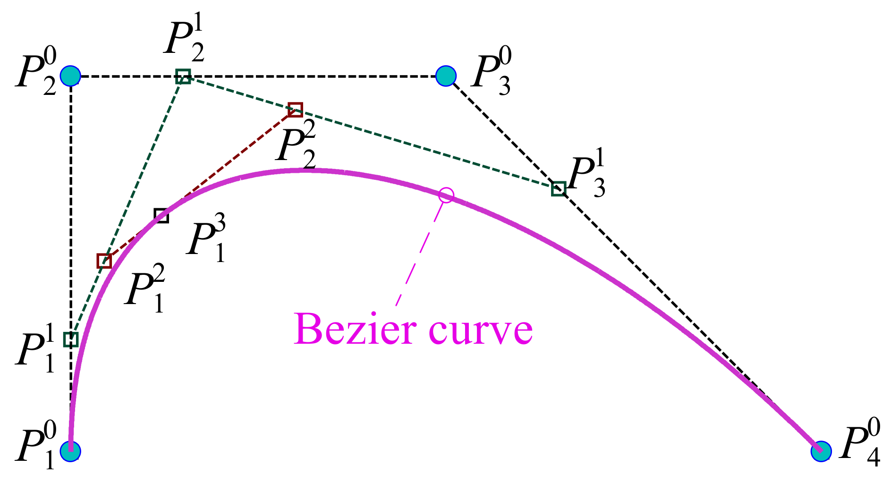
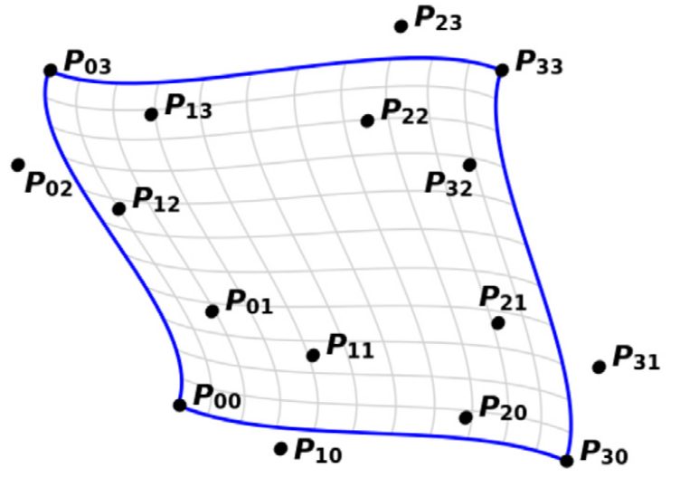

# 警告：仍在撰写中
Giacomo 正在编写本页内容

# JOREK 中的空间离散

JOREK 的离散方法在两篇论文中有详尽描述：[O. Czarny, G. Huysmans, J.Comput.Phys 227, 7423 (2008)](https://www.sciencedirect.com/science/article/pii/S0021999108002118) 与 [S. Pamela et al. J. Comput. Phys. 464, 111101 (2022)](https://www.sciencedirect.com/science/article/pii/S0021999122001632?via%3Dihub)。此处概述其中最重要的方面以及代码实现。

如[此处](http://localhost:4000/doc_repo/docs/physics/coordinates.html)所详尽说明，JOREK 使用柱坐标 $(R,Z,\phi)$。极向平面（变量 $R$ 与 $Z$）上的离散采用二维贝塞尔有限元，将在[下一节](#2d-bezier-finite-elements-in-the-poloidal-plane)讨论；而沿环向（变量 $\phi$）的离散则由截断的实傅里叶级数完成，详见[本节](#real-fourier-series-in-toroidal-direction)。

两种离散结合后写成：

$$
\mathbf{X}(R,Z,\phi) = \left(\sum_{l=1}^{N_{tor}} Z_l(\phi) \left (\sum_{i = 1}^{N_{vert}}\sum_{j = 1}^{\text{dof_per_vertex}} h^{ij} \vec{u}^{ij} b^*_{i,j}(R,Z)\right) \right ) \tag{1}
$$

内层括号为极向离散，使用基函数 $b^*_i$；$Z_l$ 则是环向离散的基函数。

## 极向平面上的二维贝塞尔有限元 
JOREK 在极向平面 $RZ$ 上使用等参 Gm 连续的贝塞尔有限元进行空间离散。它不把控制点当作"直接"自由度，而是采用另一种表述，称为*节点表述*（nodal formulation，见[此处](#bezier-finite-element-nodal-representation)），这大大便于在多个有限元之间施加 Gm 连续性。等参与 Gm 连续（$m\in \mathbb{N}$）的含义随后说明。

关于贝塞尔曲线、贝塞尔曲面的概览，以及如何由此过渡到贝塞尔有限元的概念，参见[附录 A](#appendix-a-introduction-on-bezier-curves-and-bezier-surfaces)

我们采用参数 $s,t\in [0,1]$ 作为贝塞尔有限元的局部坐标，于是单个 $n$ 次贝塞尔有限元上的离散写成

$$
X_\text{pol}(s,t) = \sum_{i=0}^{n}\sum_{j=0}^{n} \mathbf{P}_{ij} B_i^n(s)B_j^n(t) \tag{2}
$$

其中 $B_i^n$ 与 $B_j^n$ 为 Bernstein 多项式，$P_{ij}$ 为曲面的控制点。

如下一节所述，式 $(2)$ 可改写为更便利的形式，即：

$$
X_\text{pol}(s,t) = \sum_{i=0}^{N_\text{vert}-1} \sum_{j=0}^{\text{dof_per_vertex}} h^{ij} \vec{u}^{ij} b_i(s,t)
$$

需要注意，该表述仅在*单个*有限元内部成立。

形式上它可以推广到多个单元，从而在 $(R,Z)$ 与 $(s,t)$ 之间建立映射，而这一映射本来就是必需的。……（此处待完成）

### 贝塞尔有限元的节点表述 {#bezier-finite-element-nodal-representation}
JOREK 对有限元采用一种特殊的表述。具体而言，控制点按其靠近哪个插值点分成 $4$ 组。当次数 $n$ 为奇数时，每组有 $(n+1)^2/4$ 个点。
为每个插值点（每个*节点*）指定一组向量基（这才是真正的自由度！），控制点则改写为这些向量的组合。

本节其余部分给出双三次贝塞尔有限元的示例，它是 JOREK 中使用最多的有限元。
接着讨论 JOREK 中实现的、适用于任意次数（不限于双三次）的**广义节点表述**，并
说明在该表述下施加 $G_m$ 连续性更为简单。
最后简要说明为何选择这一特定表述，以及它的意义所在。

#### 双三次贝塞尔有限元的节点表述
对双三次贝塞尔有限元，Bernstein 多项式基是三次 Bernstein 多项式基的张量积。

控制点如下图所示分成 4 组。

$$
\begin{matrix}
30      &&& 31      &&& 21      &&& 20 \\
\bullet &&& \bullet &&& \bullet &&& \bullet \\ \\
32      &&& 33      &&& 23      &&& 22 \\
\bullet &&& \bullet &&& \bullet &&& \bullet \\ \\
02      &&& 03      &&& 13      &&& 12 \\
\bullet &&& \bullet &&& \bullet &&& \bullet \\ \\
00      &&& 01      &&& 11      &&& 10 \\
\bullet &&& \bullet &&& \bullet &&& \bullet \\ \\
\end{matrix}
$$

点 $x0$（$x\in \{0,1,2,3\}$）为插值点，其所在组内的其余点为 $xy$，其中 $y\in \{1,2,3\}$。

随后对每组 $i$ 引入向量 $p_i, v_i, u_i$ 与 $w_i$，以及
若干预先定义量 $d_{u,i}$ 和 $d_{v,i}$

$$
\begin{align}
\mathbf{P}_{0,0} &= p_1 \\
\mathbf{P}_{0,1} &= p_1 + v_1\, d_{v,1} \\
\mathbf{P}_{1,0} &= p_1 + u_1\, d_{u,1} \\
\mathbf{P}_{1,1} &= P_{0,1} + P_{1,0} - p_1 + w_1\, d_{u,1}\, d_{v,1} \\ \\
\mathbf{P}_{3,0} &= p_2 \\
\mathbf{P}_{3,1} &= p_2 + v_2\, d_{v,2} \\
\mathbf{P}_{2,0} &= p_2 + u_2\, d_{u,2} \\
\mathbf{P}_{2,1} &= P_{3,1} + P_{2,0} - p_2 + w_2\, d_{u,2}\, d_{v,2} \\ \\
\mathbf{P}_{3,3} &= p_3 \\
\mathbf{P}_{3,2} &= p_3 + v_3\, d_{v,3} \\
\mathbf{P}_{2,3} &= p_3 + u_3\, d_{u,3} \\
\mathbf{P}_{2,2} &= P_{2,3} + P_{3,2} - p_3 + w_3\, d_{u,3}\, d_{v,3} \\ \\
\mathbf{P}_{0,3} &= p_4 \\
\mathbf{P}_{0,2} &= p_4 + v_4\, d_{v,4} \\
\mathbf{P}_{1,3} &= p_4 + u_4\, d_{u,4} \\
\mathbf{P}_{1,2} &= P_{0,2} + P_{1,3} - p_4 + w_4\, d_{u,4}\, d_{v,4}
\end{align}
\tag{4}
$$

该表述基于以下工作：[O. Czarny, G. Huysmans, J.Comput.Phys 227, 7423 (2008)](https://www.sciencedirect.com/science/article/pii/S0021999108002118)。

#### 贝塞尔有限元的广义节点表述 {#generalized-nodal-representation-of-bezier-finite-element}
文献 [S. Pamela et al. J. Comput. Phys. 464, 111101 (2022)](https://www.sciencedirect.com/science/article/pii/S0021999122001632?via%3Dihub) 把上一段针对双三次单元给出的结果推广到任意次数 $n$，且通常施加 $m=(n-1)/2$ 的 $G_m$ 连续性。
此时不再使用 $p_i,u_i,v_i,w_i$ 向量，而采用记号 $u_{ij}$ 与 $d_{u,i}$，并配合 $h^{ij}$。例如在双三次情形下有 $u_{i0}:=p_i, u_{i1}:=u_i, ...$。
于是广义表述（仅以节点组 $\mathbf{P}_{00}$ 为例）写成：

$$
\mathbf{P}_{ij} = h^{ij}u^{ij} + \sum_{k=0}^i\sum_{l=0}^i (-1)^{1+i+j+k+l}(1-\delta_{ki}\delta_{lj}) 
\begin{pmatrix}
i \\ k
\end{pmatrix}
\begin{pmatrix}
j \\ l
\end{pmatrix}
\mathbf{P}_{kl}
$$

其中 $0\leq i,j \leq (n+1)/2$

#### <u>在广义节点表述中施加连续性</u>
在 JOREK 中，一个节点（即 $\mathbf{P}\_{00}$）总是由 $4$ 个有限元共有。
设 $\xi_{1,1}, \xi_{-1,1}, \xi_{-1,-1}, \xi_{1,-1}$ 为共有该节点的有限元，按逆时针排列。
于是这些单元在公共节点 $\mathbf{P}\_{00}$ 处各自使用不同的向量集 $u^{ij}$（及取值 $h^{ij}$）作为节点表述。记 $u^{ij}$ 与 $h^{ij}$ 为单元 $\xi_{1,1}$ 所使用的节点表述，$u^{-ij}$ 与 $h^{-ij}$ 为单元 $\xi_{-1,1}$ 的，$u^{i-j}$ 与 $h^{i-j}$ 为单元 $\xi_{1,-1}$ 的，最后 $u^{-i-j}$ 与 $h^{-i-j}$ 为单元 $\xi_{-1,-1}$ 的。

采用上述记号，公共节点上的 $G_m$ 连续性通过施加以下约束得到。

$\forall j, \ \ h^{-ij}$ 受约束于：

$$
h^{-ij} = 
\begin{cases}
-\alpha h^{ij} & \text{for } i = 1 \text{ and } \alpha > 0 \\
h^{ij} & for i \neq 1
\end{cases}
$$

$\forall i, \ \ h^{i-j}$ 受约束于：

$$
h^{i-j} = 
\begin{cases}
-\beta h^{ij} & \text{for } j = 1 \text{ and } \beta > 0 \\
h^{ij} & for j \neq 1
\end{cases}
$$

#### <u>关于该表述的简要直观理解</u>
如 [S. Pamela et al. J. Comput. Phys. 464, 111101 (2022)](https://www.sciencedirect.com/science/article/pii/S0021999122001632?via%3Dihub) 的推论 1 所证明，在所采用的特定节点表述中，向量 $u^{ij}$ 与**导数**在方向与符号上**一致**（数值大小则不然）

$$
\frac{\partial^{i+j} \mathbf{P}}{\partial^{i} s \partial^{j} t}(s=0,t=0)
$$

这一点极为有用，例如在生成网格时，因为构造磁面对齐网格需要用到 $R$ 与 $Z$ 的导数。

### 采用节点表述的离散
采用节点表述时，

### 代码中的实现

### 以下内容仍待整理

由下式定义的二维三阶 Bernstein 多项式 $B_{i,j}^{3}(s,t)$

$$
B_{i,j}^{3}(s,t) = B_{i}^{3}(s)B_{j}^{3}(t)\qquad i,j = 0\ldots 3 \tag{1}
$$

其中

$$
B_{i}^{3}(s) = \frac{3!}{i!(3 - i)!} s^{i}(1 - s)^{3 - i} \tag{2}
$$

用于极向平面上的离散。坐标 $s = 0\ldots 1$ 与 $t = 0\ldots 1$ 构成单元局部坐标系。量 $X$（可以是坐标，也可以是物理变量 $(R,Z,\Psi,T,\ldots$；等参离散）可表示为

$$
X(s,t) = \sum_{i = 0}^{3}P_{i,j}B_{i,j}^{3}(s,t). \tag{3}
$$

由于要求有限元具有一阶连续性，并非控制点 $P_{i,j}$ 的所有组合都有效。实际上，单元中每个节点 $k$ 和每个量 $X$ 只剩四个自由参数 $p_k$、$u_k$、$v_k$ 与 $w_k$。控制点 $P_{i,j}$ 可由这些自由参数按下式重构。节点 $k = 1\ldots 4$ 分别对应位置 $(i,j) = (0,0)$、$(3,0)$、$(3,3)$ 与 $(0,3)$。

$$
\begin{array}{r l}
P_{0,0} &= p_1 \\
P_{0,1} &= p_1 + v_1\, d_{v,1} \\
P_{1,0} &= p_1 + u_1\, d_{u,1} \\
P_{1,1} &= P_{0,1} + P_{1,0} - p_1 + w_1\, d_{u,1}\, d_{v,1} \\
P_{3,0} &= p_2 \\
P_{3,1} &= p_2 + v_2\, d_{v,2} \\
P_{2,0} &= p_2 + u_2\, d_{u,2} \\
P_{2,1} &= P_{3,1} + P_{2,0} - p_2 + w_2\, d_{u,2}\, d_{v,2} \\
P_{3,3} &= p_3 \\
P_{3,2} &= p_3 + v_3\, d_{v,3} \\
P_{2,3} &= p_3 + u_3\, d_{u,3} \\
P_{2,2} &= P_{2,3} + P_{3,2} - p_3 + w_3\, d_{u,3}\, d_{v,3} \\
P_{0,3} &= p_4 \\
P_{0,2} &= p_4 + v_4\, d_{v,4} \\
P_{1,3} &= p_4 + u_4\, d_{u,4} \\
P_{1,2} &= P_{0,2} + P_{1,3} - p_4 + w_4\, d_{u,4}\, d_{v,4}
\end{array}
\tag{4}
$$

此处 $d_{u,k}$ 与 $d_{v,k}$ 度量控制点到单元节点的距离。它们是单元属性，即对属于多个单元的节点，$d_{u,k}$ 的取值取决于所考虑的单元。在 JOREK 中它们表示为

$$
\begin{align}
&\mathtt{element\%size(k,1)} \rightarrow 1  \\
&\mathtt{element\%size(k,2)} \rightarrow d_{u,k} \\
&\mathtt{element\%size(k,3)} \rightarrow d_{v,k} \\
&\mathtt{element\%size(k,4)} \rightarrow d_{u,k} d_{v,k} 
\end{align}
$$

## 投影到贝塞尔单元上

量 $X$ 在某一单元内的分布 $X(s,t)$ 可由式 $(3)$ 表示。代入式 $(1)$–$(2)$ 与式 $(4)$ 得到如下表达式

$$
X(s,t) = \sum_{k = 1}^{4} \tilde{p}_k(s,t) \tag{5}
$$

其中各贡献项为

$$
\tilde{p}_k = b_{k,1}\, p_k + b_{k,2}\, u_k\, d_{u,k} + b_{k,3}\, v_k\, d_{v,k} + b_{k,4}\, w_k\, d_{u,k}\, d_{v,k} \tag{6}
$$

分别对应四个节点。此处，

$$
\begin{array}{r l}
b_{1,1} &= (1 - s)^{2} (1 - t)^{2} (1 + 2 s) (1 + 2 t) \\
b_{1,2} &= 3 (1 - s)^{2} (1 - t)^{2} s (1 + 2 t) \\
b_{1,3} &= 3 (1 - s)^{2} (1 - t)^{2} (1 + 2 s) t \\
b_{1,4} &= 9 (1 - s)^{2} (1 - t)^{2} s t \\
b_{2,1} &= s^{2} (1 - t)^{2} (3 - 2 s) (1 + 2 t) \\
b_{2,2} &= 3 s^{2} (1 - t)^{2} (1 - s) (1 + 2 t) \\
b_{2,3} &= 3 s^{2} (1 - t)^{2} (3 - 2 s) t \\
b_{2,4} &= 9 s^{2} (1 - t)^{2} (1 - s) t \\
b_{3,1} &= s^{2} t^{2} (3 - 2 s) (3 - 2 t) \\
b_{3,2} &= 3 s^{2} t^{2} (1 - s) (3 - 2 t) \\
b_{3,3} &= 3 s^{2} t^{2} (3 - 2 s) (1 - t) \\
b_{3,4} &= 9 s^{2} t^{2} (1 - s) (1 - t) \\
b_{4,1} &= (1 - s)^{2} t^{2} (1 + 2 s) (3 - 2 t) \\
b_{4,2} &= 3 (1 - s)^{2} t^{2} s (3 - 2 t) \\
b_{4,3} &= 3 (1 - s)^{2} t^{2} (1 + 2 s) (1 - t) \\
b_{4,4} &= 9 (1 - s)^{2} t^{2} s (1 - t) .
\end{array}
\tag{7}
$$

在 JOREK 中，需要在索引为 $(i_G, j_G)$ 的高斯点位置取值 $b_{k,j}$，它们记为

$\texttt{H(k,j,i_G,j_G)} b_{k,j}$ at Gaussian point $(i_G,j_G) \tag{8}$ 

并在子程序 ''basisfunctions2'' 中初始化。

## 代码中的记号

每个节点上对应于第 $\nu$ 个物理量的第 $l$ 个环向谐波的自由度，在代码中按如下方式记：

$$
\begin{align}
&\mathtt{node\%values(l,1,\nu)} \rightarrow p_k  \\
&\mathtt{node\%values(l,2,\nu)} \rightarrow u_k  \\
&\mathtt{node\%values(l,3,\nu)} \rightarrow v_k  \\
&\mathtt{node\%values(l,4,\nu)} \rightarrow w_k 
\end{align}
$$

坐标 $R$（$\mu = 1$）与 $Z$（$\mu = 2$）的自由度记为，

$$
\begin{align}
 &\mathtt{node\%x(1,\mu)} \rightarrow p_k  \\
 &\mathtt{node\%x(2,\mu)} \rightarrow u_k  \\
 &\mathtt{node\%x(3,\mu)} \rightarrow v_k  \\
 &\mathtt{node\%x(4,\mu)} \rightarrow w_k 
\end{align}
$$

对所有的 $\nu = 1\ldots N_{var}$、$i_G, j_G = 1\ldots N_{Gauss}$ 与 $p = 1\ldots N_{plane}$，给定有限元内某高斯点 $(s_{i_G}, t_{j_G})$ 处、环向位置 $\phi_p$ 上的变量值可表示为

$$
\begin{aligned}
X_{\nu}(s_{i_G},t_{j_G},\phi_{p}) &= \sum_{k = 1}^{N_{vert}}\sum_{j = 1}^{N_{ord}}\sum_{l = 1}^{N_{tor}} \mathrm{nodes}(i)\%\mathrm{values}(1,j,\nu) \\
&\qquad \cdot \mathrm{H}(k,j,i_G,j_G) \cdot \mathrm{element}\%\mathrm{size}(k,j) \cdot \mathrm{HZ}(1,p),
\end{aligned}
\tag{9}
$$

其中 `i=element%vertex(k)`。这里 $N_{var}$ 表示物理变量的数目，$N_{Gauss} = 4$ 表示 $s$、$t$ 两个方向各自用于高斯求积的高斯点数，$N_{plane} = 2(N_{tor} - 1)$ 表示位于 $\phi_{p} = 2\pi (p - 1) / N_{plane}$ 的环向平面数，$N_{vert} = 4$ 表示每个单元的顶点数，$N_{ord} = 4$ 表示每个顶点的自由度数，$N_{tor}$ 表示不同环向傅里叶模的数目。量 ''HZ(l,p)'' 对应第 $l$ 个傅里叶模在环向位置 $\phi_{p}$ 处的取值，下文记为 $Z_{l}(\phi_{p})$。下表列出不同模索引 $l$ 所对应的傅里叶模。

| l | 1 | 2 | 3 | 4 | 5 | ... |
|---|---|---|---|---|---|---|
| $Z_l(\phi_p) \equiv$ `HZ`(l,p) | 1 | $\cos \phi_p$ | $\sin \phi_p$ | $\cos 2\phi_p$ | $\sin 2\phi_p$ | ... |

## 环向的实傅里叶级数 {#real-fourier-series-in-toroidal-direction}
* 环向采用实傅里叶级数（$\cos$、$\sin$）：

| JOREK 谐波 | 环向模数 | 环向基函数 |
|--|--|--|
| 1 | 0 | 1 |
| 2 | n_period | cos(n_period*phi) |
| 3 | n_period | sin(n_period*phi) |
| 4 | 2*n_period | cos(2*n_period*phi) |
| 5 | 2*n_period | sin(2*n_period*phi) |
| ... | ... | ... |
| n_tor-1 | (n_tor-1)/2*n_period | cos((n_tor-1)/2*n_period*phi) |
| n_tor | (n_tor-1)/2*n_period | sin((n_tor-1)/2*n_period*phi) |

* 通过**硬编码参数** `n_tor` 与 `n_period` 选择模拟中包含的谐波。
  * `n_tor`：实傅里叶模的总数（奇整数）
  * `n_period`：环向周期数（正整数）
* 模拟中包含的**最大环向模数**为 `n_max=(n_tor-1)/2*n_period`。
* 需要**足够多的环向平面**以避免混叠。最低要求通常为 `n_plane >= 2 * n_tor`。对每个算例扫描 `n_plane` 以确保收敛总是可取的做法。若不使用 FFTW，`n_plane` 必须是 2 的幂。若使用 FFTW（更多说明见[此处](http://localhost:4000/doc_repo/docs/compiling/cat_compiling.html)），`n_plane` 可以是任意正整数，但并非所有取值下 FFTW 的效率都相同。

## 附录 A：贝塞尔曲线与贝塞尔曲面简介 {#appendix-a-introduction-on-bezier-curves-and-bezier-surfaces}
先简要概述贝塞尔曲线，再由这一背景过渡到 JOREK 所使用的特定形式体系。

#### <u>贝塞尔曲线</u>

贝塞尔曲线是由一组点控制的参数曲线 $\mathbf{P}(t)$，这些点直观地称为*控制点*。
参数 $t$ 的取值范围为 $[0,1]$。
控制点序列中的首末两点，即 $\mathbf{P}\_0$ 与 $\mathbf{P}\_{n - 1}$，为插值点，即 $\mathbf{P}(0) = \mathbf{P}\_0$、$\mathbf{P}(1) = \mathbf{P}\_1$。
控制点对曲线形状的影响由基 $\{B_0(t), \dots, B_n(t)\}$ 决定，该基称为*Bernstein 多项式*。第 `i` 个点与多项式 $\mathbf{P}\_i$ 相对应，贝塞尔曲线的数学表达式即为

$$
\mathbf{P}(t) = \sum_{i = 0}^{n}\mathbf{P}_iB_i(t)
$$

Bernstein 多项式由下式定义：

$$B_{i}^{n}(s) = \frac{n!}{i!(n - i)!} s^{i}(1 - s)^{n - i}\qquad i = 0\ldots n$$

Bernstein 多项式基是贝塞尔有限元框架的基础。在 JOREK 中，它**并非**单个有限元的局部基，而该局部基是由 Bernstein 基导出的。详见[贝塞尔有限元的节点表述](#bezier-finite-element-nodal-representation)一节。

所谓 $n$ 次贝塞尔曲线，指有 $n + 1$ 个点和 $n + 1$ 个 $n$ 次多项式。

> **关于贝塞尔曲线的直观理解**：贝塞尔曲线由法国工程师 Pierre Bézier 发明，构造它们的直观方式是通过 [de Casteljau 算法](https://en.wikipedia.org/wiki/De_Casteljau%27s_algorithm)。可以把贝塞尔曲线看作递归施加的线性插值（图形学术语中称为 LERP）。首先以参数 `t` 对每两个相邻控制点做线性插值，于是得到 `n` 个点。然后对这些新的"导出"控制点以参数 `t` 重复同样操作，直至只剩一个点。这个点就是 $\mathbf{P}(t)$。下图展示了上述过程：
> 
> 

> **关于维数的重要说明**：需要强调，点 $\mathbf{P}_i$ 可以属于**任意** $m$（只要 $m > 1$）的空间 $\mathbb{R}^m$。通常想到的贝塞尔曲线有 $\mathbf{P}_i \in \mathbb{R}^2$，但也完全可以有 $\mathbf{P}_i \in \mathbb{R}^{100}$！事实上在 JOREK 中最小的空间是 $\mathbb{R}^8$，因为至少使用 $6$ 个变量。

#### <u>贝塞尔曲面</u>

贝塞尔曲面可视为贝塞尔曲线的张量积。此时基具有如下形式：

$$\{B_{i}(s)B_{j}(t)\}_{i = 0\ldots n,j = 0\ldots n}$$

并且每个多项式对应一个 $\mathbf{P}_{i,j}$ 元素。贝塞尔曲面随即写成：

$$\mathbf{P}(s,t) = \sum_{i = 0}^{n}\sum_{j = 0}^{n}B_{i}^{n}(s)B_{j}^{n}(t)$$

### 从贝塞尔曲面到贝塞尔有限元

在 JOREK 中，贝塞尔曲面用于极向平面上的离散。点 $\mathbf{P}_i$ 的前两个坐标是区域坐标 $R$ 与 $Z$，其余 $6+$ 个坐标对应对所关注的变量（函数）（所用变量清单见[此处](http://localhost:4000/doc_repo/docs/physics/base_fluid_models/base_fluid_models.html)）。

在其最基本的形式下，贝塞尔有限元就是一个贝塞尔曲面，*自由度*即点 $\mathbf{P}_i$。准确地说，点 $\mathbf{P}_i \in \mathbb{R}^m$ 的每个分量都是一个自由度，因此自由度总数为 $n \cdot m$。

当把多个有限元拼接起来构造整体表述时，形式会变得更为复杂。事实上，必须加入连续性约束。下面给出 $G_0$ 连续性的一个例子；关于 $G_0$ 与 $G_1$ 更深入的说明见 [O. Czarny, G. Huysmans, J.Comput.Phys 227, 7423 (2008)](https://www.sciencedirect.com/science/article/pii/S0021999108002118)，关于 $G_2$ 以及任意 $G_m$ 的推广见 [S. Pamela et al. J. Comput. Phys. 464, 111101 (2022)](https://www.sciencedirect.com/science/article/pii/S0021999122001632?via%3Dihub)。

#### 施加 $G_0$ 连续性
在 JOREK 中所有有限元都有 $4$ 个插值点，并且都有 $4$ 个相邻有限元（边界处或网格中心等特殊点除外）。在两个相邻有限元之间施加 $G_0$ 连续性，意味着"交界"边上的所有控制点——即 2 个共有的插值点，加上沿连接这两个插值点的边分布的控制点——必须**相等**。

例如对双三次贝塞尔有限元，边上有 $4$ 个控制点（2 个插值点与 2 个非插值点），须令其与相邻有限元的 $4$ 个点相等。

#### 从施加连续性到节点表述
施加高阶连续性会牵涉大量控制点，因而难以清楚分辨哪些量是自由度、哪些量是被固定的。

[本节](#bezier-finite-element-nodal-representation)讨论的节点表述正是为了大幅简化这一点，使自由度一目了然。更多细节参见上述章节。
