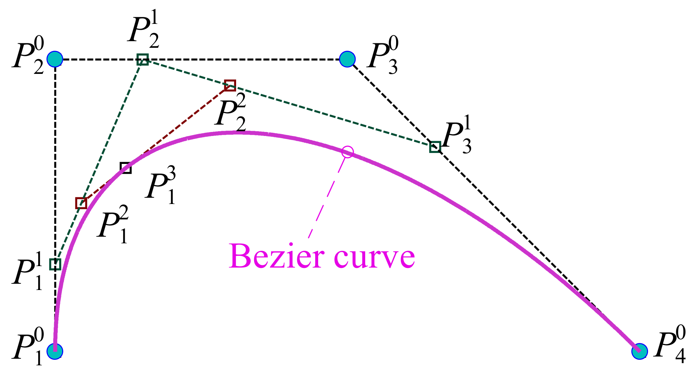
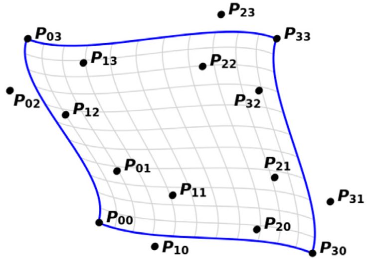

## 贝塞尔曲线与贝塞尔曲面引言

先简要概述贝塞尔曲线，再由这一背景过渡到 JOREK 所采用的特殊形式。

#### <u>贝塞尔曲线</u>

贝塞尔曲线是由一组点（直观上称为*控制点*）控制的参数曲线 $\mathbf{P}(t)$。
参数 $t$ 的取值范围为 $[0,1]$。
控制点序列中的首末两点，即 $\mathbf{P}\_0$ 与 $\mathbf{P}\_{n - 1}$，是插值点，即 $\mathbf{P}(0) = \mathbf{P}\_0$、$\mathbf{P}(1) = \mathbf{P}\_1$。
控制点对曲线形状的影响由一组基 $\{B_0(t), \dots, B_n(t)\}$ 决定，该基称为*伯恩斯坦多项式*。第 `i` 个点与多项式 $\mathbf{P}\_i$ 对应，贝塞尔曲线的数学表达式为

$$
\mathbf{P}(t) = \sum_{i = 0}^{n}\mathbf{P}_iB_i(t)
$$

伯恩斯坦多项式由下式定义：

$$B_{i}^{n}(s) = \frac{n!}{i!(n - i)!} s^{i}(1 - s)^{n - i}\qquad i = 0\ldots n$$

伯恩斯坦多项式基是贝塞尔有限元框架的基础。在 JOREK 中，单个有限元的局部基**并非**该基，而是由伯恩斯坦基导出。详见[贝塞尔有限元的节点表述](#bezier-finite-element-nodal-representation)一节。

所谓 $n$ 阶贝塞尔曲线，指有 $n + 1$ 个点与 $n + 1$ 个 $n$ 次多项式。

> **对贝塞尔曲线的直观理解**：贝塞尔曲线由法国工程师 Pierre Bézier 提出，构造它最直观的方式是 [de Casteljau 算法](https://en.wikipedia.org/wiki/De_Casteljau%27s_algorithm)。可把贝塞尔曲线看作线性插值（图形学术语中称 LERP）的递归应用：先用参数 `t` 对每两个相邻的控制点作线性插值，得到 `n` 个点；再对这组新的“派生”控制点以同样的参数 `t` 重复该过程，直至只剩一个点，该点即 $\mathbf{P}(t)$。下图示意上述过程：
> 
> 

> **关于维数的重要说明**：需要强调，点 $\mathbf{P}_i$ 可属于**任意** $m > 1$ 的空间 $\mathbb{R}^m$。通常认为贝塞尔曲线取 $\mathbf{P}_i \in \mathbb{R}^2$，但也可以是 $\mathbf{P}_i \in \mathbb{R}^{100}$！在 JOREK 中最小空间为 $\mathbb{R}^8$，因为至少用到 $6$ 个变量。

#### <u>贝塞尔曲面</u>

贝塞尔曲面可看作贝塞尔曲线的笛卡尔积。此时基的形式为：

$$\{B_{i}(s)B_{j}(t)\}_{i = 0\ldots n,j = 0\ldots n}$$

每个多项式都对应一个 $\mathbf{P}_{i,j}$。贝塞尔曲面于是写成：

$$\mathbf{P}(s,t) = \sum_{i = 0}^{n}\sum_{j = 0}^{n}B_{i}^{n}(s)B_{j}^{n}(t)$$

### 从贝塞尔曲面到贝塞尔有限元

JOREK 用贝塞尔曲面在极向平面上作离散。点 $\mathbf{P}_i$ 的前两个坐标为计算域坐标 $R$ 与 $Z$，其余 $6+$ 个坐标对应所关心的变量（函数）（所用变量清单见[此处](http://localhost:4000/doc_repo/docs/physics/base_fluid_models/base_fluid_models.html)）。

最基本形式的贝塞尔有限元就是一个贝塞尔曲面，其*自由度*即点 $\mathbf{P}_i$。确切地说，点 $\mathbf{P}_i \in \mathbb{R}^m$ 的每个分量都是一个自由度，故自由度的总数为 $n \cdot m$。

当把多个有限元拼接成全局表示时，表述会变得复杂，因为必须加入连续性约束。下面先以 $G_0$ 连续性为例；$G_0$ 与 $G_1$ 的更详细说明见 [O. Czarny, G. Huysmans, J.Comput.Phys 227, 7423 (2008)](https://www.sciencedirect.com/science/article/pii/S0021999108002118)，$G_2$ 以及对任意 $G_m$ 的推广见 [S. Pamela et al. J. Comput. Phys. 464, 111101 (2022)](https://www.sciencedirect.com/science/article/pii/S0021999122001632?via%3Dihub)。 

#### 施加 $G_0$ 连续性
在 JOREK 中，所有有限元都有 $4$ 个插值点，并与 $4$ 个相邻有限元相接（边界上或网格中心等特殊点除外）。在两个相邻有限元之间施加 $G_0$ 连续性，意味着“交界”边上的所有控制点——即共享的 2 个插值点，以及连接这两个插值点的边上的控制点——必须**相等**。 

例如对双三次贝塞尔有限元，边上有 $4$ 个控制点（2 个插值点与 2 个非插值点），须令其与另一有限元的 $4$ 个对应点相等。

#### 从施加连续性到节点表述
施加高次连续性涉及大量控制点，因此难以清楚分辨哪些是自由度、哪些是被固定的量。

在[本节](#bezier-finite-element-nodal-representation)讨论的节点表述正是为大幅简化这一点、使自由度一目了然而设。细节见上述章节。