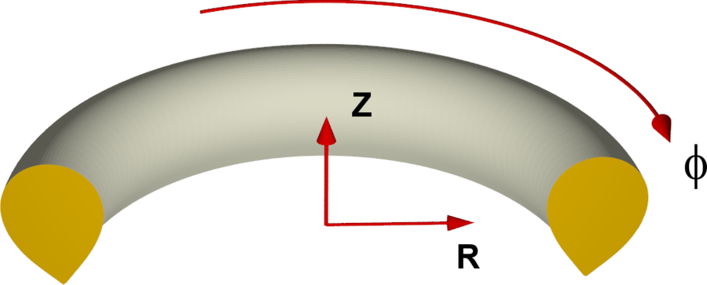

# 基本柱坐标系

另请参阅[记号约定](notation.md)。

JOREK 的基本柱坐标系 $(u^1,u^2,u^3)=(R,Z,\phi)$ 由下式给出
$$ \begin{align*}
x &= R~\mathrm{cos} \phi \\
y &= -R~\mathrm{sin} \phi \\
z &= Z,
\end{align*} $$
其中 $(x,y,z)$ 表示笛卡尔坐标。因此，若从上方俯视，$\phi$ 沿**顺时针**方向！**注意：不同托卡马克并不总是如此**

**注意：** 在 element_matrix 例程中，x 与 y 被用作 R 与 Z 的同义词，切勿与笛卡尔坐标混淆。

## 基矢量

__协变基矢量__ $ \mathbf{a}_\alpha = \partial\mathbf{X}/\partial u^{\alpha} $ 为：

$$ \begin{align*}
\mathbf{a}_1 &= \begin{pmatrix} \mathrm{cos}\phi \\ -\mathrm{sin}\phi \\ 0\end{pmatrix}, \quad 
\mathbf{a}_2 &= \begin{pmatrix} 0 \\ 0 \\ 1\end{pmatrix}, \quad 
\mathbf{a}_3 &= \begin{pmatrix} -R~\mathrm{sin}\phi \\ -R~\mathrm{cos}\phi \\ 0\end{pmatrix}
\end{align*} $$

基矢量之间的叉积：

$$ \begin{align*}
\mathbf{a}_1 \times \mathbf{a}_2 &= \mathbf{a}_3/R \\
\mathbf{a}_1 \times \mathbf{a}_3 &= -R~\mathbf{a}_2 \\
\mathbf{a}_2 \times \mathbf{a}_3 &= R~\mathbf{a}_1 \\
\end{align*} $$

当然还有：$ \mathbf{a}_\alpha \times \mathbf{a}_\alpha = 0 $ 以及 $ \mathbf{a}_\alpha \times \mathbf{a}_\beta = -\mathbf{a}_\beta \times \mathbf{a}_\alpha $。__逆变基矢量__ 由下式给出：

$$ \begin{align*}
\mathbf{a}^1 &= \mathbf{a}_1 \\
\mathbf{a}^2 &= \mathbf{a}_2 \\
\mathbf{a}^3 &= \mathbf{a}_3 / R^2
\end{align*} $$

当然有 $ \mathbf{a}_\alpha \cdot \mathbf{a}^\beta = \delta_\alpha^\beta $。此外：

$$ \begin{align*}
\mathbf{a}^1 &= \nabla R  \qquad\qquad \mathbf{a}_1 = J \nabla Z \times \nabla \phi \\
\mathbf{a}^2 &= \nabla Z  \qquad\qquad \mathbf{a}_2 = J \nabla \phi \times \nabla R \\
\mathbf{a}^3 &= \nabla \phi \qquad\qquad \mathbf{a}_3 = J \nabla R \times \nabla Z \\
\end{align*} $$

以及

$$ \begin{align*}
\mathbf{a}^1 \times \mathbf{a}^2 &= R\mathbf{a}^3 \\
\mathbf{a}^1 \times \mathbf{a}^3 &= -\mathbf{a}^2/R \\
\mathbf{a}^2 \times \mathbf{a}^3 &= \mathbf{a}^1/R \\
\end{align*} $$

其中 __J 为雅可比__：

$$ \begin{equation*}
  J= \mathbf{a}_1\cdot(\mathbf{a_2}\times\mathbf{a}_3) = R
\end{equation*} $$

__归一化基矢量__ 由下式给出：

$$ \begin{align*}
  \mathbf{e}_1 \equiv \mathbf{e}^1 &= \mathbf{a}_1 = \mathbf{a}^1 \\
  \mathbf{e}_2 \equiv \mathbf{e}^2 &= \mathbf{a}_2 = \mathbf{a}^2 \\
  \mathbf{e}_3 \equiv \mathbf{e}^3 &= \mathbf{a}_3 / R = R~\mathbf{a}^3
\end{align*} $$

## 度规张量

协变与逆变的度规张量由下式给出：
$$ \begin{align*}
g_{\alpha\beta} = \mathbf{a}_\alpha\cdot\mathbf{a}_\beta &= \mathrm{diag}(1,~ 1, ~ R^2) \\
g^{\alpha\beta} = \mathbf{a}^\alpha\cdot\mathbf{a}^\beta &= \mathrm{diag}(1,~ 1, ~ 1/R^2)
\end{align*} $$

协变度规张量的行列式为
$$ \begin{equation*}
g \equiv J^2 =\det{\left(g_{\alpha\beta}\right)}=R^2
\end{equation*} $$

## 微分算子

### 一般表达式

$$ \begin{align*}
  \nabla U &= \partial_i U \mathbf{a}^i \\
  \nabla \cdot \mathbf{V} &= \frac{1}{J} \partial_i (J V^i) \\
  \nabla \times \mathbf{V} &= \frac{1}{J}(\partial_2 V_3 - \partial_3 V_2)\mathbf{a}_1 + \frac{1}{J}(\partial_3 V_1 - \partial_1 V_3)\mathbf{a}_2 + \frac{1}{J}(\partial_1 V_2 - \partial_2 V_1)\mathbf{a}_3
\end{align*} $$

### 柱坐标

$$ \begin{align*}
  \nabla U                &=\partial_1 U~\mathbf{a}^1
    + \partial_2 U~\mathbf{a}^2 + \partial_3 U~\mathbf{a}^3 \\
  \nabla_\text{pol} U                &=\partial_1 U~\mathbf{a}^1
    + \partial_2 U~\mathbf{a}^2 \\
  \nabla\cdot\mathbf{V}   &=\frac{1}{R}\partial_1 (R V^1) + \partial_2 V^2 + \partial_3 V^3 \\
\nabla \times \mathbf{V} &=  \frac{1}{R}\left(\partial_2 V_3 - \partial_3 V_2 \right)~\mathbf{a}_1
 + \frac{1}{R}\left(\partial_3 V_1 - \partial_1 V_3 \right)~\mathbf{a}_2
+ \frac{1}{R}\left(\partial_1 V_2 - \partial_2 V_1 \right)~\mathbf{a}_3 \\
  \Delta U &= \nabla\cdot\nabla U = \frac{1}{R}\partial_1(R \partial_1 U) + \partial_{2,2}U + \frac{1}{R^2}\partial_{3,3}U \\
  \Delta_\text{pol}U &= \nabla\cdot\nabla_\text{pol} U = \frac{1}{R}\partial_1(R \partial_1 U) + \partial_{2,2}U \\
  \Delta^*U &= R^2 \nabla\cdot\left(\frac{1}{R^2}\nabla_\text{pol} U\right)=R~\partial_1\left(\frac{1}{R}\partial_1 U\right)+\partial_{2,2} U \\
  [A,B] &= e_3 \cdot (\nabla A \times\nabla B) = \partial_1 A~\partial_2 B - \partial_2 A~\partial_1 B\\
  \nabla \cdot \mathbf{\Pi} &= \left[\partial_R \Pi^{RR}+\partial_Z \Pi^{ZR}+\frac{1}{R}\partial_\phi \Pi^{\phi R}+\frac{1}{R}\left(\Pi^{RR}-\Pi^{\phi\phi}\right)\right] \mathbf{e}_R\\
  &+ \left[\partial_R \Pi^{RZ}+\partial_Z \Pi^{ZZ}+\frac{1}{R}\partial_\phi \Pi^{\phi Z}+\frac{1}{R}\Pi^{RZ}\right]\mathbf{e}_Z\\
  &+\left[\partial_R\Pi^{R\phi}+\partial_Z \Pi^{Z\phi}+\frac{1}{R}\partial_\phi\Pi^{\phi\phi}+\frac{1}{R}\Pi^{\phi R}+\frac{1}{R}\Pi^{R\phi}\right]\mathbf{e}_\phi
\end{align*} $$

## Christoffel 符号

### 一般表达式

$$ \begin{align*}
   \mathbf{A} \cdot \nabla \mathbf{B} &= A^i \partial_i (B^j a_j) = A^i (\partial B^j)a_j + A^i B^j (\partial_i a_j
) = A^i(\partial_i B^j + \Gamma^j_{ik} B^k) a_j\\  (\mathbf{A} \cdot \nabla \mathbf{B})^j &= A^i (\partial_i B^j + \Gamma^j_{ik} B^k)

\end{align*} $$

### 柱坐标

$$ \begin{align*}
\partial_3 \mathbf{a}^1 &= R \nabla \phi = R \mathbf{a}^3 \\
\partial_3 \mathbf{a}^3 &= -\frac{1}{R} \mathbf{a}^1 \\
\partial_1 \mathbf{a}^3 &= -\frac{1}{R} \mathbf{a}^3 \\
\end{align*} $$

## COCOS 约定
JOREK 采用的托卡马克坐标约定 COCOS 为 8。由此得到以下 COCOS 系数：
$$ \begin{align*}
  e_{\mathrm{Bp}}         &= 0  \\
  \sigma_{\mathrm{Bp}}      &= -1 \\
  \sigma_{R\phi Z}          &= -1 \\
  \sigma_{\rho \theta \phi} &= 1 
\end{align*} $$

关于 COCOS 约定的细节，请参见
[Sauter, O., Medvedev, S.Yu, Computer Physics Communications 184 (2), 293-302 (2013)](https://www.sciencedirect.com/science/article/pii/S0010465512002962)。
