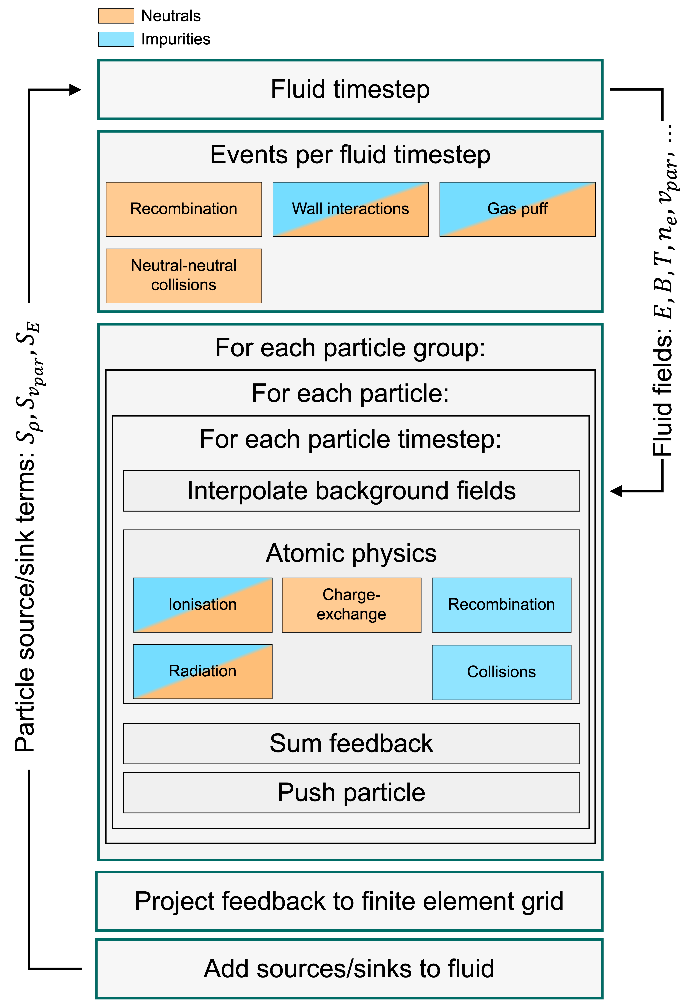

# 耦合方案

JOREK 中（动理学）中性粒子模型的推导与实现见 [*S. Q. Korving et al. PoP 2023*](https://doi.org/10.1063/5.0135318)。

对于中性粒子（ncs）与杂质（ics）耦合方案，粒子源与粒子汇被投影到密度方程、（平行）动量方程和能量方程中。然而，由于 JOREK 形式的方程与典型的 Euler 形式方程不同，源项需要做修正。源项的修正方式如下：

 $$ 
\begin{aligned}
\left( \frac{\partial \rho}{\partial t}\right) &= S_\rho \\

\rho \left( \frac{\partial v}{\partial t}\right) &= \vec{S}_v = \vec{S}_{\rho v}-\vec{v}S_\rho \\

\left( \frac{\partial \rho T}{\partial t}\right) &= S_T = (\gamma -1)\left( S_E - \vec{v}\cdot \vec{S}_{\rho v} + \frac{1}{2} v^2 S_\rho \right), \\
\end{aligned}
 $$ 

其中 $`S_E`$、$`\vec{S}_{\rho v}`$ 与 $`S_\rho`$ 为物理源项。

<figure style="float: right; margin-left: 15px; text-align: center;">
  
  <figcaption style="font-size: 0.9em; font-style: italic; color: #555;">Flowchart of the two-way coupling</figcaption>
</figure>
粒子与 MHD 方程双向耦合，其示意框图见右图：

### 源项一览

| 反应 | $`S_\rho`$   | $`\vec{S}_{\rho v}`$  | $`\vec{S}_{v}`$ | $`S_{E,i}`$ | $`S_{Ti}`$ | $`S_{E,e}`$ | $`S_{Te}`$ |
| - | - | - | - | - | - | - | - |
| *n* 电离| $`m_i \Gamma_{ion}`$ | $`m_i \Gamma_{ion} \vec{v}_n`$ | $`m_i \Gamma_{ion} (\vec{v}_n - \vec{v}_n)`$ | $`\Gamma_{ion} ( \frac{m_i}{m_n}\frac{T_n}{\gamma-1} + \frac{1}{2} m_i v_n^2)`$ | $`\Gamma_{ion} ( T_n + \frac{1}{2} m_i (\vec{v}_n-\vec{v}_i)^2)`$ | $`-\Gamma_{ion} \|E_{Bind}\|`$ | $`-\Gamma_{ion} \|E_{Bind}\|`$ |
| *n* 复合 | $`-m_i \Gamma_{rec}`$ | $`-m_i \Gamma_{rec} \vec{v}_i`$ | - | $`-\Gamma_{rec}( \frac{T_i}{\gamma-1}+\frac{1}{2} m_i v_i^2 )`$| $`-\Gamma_{rec} T_i`$ | $`-\Gamma_{rec} \frac{T_e}{\gamma-1}`$ | $`-(L_{PRB}-S_{rec}\|E_{bind}\|)n_e n_i`$ |
| *n* CX | - | $`w_p (v_n^{old} - (N_{rng} \sqrt{\frac{T_i}{m_i}}+v_{drift}))`$ | idem | $`\frac{1}{2} w_p ((v_n^{old})^2-(v_n^{new})^2)`$ | $`S_E^{CX} - v \cdot S_v^{CX}`$ | | |
| *杂质* 电离/复合 | - | - | - | - | - | $`-w_p \|E_{bind}\|`$ |  $`-(\gamma-1)w_p \|E_{bind}\|`$ |
| *杂质* 辐射 | - | - | - | - | - | $`-n_e w_p (PLT + PRB -S_{rec}\|E_{bind}\|)\delta t`$ | $`-(\gamma-1)n_e w_p (PLT + PRB -S_{rec}\|E_{bind}\|)\delta t`$ |
| *杂质* 碰撞 | - | $`w_p m_{imp}(v_{old}-v_{new})`$| idem | $`\frac{1}{2} w_p m_{imp}(v_{old}^2-v_{new}^2)`$ | $`(\gamma - 1)\frac{1}{2} w_p m_{imp}(v_{old}^2-v_{new}^2)`$ | | |

注 1：含 $` T + \frac{1}{2} m_i (\vec{v}_a-\vec{v}_b)^2 `$ 的项属于流体图像，其中宏观漂移速度可从随机微观速度中分离出来，由此得到温度。而对于粒子图像，它就只是动能。

注 2：辐射率与冷却率之间存在差别。等离子体的能量汇是冷却率。并非所有辐射都在冷却等离子体，例如 i-e 复合中的介质级联（dielectric cascade）
