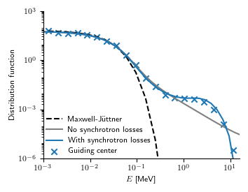
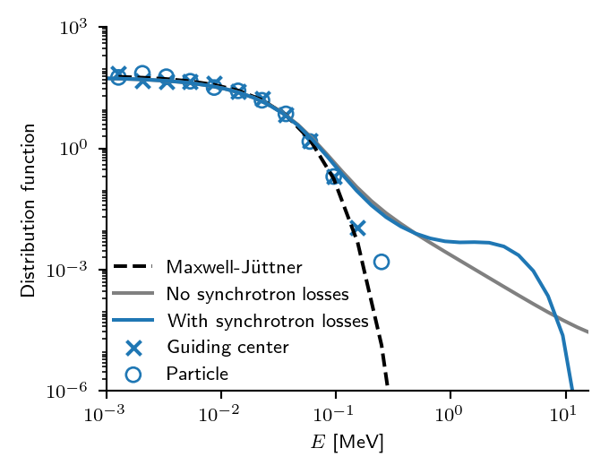
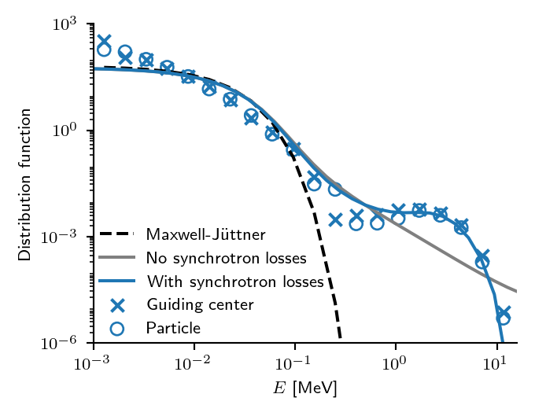

# 粒子追踪器中的逃逸电子物理

## 推进器

逃逸电子既可通过求解完整的回旋轨道追踪，也可通过求解导向中心的运动追踪。回旋轨道推进器采用保体积算法，该算法保持粒子能量，本质上是经典 Boris 推进器的相对论变体。导向中心推进器用 RK4 方法求解运动方程，不保持能量。时间步的推荐初值为：回旋轨道 1e-12，导向中心 1e-11。推进器及其实现见这篇[文献](https://iopscience.iop.org/article/10.1088/1741-4326/aa95cd)。 

示例 `particles/examples/ex6_jorek.f90`（回旋轨道）和 `particles/examples/ex7_jorek.f90`（导向中心）展示了相对论推进器的用法。 

- 回旋运动用 `volume_preserving_push_jorek` 求解，粒子类型为 `particle_kinetic_relativistic`。
- 导向中心运动用 `runge_kutta_fixed_dt_gc_push_jorek` 求解，粒子类型为 `particle_gc_relativistic`。

### 辐射反作用力

反应堆等离子体中的辐射反作用力只对高能（E » 1 MeV）电子有意义，它可为逃逸电子能量设定上限。JOREK 中实现的辐射反作用力的细节见[此处](https://iopscience.iop.org/article/10.1088/1741-4326/ac75fd/meta)。 

启用辐射反作用力的方式是调用粒子推进器的另一变体（这两个函数既推进标记粒子，也计入辐射反作用力）： 

- `volume_preserving_radiation_push_jorek`
- `runge_kutta_fixed_dt_gc_push_jorek_radreact`

### 碰撞算子

碰撞算子基于相对论 Fokker-Planck 方程，其中等离子体与检验粒子都可以是相对论性的。在粒子模拟中，我们求解相应的随机方程（Langevin 方程）。因此，若启用碰撞，粒子模拟不是确定性的。 

碰撞算子见[此处](https://iopscience.iop.org/article/10.1088/1741-4326/ac75fd/meta)和[此处](https://www.sciencedirect.com/science/article/pii/S0010465517303326)。其计算要求首先初始化特殊函数的查找表。可用以下步骤生成数据文件（默认设置对所有聚变等离子体都适用）： 

1. 取消 `particles/pushers/mod_ccoll_relativistic.f90` 中程序的注释
2. 编译 `util/j2p -j 8 mod_ccoll_relativistic`
3. 运行（生成的 HDF5 文件为 `ccolldata`）`./mod_ccoll_relativistic`

此外，还需要初始化离子数据；若存在杂质组分，这需要 ADAS（当前代码假定一种主离子组分加一种杂质，所有电荷态都作为独立组分处理）： 

    call init_imp_adas(0)
    call ccoll_init('ccolldata', dat)

- 回旋轨道模拟中的碰撞通过 `call ccoll_kinetic_relativistic_push` 施加
- 在导向中心模拟中通过 `call ccoll_gc_relativistic_push` 施加

注意这些方法只按碰撞算子更新粒子动量，因此在演化粒子随时间变化时需与前述任一推进器配合使用。粒子算子作用于整个三维动量，而导向中心算子对投掷角和能量有各自的算子。因此，通过注释掉  中的相应行，可以只保留投掷角散射或只保留减速。另有一点：导向中心算子没有空间算子。该算子对应经典输运，其贡献在多数情况下可忽略（回旋轨道算子本身已包含它）。两种算子都包含新经典输运。 

译者注：原文此处缺少被注释行所在的文件名，疑为漏字。
{: .warning }

对逃逸电子而言，部分屏蔽对碰撞的影响很显著。可通过调用以下函数计入： 

- 回旋轨道：`call ccoll_kinetic_relativistic_push_partialscreening`
- 导向中心：`call ccoll_gc_relativistic_push_partialscreening`

该实现基于 [Hesslow 的学位论文](https://research.chalmers.se/en/publication/518256)中的公式。其局限在于：两种算子都假定检验粒子是电子（部分屏蔽对离子本就不适用）。此外，回旋轨道算子实际上就是导向中心算子（中间做了导向中心变换），因此现在全轨道模拟也不再具有经典输运。 

## 基准算例 

当碰撞与辐射反作用力同时存在时，电场中的电子不会无限加速，而是形成所谓的尾部隆起（bump-on-tail）分布。我们利用这一事实来校验实现。然而没有解析结果，因此比较是针对动理学程序 DREAM 进行的。测试代码位于 `particles/examples/test_bump.f90`，稍作修改也可用于真实的 JOREK 数据。 

结果： 



结果与 DREAM 结果一致。 



在 JOREK 中关闭电场会如预期产生麦克斯韦分布。 



使用部分屏蔽模型时与隆起部分吻合极好。然而理论上不应有差别，因为该测试用的是氢等离子体。因此差异很可能源于部分屏蔽模型所用的表达式假定入射粒子是高能电子（尤其是对库仑对数而言）。这也可解释为何麦克斯韦分布未能很好重现——除非这是时间步／蒙特卡洛噪声的问题。 

### 绘图 

以下脚本 `plot_bump.py` 可用于绘制该基准算例。 

```python
import numpy as np
import h5py
import matplotlib.pyplot as plt

# Temperature [eV] used in the simulations
Te = 16.2e3

# JOREK results (gc and fo): energies in keV
with h5py.File("bump_gc.h5", "r") as h5:
    E_gc = ( np.sqrt(1+h5["p"][:]**2) - 1 ) * 511e-3
    E_gc = np.log10(E_gc)

with h5py.File("bump_fo.h5", "r") as h5:
    E_fo = ( np.sqrt(1+h5["p"][:]**2) - 1 ) * 511e-3
    E_fo = np.log10(E_fo)


# DREAM results (with and without bump): energy histogram
ekin = np.linspace(-3,2,40) # Energy grid [log10(E / 1 keV)]
f_bumpon  = np.array([5.42942783e+01, 5.32268922e+01, 5.16737609e+01, 4.97198558e+01,
                      4.72825665e+01, 4.41637419e+01, 4.02501821e+01, 3.55340567e+01,
                      3.01128017e+01, 2.41335301e+01, 1.79673036e+01, 1.21477229e+01,
                      7.25391932e+00, 3.73661258e+00, 1.63336698e+00, 6.30143786e-01,
                      2.31679345e-01, 8.98287072e-02, 3.92944903e-02, 1.99500624e-02,
                      1.17637294e-02, 7.87608799e-03, 5.97913283e-03, 5.05683229e-03,
                      4.76005747e-03, 4.82954766e-03, 4.67470560e-03, 3.77645843e-03,
                      2.28792626e-03, 9.36875797e-04, 2.25375299e-04, 2.38378940e-05,
                      1.98041915e-07, 5.56973669e-09, 1.75341101e-09, 5.49378996e-10,
                      1.70524993e-10, 5.09506772e-11, 1.65940600e-11, 7.48839590e-12])
f_bumpoff = np.array([5.39910097e+01, 5.29378339e+01, 5.14052501e+01, 4.94769819e+01,
                      4.70713950e+01, 4.39925535e+01, 4.01280250e+01, 3.54690278e+01,
                      3.01103920e+01, 2.41947194e+01, 1.80854725e+01, 1.23060305e+01,
                      7.42645716e+00, 3.89346607e+00, 1.75240354e+00, 7.05844946e-01,
                      2.73698864e-01, 1.11572854e-01, 5.01610109e-02, 2.51514945e-02,
                      1.37384461e-02, 7.86916932e-03, 4.65483561e-03, 2.80290204e-03,
                      1.70159558e-03, 1.03405676e-03, 6.28339168e-04, 3.82009779e-04,
                      2.32987718e-04, 1.43248441e-04, 8.93833939e-05, 5.71001460e-05,
                      3.77699078e-05, 2.62521616e-05, 1.95452796e-05, 1.59802485e-05,
                      1.40516207e-05, 6.24092063e-06, 1.70656343e-07, 3.24827106e-11])

# Bin JOREK results to histogram and turn histogram into distribution
def distfromjorek(evals):
    ebin_edges = np.linspace(-3,2,25) # Energy grid [log10(E / 1 keV)]
    ebins = ebin_edges[:-1] + (ebin_edges[1:] - ebin_edges[:-1]) / 2
    f = np.histogram(evals,  bins=ebin_edges, density=False)[0]

    gamma  = 10**ebins / 511e-3 + 1 # Lorentz factor
    energy = 10**ebin_edges

    # Turn histogram h(E) into distribution function f(E)
    f  = f / (energy[1:] - energy[:-1]) # Divide with bin width to change units from counts to density
    f  = f * np.sqrt(gamma**2-1) / (gamma**3 - gamma) # Jacobian
    f  = f  / np.trapz(f, 10**ebins) # Normalize to int f dE = 1

    return (ebins, f)

energy, f_gc = distfromjorek(E_gc)
f_fo = distfromjorek(E_fo)[1]

# Maxwellian at given energy
theta = Te/511e3
gamma = 10**energy / 511e-3 + 1
f_max = np.exp(1/theta-gamma/theta)
f_max = f_max / np.trapz(f_max, 10**energy)


cm = 1/2.54
params = {'legend.fontsize': 8,
          'figure.figsize': (9*cm, 7*cm),
          'axes.labelsize':  8,
          'axes.titlesize':  12,
          'xtick.labelsize': 8,
          'ytick.labelsize': 8,
          'font.size' : 8,
          'text.usetex' : True}
plt.rcParams.update(params)

fig = plt.figure()
h = [None] * 5
h[0], = plt.plot(energy, f_max, color='black', linestyle='--')
h[1], = plt.plot(ekin, f_bumpoff, color='grey')
h[2], = plt.plot(ekin,  f_bumpon, color='C0')
h[3]  = plt.scatter(energy, f_gc, marker='x', color='C0')
h[4]  = plt.scatter(energy, f_fo, marker='o', color='C0', facecolors='none')

plt.xlim(-3,1.2)
plt.ylim(10**-6,10**3)
plt.xticks([-3,-2,-1,0,1])

plt.gca().set_xticklabels([r'$10^{-3}$', r'$10^{-2}$', r'$10^{-1}$', r'$10^{0}$', r'$10^{1}$'])
plt.xlabel(r'$E$ [MeV]')
plt.ylabel(r"Distribution function")
plt.gca().set_yscale('log')
plt.yticks([1e-6, 1e-3, 1e0, 1e3])

plt.legend(h, ["Maxwell-Jüttner", "No synchrotron losses", "With synchrotron losses",
               "Guiding center", "Particle"], frameon=False,loc=(0,0))

plt.gca().spines['right'].set_visible(False)
plt.gca().spines['top'].set_visible(False)

plt.tight_layout()

#fig.savefig("test_bump.eps", format="eps")
fig.savefig("test_bump.png", format="png", dpi=96*2)

plt.show()
```

以下 Python 脚本 `dream_bump.py` 用于 DREAM 模拟。 

```python
#!/usr/bin/env python3
#
# Recreate bump-on-tail distribution.
#
# ###################################################################

import numpy as np
import sys
import matplotlib.pyplot as plt

sys.path.append('../py/')

import DREAM
from DREAM.DREAMSettings import DREAMSettings
import DREAM.Settings.Equations.IonSpecies as Ions
import DREAM.Settings.Solver as Solver
import DREAM.Settings.CollisionHandler as Collisions
import DREAM.Settings.Equations.HotElectronDistribution as FHot
import DREAM.Settings.Equations.RunawayElectrons as Runaways
import DREAM.Formulas

def run(hot_pmax=2, hot_nxi=40, hot_np=20,
        pmin=0.1, nt=50, c='black'):
    ds = DREAMSettings()

    ds.collisions.lnlambda = Collisions.LNLAMBDA_THERMAL

    E = -0.03
    n = 1e19
    T = 16.2e3
    #print(E/DREAM.Formulas.getEc(T, n))
    #print(E/DREAM.Formulas.getED(T, n))

    # Set E_field
    ds.eqsys.E_field.setPrescribedData(E)

    # Set temperature
    ds.eqsys.T_cold.setPrescribedData(T)

    # Set ions
    ds.eqsys.n_i.addIon(name='H', Z=1, iontype=Ions.IONS_PRESCRIBED_FULLY_IONIZED, n=n)

    # Hot-tail grid settings
    ds.hottailgrid.setNxi(hot_nxi)
    ds.hottailgrid.setNp(hot_np)
    ds.hottailgrid.setPmax(hot_pmax)
    ds.eqsys.f_hot.setHotRegionThreshold(
        pThreshold=pmin,
        pMode=FHot.HOT_REGION_P_MODE_THERMAL)

    ds.collisions.collfreq_mode = Collisions.COLLFREQ_MODE_FULL
    ds.eqsys.f_hot.setSynchrotronMode(True)

    # Set initial hot electron Maxwellian
    ds.eqsys.f_hot.setInitialProfiles(n0=n/1e5, T0=T)

    # Set runaway grid
    ds.eqsys.n_re.setAvalanche(avalanche=Runaways.AVALANCHE_MODE_NEGLECT)
    ds.runawaygrid.setEnabled(False)

    # Set up radial grid
    ds.radialgrid.setB0(4)
    ds.radialgrid.setMinorRadius(0.1)
    ds.radialgrid.setWallRadius(0.1)
    ds.radialgrid.setNr(1)

    # Choose solver
    #ds.solver.setType(Solver.LINEAR_SOLVER_LU)
    #ds.solver.setType(Solver.NONLINEAR)
    ds.solver.setType(Solver.LINEAR_IMPLICIT)
    ds.solver.preconditioner.setEnabled(False)


    # Set time stepper
    ds.timestep.setTmax(1e1)
    ds.timestep.setNt(nt)

    # Save settings to HDF5 file
    ds.save('dream_settings.h5')

    do = DREAM.runiface(ds)

    fhot = do.eqsys.f_hot

    ekin = (np.sqrt(1+do.eqsys.grid.hottail.p**2) - 1) * 511e3 / 1e6
    f = np.abs(fhot.angleAveraged()[-1,0,:])
    f = f / np.trapz(f, ekin)
    plt.plot(np.log10(ekin), np.log10(f), color=c)

    # Interpolate and print for plotting
    f = np.interp(np.linspace(-3,2,40),np.log10(ekin),f)
    print(f.tolist())


plt.figure()

# Visualizing multiple runs simultaneously we can check the convergence
run(hot_pmax=100, hot_nxi=360, hot_np=2000, nt=10, c='C0')
#run(hot_pmax=100, hot_nxi=360, hot_np=2000, nt=10, c='C1')
#run(hot_pmax=100, hot_nxi=360, hot_np=2000, nt=10, c='C2')

plt.xlim(-3,1.2)
plt.ylim(-6,3)
plt.xticks([-3,-2,-1,0,1])
plt.show()
```
