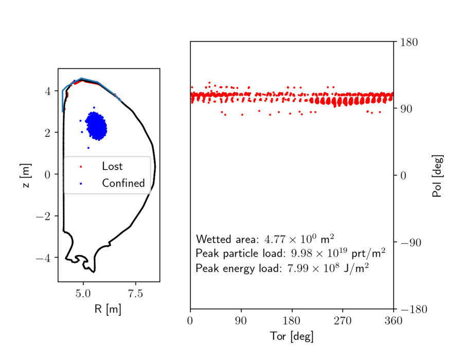
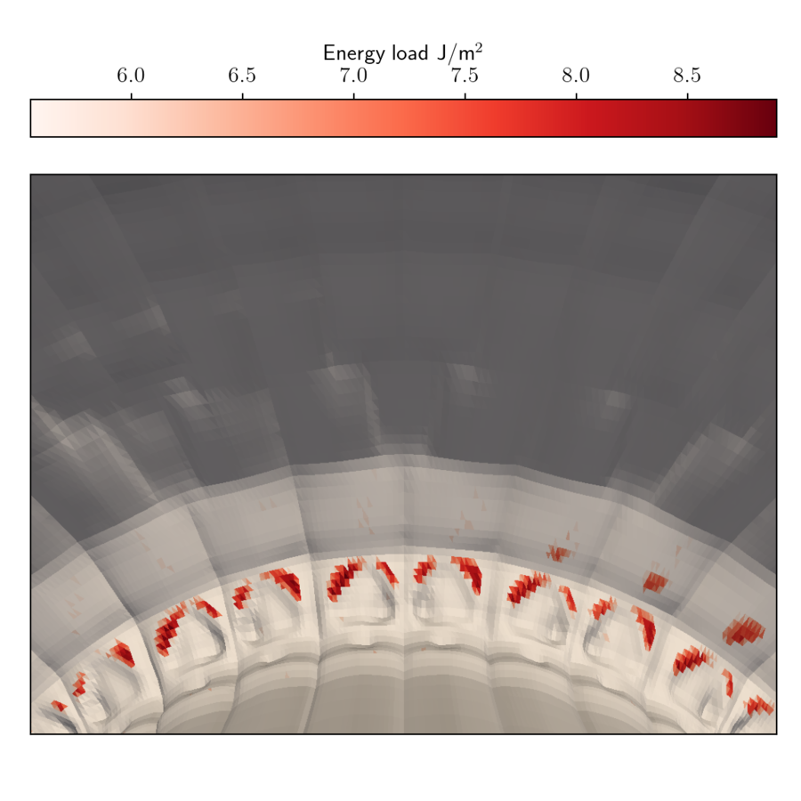
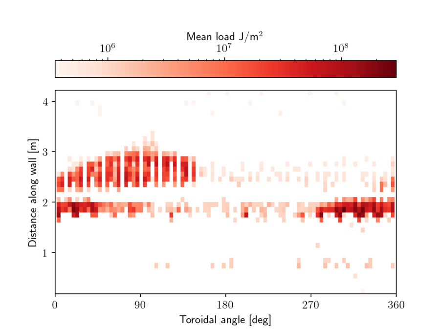
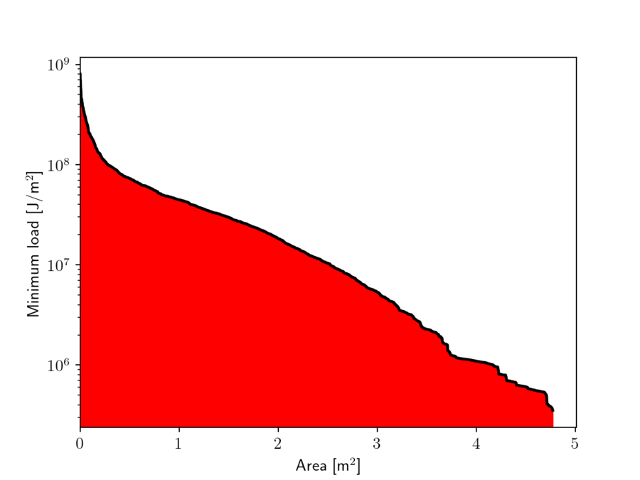
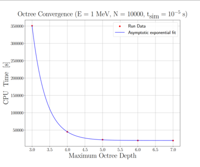

# 如何使用粒子追踪器评估壁负荷？ 

## 注意：
  * 壁碰撞检查只对相对论粒子与相对论导向中心模式做了完整实现。其他模式下算法依然存在，但若不实现导出例程中粒子能量的计算方式，就无法得到完整输出（这是一件简单的事）。
  * 使用该模块需要一个表示面向等离子体部件（PFC）的三角形网格。若没有，可用本脚本从 JOREK 计算网格的边界生成简单壁网格。
  * 另见 Miko Skyllas 的[实习报告](./../../assets/wall_loads/internship_report_with_chapters.pdf)。

### namelist2wall.py
```python

import numpy as np
import h5py

wall2d = np.genfromtxt("jorek_namelist",
                       dtype       = 'U',
                       delimiter   = ',',
                       skip_header = 113,
                       max_rows    = 371-114)

r = np.array([float(x.split("=")[-1]) for x in wall2d[:,0]])
z = np.array([float(x.split("=")[-1]) for x in wall2d[:,1]])

nr = r.size
nphi = 360

nodes = np.zeros(( nphi*(nr-1)*2*9, ))
for p in range(nphi):
    for i in range(r.size-1):
        idx  = p * (nr-1) * 2 * 9 + i * 2 * 9
        phi1 = p     * 2*np.pi / nphi
        phi2 = (p+1) * 2*np.pi / nphi

        x1 = r[i]   * np.cos(phi1)
        x2 = r[i]   * np.cos(phi2)
        x3 = r[i+1] * np.cos(phi1)
        y1 = r[i]   * np.sin(phi1)
        y2 = r[i]   * np.sin(phi2)
        y3 = r[i+1] * np.sin(phi1)
        z1 = z[i]
        z2 = z[i]
        z3 = z[i+1]
        nodes[idx:idx+9] = [x1, y1, z1, x2, y2, z2, x3, y3, z3]

        x1 = r[i+1] * np.cos(phi2)
        x2 = r[i+1] * np.cos(phi1)
        x3 = r[i]   * np.cos(phi2)
        y1 = r[i+1] * np.sin(phi2)
        y2 = r[i+1] * np.sin(phi1)
        y3 = r[i]   * np.sin(phi2)
        z1 = z[i+1]
        z2 = z[i+1]
        z3 = z[i]
        nodes[idx+9:idx+18] = [x1, y1, z1, x2, y2, z2, x3, y3, z3]

ntriangle = nphi*(nr-1)*2
with h5py.File('wall2d.h5','w') as h5:
    h5.create_dataset("ntriangle",  (1,),              data=ntriangle, dtype='i4')
    h5.create_dataset("nodes",      (ntriangle*3*3,),  data=nodes,     dtype='f8')

import matplotlib.pyplot as plt
plt.plot(r,z,color='red')
plt.scatter(np.sqrt(nodes[0::3]**2 + nodes[1::3]**2 ), nodes[2::3], 1)
plt.gca().set_aspect('equal', 'box')

plt.show()
```


## 1. 输入

输入是一个简单的 HDF5 文件，含两个数据集：**ntriangle** 表示壁单元（三角形）的数目，**nodes** 是三角形节点的数组，格式为 [x1_1, y1_1, z1_1, x2_1, y2_1, z2_1,x3_1, y3_1, z3_1, x1_2, y1_2, z1_2, ...]，其中最后一个下标为三角形编号。

构造输入的一个简便方法是：用 pyvista 读取数据（通常为 stl 或 vtk 格式），再转换为所需格式：

### readstl.py
  
```python 
import numpy as np
import pyvista as pv

mesh = pv.read('mesh.stl')
# If you have multiple files you can merge and scale like this (units are assumed to be in meters in the wall input)
#mesh = meshes[0].merge(meshes[1:]).scale([1/1000.0, 1/1000.0, 1/1000.0], inplace=False)
faces = mesh.faces.reshape((-1, 4))[:, 1:]
nodes = mesh.points[faces]
ntriangle = nodes.shape[0]
nodes = np.transpose(nodes,(0,1,2)).ravel()

with h5py.File('wall.h5','w') as h5:
    h5.create_dataset("ntriangle",  (1,),              data=ntriangle, dtype='i4')
    h5.create_dataset("nodes",      (ntriangle*3*3,),  data=nodes,     dtype='f8')

```

将壁网格放入算例目录。
## 2. 运行带壁碰撞检查的模拟 

该模块的实现位于 particles/mod_wall_collision.f90。要在粒子模拟中使用该模块，首先初始化壁数据。
```
type(octree_triangle) :: octree ! The struct containing the wall data.
call mod_wall_collision_init('wall.h5', octree, max_depth)
```
要在每个时间步检查壁碰撞，使用（位于模拟循环内）
```
call mod_wall_collision_check(p, q, octree, wall_id, wall_pos)
```

其中 p 为时间步开始时标记粒子的位置（柱坐标），q 为时间步结束时的位置。该子程序返回被击中壁单元的 id（未击中则为零）以及撞击点 p + t * (q - p)，其中参数 t 由碰撞检查确定。壁单元 id 对应该单元在输入文件中的位置。

释放资源用
```
call mod_wall_collision_free(octree)
```

可用以下调用导出数据
```
call mod_wall_collision_export(sim, file)
```

注意这假定（对丢失的标记粒子）你已按 i_elm = (-1) * wall_id 存储数据。负号只是为了标明该标记粒子已丢失。

示例脚本见 particles/examples/example_wallload.f90
## 3. 输出与后处理 

模块会创建一个 HDF5 文件作为输出，其中包含：
  * 受载单元的 ID（即原始输入数组中的下标，从 1 开始）。
  * 每个受载三角形上的粒子负荷（prt/m^2）。粒子负荷按 sum(weight) / 单元面积计算，求和遍历所有击中该单元的粒子。
  * 每个受载三角形上的热负荷（J/m^2）。热负荷按 sum( particle weight * particle energy) / 单元面积计算。

可选地，还可输出粒子重启文件，其中 i_elm 表示该标记粒子的末态（>0 为约束，=0 为丢失但未击中壁，< 0 为该标记粒子丢失处的三角形 ID（乘以 -1 以标明标记粒子已丢失））。

后处理脚本为 util/plot_wallload.py，会输出受载面积以及最大粒子负荷与热负荷。该脚本需要壁输入、壁负荷，可选地还需要粒子重启文件。脚本还会可视化损失（注意默认设置针对 ITER）：

<p float="left">
  
  
</p>

(**左**) 标记粒子最终位置的散点图。(**右**) 三维壁网格上的负荷

<p float="left">
  
  
</p>

(**左**) 壁上的负荷分布。注意这些损失是投影到第一幅图中的蓝线上，因此该图并不显示精确的损失或其分布，而只是总体分布形态。(**右**) 显示至少受到给定热负荷影响的面积的直方图。


## 4. 算法说明 

该算法相对简单。在每个时间步，用标记粒子新旧位置之间的线段，借助 Möller-Trumbore 算法对壁三角形做射线追踪。为优化过程，只对邻近的三角形做射线追踪。做法是递归地把体积划分为八个象限，只对与标记粒子新位置或旧位置处于同一体积内的三角形做碰撞检查。该 //octree// 在初始化时构建，其效果可见下图（模拟中建议 max_depth=6）：


