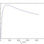

原子物理，特别是涉及电离—复合以及辐射的部分，在 `with_neutrals` 与 `with_impurities` 模型中被频繁使用。本页对这些模型中我们的处理方式作一般性说明。

总体而言，我们处理原子物理有三种不同方式：

1. 仅使用解析拟合曲线，通常假定处于日冕平衡；
2. 使用 ADAS 数据库，并对电荷态分布假定日冕平衡；
3. 使用 ADAS 数据，同时通过粒子投影考虑非平衡电荷态分布。

第一种方法已基本过时，近期的计算中很少使用。

由于在 `with_impurities` 模型中我们只有一个流体场来表示杂质组分，目前只能对一个"主杂质组分"求解连续性方程。同时允许存在若干密度恒定的"背景杂质组分"。

## 氘

目前已实现三种计算氘的电离、复合与辐射原子系数的方法。比较结果记录在 [IMAS-3403](https://jira.iter.org/browse/IMAS-3403) 中。

- 一种旧的拟合，不再推荐使用，仅为向后兼容而保留。由 `old_deuterium_atomic=.true.` 开启。电离率的计算见[下文](#ionization-rate-for-deuterium-old-fit)。
- ADAS 系数的更精确拟合。默认开启，即 `old_deuterium_atomic=.false.` 且 `deuterium_adas=.false.`。
- 使用原始的（经插值的）ADAS 系数。由 `deuterium_adas=.true.` 开启。这需要用 `./util/fetch_openadas.sh 96_h` 单独下载系数。

### 氘的电离率（旧拟合） {#ionization-rate-for-deuterium-old-fit}
电离率采用 [G. S. Voronov, “A practical fit formula for ionization rate coefficients of atoms and ions by electron impact: Z¼1-28,” At. Data Nucl. Data Tables 65(1), 1–35 (1997)](http://www.sciencedirect.com/science/article/pii/S0092640X97907324) 中的参数化（该式实际上针对氢）：

\begin{aligned}
\langle \sigma v \rangle_{ion} \; [\mathrm{m}^3/\mathrm{s}] = C_1 \cdot (C_2 + C_3/T_e[\mathrm{eV}])^{-1} \cdot (C_3/T_e[\mathrm{eV}])^{\alpha} \cdot \exp(-C_3/T_e[\mathrm{eV}])
\end{aligned}

其中 $C_1 = 0.291 \cdot 10^{-13}$，$C_2 = 0.232$，$C_3 = 13.6$，$\alpha = 0.39$。

为换算到 JOREK 单位（JU），须注意 $\langle \sigma v \rangle_{ion}$ 是用于如下形式的表达式：

\begin{aligned}
\partial_t n_e = \ldots + n_e n_n \langle \sigma v \rangle_{ion}
\end{aligned}

而在 JOREK 中我们使用质量密度，因此采用如下形式的表达式：

\begin{aligned}
\partial_t \rho = \ldots + \rho \rho_n S_{ion}
\end{aligned}

由此可得 $S_{ion} \; [\mathrm{JU}] = \mu_0^{1/2} \rho_0^{3/2} m_0^{-1} \langle \sigma v \rangle_{ion} \; [\mathrm{m}^3/\mathrm{s}]$，其中 $m_0$ 是离子（或中性粒子，二者相同）的质量（在代码中，$m_0$ 对应 `central_mass*ATOMIC_MASS_UNIT`）。

利用 JOREK 温度 $T$（假定为 $2 \cdot T_e$），在 JOREK 单位下（为简洁起见以下省略单位）得到：

\begin{aligned}
S_{ion} = C_{1J} \cdot (C_{2J} + C_{3J}/T)^{-1} \cdot (C_{3J}/T)^{\alpha} \cdot \exp(-C_{3J}/T)
\end{aligned}

其中 $C_{1J} = \mu_0^{1/2} \rho_0^{3/2} m_0^{-1} C_1$，$C_{2J} = C_2$，$C_{3J} = C_3 T[\mathrm{JU}]/T_e[\mathrm{eV}] = 2 C_3 e \mu_0 n_0$。

JOREK 中还会用到 $dS_{ion}/dT$，它可表示为（JOREK 单位）：

\begin{aligned}
dS_{ion}/dT = S_{ion} \cdot \left[ -\alpha/T + \frac{C_{3J}}{T(C_{2J}T+C_{3J})} + C_{3J} T^{-2} \right]
\end{aligned}

注意为避免负温度引起的任何问题，代码中对 $T_e[\mathrm{eV}] < 0.1$ 的情形截断电离。

## 杂质的辐射冷却率

模型 500 中已实现对背景杂质辐射的更通用处理，使用 ADAS 数据而非硬编码参数。实现的更多细节见[该 pull request](https://git.iter.org/projects/STAB/repos/jorek/pull-requests/463/overview)。注意代码中保留了**针对氩**的原始硬编码拟合，如果用户希望用拟合而非为氩调用 open adas，可将 `use_imp_adas` 设为 false。

要使用这些新功能（针对单一杂质种类），用户需在输入文件中指定以下参数：

- `imp_type`：杂质种类，如氩（`'Ar'`）、氖（`'Ne'`）、钨（`'W'`）等。
- `nimp_bg`：背景杂质密度（/m³）；默认为 0
- `adas_dir`：存放 ACD、SCD、PLT、PRB 等 adf11 文件的目录；这些文件可用 `jorek/util/fetch_openadas.sh` 下载

后续更新进一步允许用户使用**多种**（目前最多 5 种）背景杂质，详见[另一个 pull request](https://git.iter.org/projects/STAB/repos/jorek/pull-requests/600/overview)。要使用该新功能，需在输入文件中指定 `n_adas`，它表示所考虑的杂质种类数，此时 `imp_type` 与 `nimp_bg` 应为数组。例如，要使用氖（1e17 m⁻³）与钨（1e15 m⁻³）的混合物、且 ADAS 文件存放在同一个 `adas_dir`（例如 `'~/adas_data_files/'`）中，可如下指定：

- n_adas = 2
- nimp_bg = 1.d17, 1.d15
- imp_type = 'Ne', 'W'
- adas_dir = '~/adas_data_files/'

**注意：**

- 仅考虑辐射功率与发射系数，且假定日冕平衡，由背景杂质引起的电离功率汇尚未包含在内。
- 在模型 501 中，同一参数 `imp_type` 用于指定由 MGI、SPI 等注入材料的杂质种类。

## 主杂质组分与背景杂质组分

在 `with_impurities` 模型中，可以指定一个"主杂质组分"连同上述背景组分。我们将对该组分求解连续性方程，而不使用恒定密度。用户须在输入参数 `index_main_imp` 中指定主组分，例如：

- n_adas = 3
- index_main_imp = 1
- imp_type = 'Ne', 'Be', 'W'
- nimp_bg = 0., 3.5d17, 3.5d11
- adas_dir = '~/adas_data_files/'

上例中杂质组分总数为 3。第一个（氖）是主组分。由于我们对其求解连续性方程，氖的 `nimp_bg` 无关紧要。其余两个组分的恒定密度在 `nimp_bg` 中给出。

注意 `n_adas` 不应大于 `n_imp_max`，后者是硬编码参数。  
另请注意，目前一次只能指定一个主组分。

## 粒子投影

不使用粒子模型时，处理杂质组分通常假定日冕平衡。使用粒子模型时，电荷态分布及相应的辐射由粒子矩投影得到，从而使杂质的非平衡描述成为可能。
