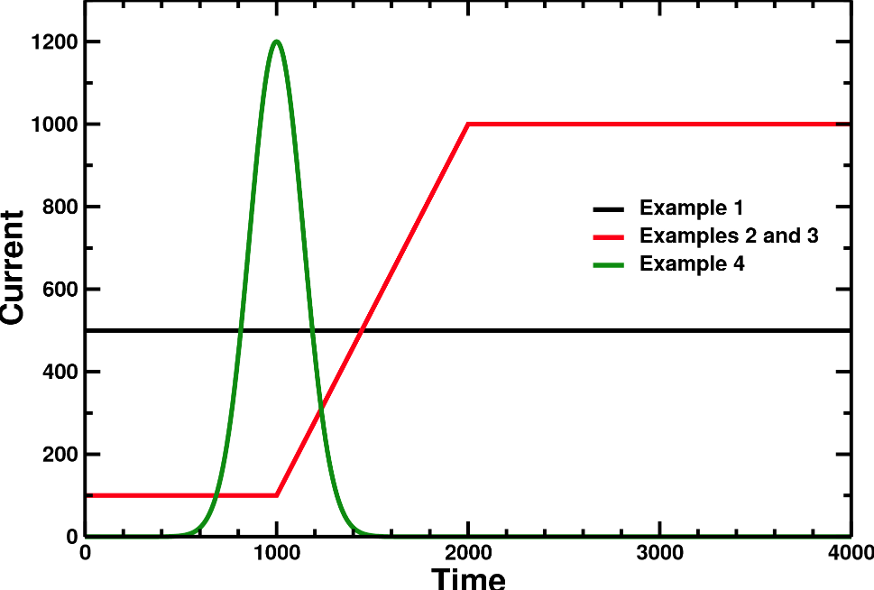

本页介绍 STARWALL 与 CARIDDI 通用的 JOREK 自由边界模式设置。本页内容包括

* [以自由边界模式运行 JOREK 需要什么？](#what-do-i-need-to-run-jorek-in-free-boundary-mode)
    * [获取响应文件](#getting-the-response-file)
* [JOREK 输入文件的自由边界参数](#jorek-input-file-free-boundary-parameters)
    * [主要参数](#main-parameters)
    * [线圈电流参数](#coil-current-parameters)
        * [用 plot_live_data.sh 可视化线圈电流](#visualizing-coil-currents-with-plot_live_datash)
    * [自由边界平衡参数与建议](#free-boundary-equilibrium-parameters-and-advices)

## 以自由边界模式运行 JOREK 需要什么？ {#what-do-i-need-to-run-jorek-in-free-boundary-mode}

1. JOREK 运行目录中要有壁—真空响应文件。对 STARWALL，该文件名称为 **starwall-response.dat**，由 STARWALL 计算得到。
2. 在 JOREK 输入文件中设置特定的输入参数。

请从[本教程](./jorek_startwall_tutorial_ex1.md)入手。

### 获取响应文件 {#getting-the-response-file}

1. 在输入文件中设置 `freeboundary=.t.` 运行 JOREK。JOREK 会停止，并在文件夹中出现含耦合面几何的 **boundary.txt** 文件。
2. 把 **boundary.txt** 复制到 STARWALL 或 CARIDDI 的运行文件夹。
3. [运行 STARWALL](./running_STARWALL.md) 或[运行 CARIDDI](./running_CARIDDI.md)
4. 把 STARWALL 或 CARIDDI 生成的 response.dat 文件复制到 JOREK 运行目录

## JOREK 输入文件的自由边界参数 {#jorek-input-file-free-boundary-parameters}

### 主要参数 {#main-parameters}

| 参数 | 说明 |
|-----------|-------------|
| `freeboundary` | 以自由边界模式运行 |
| `freeboundary_equil` | 计算自由边界平衡而非固定边界平衡，见[自由边界平衡](#free-boundary-equilibrium-parameters-and-advices)。 |
| `wall_resistivity_fact` | 用该因子缩放壁与线圈电阻率（默认值=1.0）。壁与线圈的标称电阻率在 STARWALL 与 CARIDDI 的输入文件中设置 |

### 线圈电流参数 {#coil-current-parameters}

有时运行需要线圈电流，例如计算自由边界平衡或做 RMP 研究。对每个线圈，电流演化的时间曲线（单位 **安培/匝**）可在 JOREK namelist 输入文件中指定。这项工作分别针对：

- `rmp_coils(*)`
- `pf_coils(*)`

> **注意：** `voltage_coils` 尚未完全实现，而对 `diag_coils` 指定电流通常没有用处。

**符号约定：** 输入文件中的正电流沿正 phi 方向，与 [JOREK 坐标系](../../coordinates.md)一致。

> **重要：** 若希望线圈具有你所指定的精确电流，必须把线圈电阻设为很大的值（`1.d0` 左右即可）。线圈电流会在线圈的电阻时间内衰减到所指定的电流。更多信息见[运行 STARWALL](./running_STARWALL.md)或[运行 CARIDDI](./running_CARIDDI.md)。

指定电流时间曲线有几种方式。以下示例说明不同的做法：



#### 1) 时间上恒定

```fortran
rmp_coils(1)%current = 500.
```

#### 2) 时间上恒定加一个扰动

```fortran
rmp_coils(1)%current          = 100.
rmp_coils(1)%pert             = 1000.
rmp_coils(1)%pert_start_time  = 1000.
rmp_coils(1)%pert_growth_time = 1000.
```

电流从时刻 `pert_start_time` 到 `pert_start_time+pert_growth_time` 由 `current` 线性上升到 `current+pert`，之后保持恒定。

#### 3) 由 ASCII 文件指定

```fortran
rmp_coils(1)%curr_file = 'file_name'
```

该文件第一列须为时间点，第二列为电流值。示例：

```text
0.    100.
1000. 100.
2000. 1000.
1.e5  1000.
```

#### 4) 解析表达式

```fortran
rmp_coils(1)%curr_expr = '1200*exp(-(t-1000.)**2/(200.)**2)'
rmp_coils(1)%max_time  = 10000.
rmp_coils(1)%len       = 2000
```

可以给出解析表达式，仿真开始时通过调用 Python 对其求值。**重要**的是要指定：

- `max_time`：覆盖整个仿真时间
- `len`：表达式求值所用的点数

在本例中，表达式在 t=0 到 t=10000 之间的 2000 个点上求值。**请谨慎设置 `max_time` 与 `len`！**

#### 附加修饰参数

用以下参数缩放时间、平移时间以及缩放幅值：

```fortran
rmp_coils(1)%time_scale  = 2.d0   ! slow down current evolution by factor two
rmp_coils(1)%time_shift  = 100.   ! shift the current evolution to take place dt=100 later
rmp_coils(1)%curr_scale  = 2.d0   ! increase currents by factor two
```

对时间而言，先施加缩放因子，再施加平移。

#### 用 `plot_live_data.sh` 可视化线圈电流 {#visualizing-coil-currents-with-plot_live_datash}

JOREK 输入文件中线圈的输入以安培/匝为单位（见上）。但 `plot_live_data.sh` 的输出按 $I_{SI} = I/\mu_0$ 归一化。可用 `plot_live_data.sh` 绘制时间曲线，PF 线圈、RMP 线圈与诊断线圈分别用 `-q pf_coil`、`-q rmp` 和 `-q diag`。

### 自由边界平衡参数与建议 {#free-boundary-equilibrium-parameters-and-advices}

要运行自由边界平衡，须在响应文件中包含 n=0 模。还需要在 STARWALL 或 CARIDDI 中另行指定相应的平衡线圈。

有了正确的响应文件后，在 JOREK 输入文件中设置线圈电流与自由边界平衡参数：

```fortran
freeboundary = .t.
freeboundary_equil = .t.

pf_coils(1)%current     =  2.6d+4     ! Amperes/turn
pf_coils(2)%current     = -2.6d+4
pf_coils(3)%current     =  1.0d+4
pf_coils(4)%current     =  1.0d+4

amix_freeb = 0.d0        ! To speed up convergence

use_mumps_eq = .t.       ! Optional, but works much faster than Pastix 5

cte_current_FB_fact = 1. ! Multiplies T and FF' profiles with this factor at start of freebnd iterations
```

运行该平衡。若线圈几何与电流正确，它应当收敛。先确认固定边界平衡收敛到正确解，再在自由边界模式下运行。若在自由边界模式下遇到收敛问题：

- 尝试把 `amix_freeb` 增大到 0.5 至 0.9 之间（当固定边界平衡与自由边界解差别较大时有用）
- 用 `cte_current_FB_fact` 缩放电流密度剖面，以获得期望的最终等离子体总电流

#### **旧版：** 在 Grad-Shafranov（Picard）迭代中控制总电流与垂直位置

要使用带垂直位置与总电流反馈的旧版 Picard 迭代，在 JOREK 输入文件中设置：

```fortran
newton_GS_freebnd = .f.
```

若想强制给定等离子体电流与垂直位置，该功能仍然有用。

自由边界平衡计算需要在 Picard 迭代期间对等离子体总电流（$I_p$）与垂直位置（若垂直不稳定，则为 $Z_{axis}$）施加主动反馈。为使计算收敛，需调整下列反馈参数：

| 参数 | 说明 |
|-----------|-------------|
| `current_ref` | 目标等离子体总电流（期望的最终电流，单位安培） |
| `n_feedback_current` | 每 "n" 次 Picard 迭代施加一次 $I_p$ 反馈 |
| `FB_Ip_position` | 每次迭代的 $I_p$ 修正强度，与 $(I_p - I_{p,ref})$ 成正比（经验值：0.1–2.0） |
| `FB_Ip_integral` | $I_p$ 修正的积分反馈参数，计入反馈历史（经验值：约 0.01） |
| `Z_axis_ref` | 磁轴 $Z$ 位置的目标值（单位米） |
| `n_feedback_vertical` | 每 "n" 次 Picard 迭代施加一次 $Z_{axis}$ 反馈 |
| `FB_Zaxis_position` | 每次迭代的 $Z_{axis}$ 修正强度，与 $(Z_{axis} - Z_{axis,ref})$ 成正比（经验值：1.0–20.0） |
| `FB_Zaxis_integral` | $Z_{axis}$ 修正的积分反馈参数（经验值：约 0.01） |
| `FB_Zaxis_derivative` | 微分反馈参数，与 $Z_{axis}-Z_{axis,old}$ 成正比，其中 $Z_{axis,old}$ 为上一次迭代的位置 |
| `start_VFB` | 开始 $Z_{axis}$ 反馈的迭代步编号 |

指明哪些线圈用于垂直反馈：

```fortran
vert_FB_amp(3) = -1.d0
vert_FB_amp(4) =  2.5d0
```

若等离子体向上移动（正号），4 号线圈的电流将增大。上线圈用负号，下线圈用正号。数值 2.5 表示相对反馈强度——4 号线圈电流的变化比 3 号线圈快 2.5 倍。设为 0.0 可禁用该线圈的反馈。

#### 其他有用的自由边界平衡参数

| 参数 | 说明 |
|-----------|-------------|
| `n_iter_freeb` | 自由边界平衡的最大迭代次数 |
| `amix_freeb` | 自由边界平衡的混合因子；取值范围 0.5–0.95，视算例复杂程度而定 |
| `equil_accuracy_freeb` | 收敛容差（1.d-6 较为合理） |
| `freeb_equil_iterate_area` | 仅用于限制器位形。把等离子体边界定义为包围固定边界平衡最终等离子体面积的通量等值线。配合 $I_p$ 反馈，可确保等离子体与固定边界解相似（面积相同、$I_p$ 相同） |
| `psi_offset_freeb` | 用一个全局常数平移 psi，以平滑固定边界平衡与自由边界平衡之间的过渡 |
