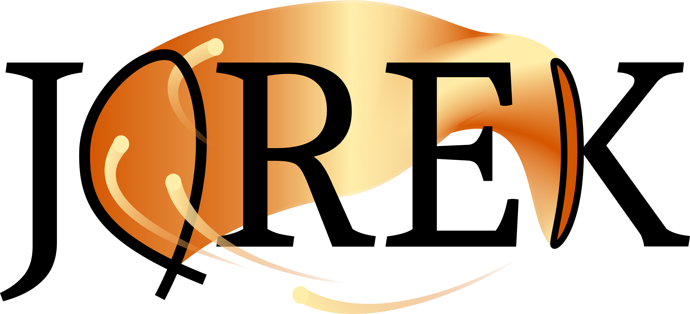

# 发表规则

- 列入所有对本工作有贡献的相关合著者。

- 遵守您所在机构以及合著者所在机构的本地发表规定。

- **务必引用**：
  1. 综述文章："M Hoelzl, GTA Huijsmans, SJP Pamela, M Becoulet, E Nardon,
     FJ Artola, B Nkonga, et al. Nuclear Fusion 61, 065001 (2021)"
  2. 最新的 JOREK 综述文章："M Hoelzl, N Schwarz, GTA Huijsmans, FJ Artola,
     D Hu, G Su, E Nardon, N Isernia, P Rac, A Cathey, M Kong et al. Nuclear Fusion
     66, 116006 (2026)"
  3. 您直接基于的相关前期工作（见 [`CITATION.cff`](https://github.com/iterorganization/JOREK/blob/develop/docs/CITATION.cff)）
     以及 JOREK 公开网站。

- **预印本**：投稿前请将预印本（摘要、幻灯片、海报、稿件）发送至
  <jorek-preprint@jorek.eu>，以确保社区知悉并核查合规性。

- JOREK 徽标有多种格式与版本，可用于海报和幻灯片
  （见 [JOREK 徽标](jorek_logo.md) 页面）。

  

---

上述规则对所有会议投稿与发表均为强制要求；关于它们如何纳入社区规则，
见 [GOVERNANCE.md](GOVERNANCE.md)。
